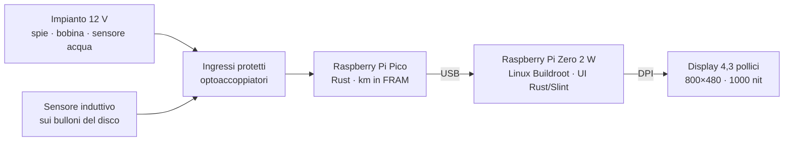

# tdm-dash

**Quadro strumenti digitale open-source per Yamaha TDM 850 prima serie (3VD, 1991–1995).**
*Open-source digital instrument cluster for the first-generation Yamaha TDM 850. Documentation is in Italian; code and comments are in English.*

> **Stato:** progetto in sviluppo (milestone M0: documentazione e scheletro). **Non** ancora utilizzabile su strada.

tdm-dash sostituisce il quadro originale con un display da 4,3" leggibile al sole e mostra:
- velocità e giri
- contachilometri totale e due parziali
- temperatura dell'acqua e tensione della batteria, con avvisi
- spie: folle, abbaglianti, frecce sinistra e destra separate

È economico (≈ 150–190 €), **reversibile** (l'impianto della moto non si taglia) ed **estensibile** ad altre moto tramite profili TOML.

## Come è fatto



| Parte | Tecnologia |
|---|---|
| Interfaccia | Rust + [Slint](https://slint.dev), renderer software su DRM/KMS |
| Sistema operativo | Linux minimale compilato con [Buildroot](https://buildroot.org), rootfs in sola lettura, avvio < 4 s |
| Microcontrollore | Rust + [embassy](https://embassy.dev) su RP2040 / RP2350 |
| Hardware | Schema elettrico KiCad, cablaggi WireViz, contenitore stampato in 3D |

## Documentazione

- **[Manuale](docs/manuale/README.md)**: progettazione, costruzione, installazione, uso
- **[Ricerca sull'impianto originale](docs/ricerca/impianto-originale.md)**, con le fonti
- **[Scheda dei rilievi sulla moto](docs/ricerca/rilievi-sulla-moto.md)**
- **[Decisioni di architettura](docs/adr/README.md)**

## Struttura del repository

```
crates/      tdm-proto (protocollo) · tdm-core (misure, km) · tdm-logic · tdm-link · tdm-dash (UI)
firmware/    firmware del Pico
profiles/    profili moto (TOML)
design/      proposta di design dell'interfaccia (HTML interattivo)
os/          albero Buildroot (BR2_EXTERNAL)
hardware/    KiCad, cablaggi WireViz, contenitore e staffa
docs/        manuale, ricerca, ADR
```

## Sviluppo

```sh
cargo test --workspace                                  # test sul PC
cargo build -p tdm-core --target thumbv6m-none-eabi     # verifica no_std per il Pico
```

La toolchain Rust (1.97.1, la stessa di Buildroot 2026.08) e i target vengono installati automaticamente da `rust-toolchain.toml`.

## Roadmap

| Milestone | Contenuto |
|---|---|
| **M0** | Scheletro del repo, ricerca, manuale (cap. 00–03) |
| M1 | Proposta di design interattiva a 800×480 |
| M2 | Workspace Rust, simulatore desktop |
| M3 / M3b | Firmware del Pico · schemi elettrici e dei collegamenti |
| M4 | Sistema operativo Buildroot |
| M5 | Costruzione dell'hardware, contenitore, staffa |
| M6 | Montaggio, calibrazione, 500 km di prova |

## Licenze

Codice MIT o Apache-2.0, immagine del sistema GPLv3 (per via di Slint), hardware CERN-OHL-P-2.0, documentazione CC-BY-SA-4.0. Dettagli in [LICENSING.md](LICENSING.md).

Yamaha e TDM sono marchi dei rispettivi proprietari. Questo progetto non è affiliato né approvato da Yamaha Motor Co., Ltd.

> **Avvertenza:** progetto sperimentale e non certificato. Leggi il capitolo [Introduzione e sicurezza](docs/manuale/00-introduzione-e-sicurezza.md) prima di montarlo su una moto.
