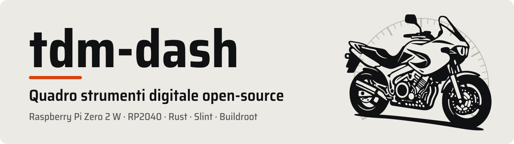
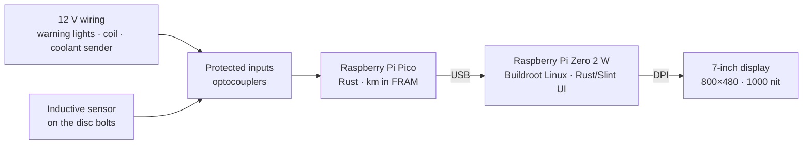

<p align="center"></p>

# tdm-dash

**Open-source digital instrument cluster for the first-series Yamaha TDM 850 (3VD, 1991–1995).**

> **Status:** design complete, hardware not built yet.
> - The dashboard software and the simulator run on a PC.
> - Ready but not yet tried on the hardware: Pico firmware, Linux image, schematics, wiring harnesses, enclosure, calibration tools and manual.
> - Still missing: the measurements on the bike and the bench and road tests.
>
> **Not** fit for road use.

tdm-dash replaces the original cluster with a 7" display readable in the sun (1000 nit) and shows:
- speed and rpm
- odometer and two trips
- coolant temperature and battery voltage, with warnings
- warning lights: neutral, high beam, separate left and right turn signals

It is cheap (≈ 190–240 €), **reversible** (the bike's wiring is never cut) and **extensible** to other motorcycles through TOML profiles. The dashboard texts are in English or Italian, chosen in the profile.

## How it is built



| Part | Technology |
|---|---|
| User interface | Rust + [Slint](https://slint.dev), software renderer on DRM/KMS |
| Operating system | Minimal Linux built with [Buildroot](https://buildroot.org), read-only rootfs, boot < 4 s |
| Microcontroller | Rust + [embassy](https://embassy.dev) on RP2040 / RP2350 |
| Hardware | KiCad schematic, WireViz harnesses, 3D-printed enclosure |

## Documentation

- **[Manual](docs/manual/README.md)**: design, build, installation, calibration, usage, troubleshooting
- **[Research on the original wiring](docs/research/original-wiring.md)**, with sources
- **[Measurement sheet for the bike](docs/research/bike-measurements.md)**
- **[Architecture decision records](docs/adr/README.md)**

## Repository layout

| Folder | Contents |
|---|---|
| [`crates/`](crates/) | tdm-proto (protocol), tdm-core (measurements, km), tdm-logic, tdm-link (`tdmctl`), tdm-dash (user interface) |
| [`firmware/`](firmware/) | Pico firmware |
| [`profiles/`](profiles/) | Bike profiles (TOML) |
| [`design/`](design/) | Interactive design mock-up of the interface (HTML) |
| [`os/`](os/) | Linux image: Buildroot and external tree |
| [`hardware/`](hardware/) | KiCad schematic, WireViz harnesses, perfboard, enclosure and bracket (OpenSCAD) |
| [`docs/`](docs/) | Manual, research, ADRs |
| [`tools/`](tools/) | Documentation and schematic checks, UF2 conversion, banner |

## Development

| Classic layout | Sport layout |
|---|---|
|  |  |

```sh
cargo run -p tdm-dash -- --language en                  # the dashboard on a PC with a simulated bike (keys: chapter 11)
cargo run -p tdm-dash                                   # the same with the TDM 850 profile as it is, Italian texts
cargo run -p tdm-link --bin tdmctl -- sim mountain      # text-only simulation
cargo test --workspace                                  # tests on the PC
cargo run --release -p tdm-dash --no-default-features -- --screenshot out   # reference screens
cargo run --release -p tdm-dash --no-default-features -- --bench 600         # drawing time
cargo build --release --target aarch64-unknown-linux-gnu -p tdm-dash --no-default-features --features kms   # binary for the Pi
make -C os release                                      # SD card image (Buildroot, about an hour)
```

The Rust toolchain (1.97.1, the same as Buildroot 2026.08) and the targets are installed automatically from `rust-toolchain.toml`.

The CI (GitHub Actions) runs:
- Rust tests, firmware for RP2040 and RP2350, binary for the Pi
- schematic ERC and the cross-check against the firmware pins
- harnesses, printable parts and documentation checks
- the full image, on tags and once a week

## Roadmap

| Milestone | Contents | Status |
|---|---|---|
| M0 | Repository skeleton, research, manual (ch. 00–03) | Done |
| M1 | Interactive 800×480 design mock-up | Done |
| M2 | Rust workspace, desktop simulator | Done |
| M3 / M3b | Pico firmware · schematics and wiring harnesses | Done, to be tried on the hardware |
| M4 | Buildroot operating system | Done, to be tried on the hardware |
| M5 | Enclosure, bracket, perfboard, build manual (ch. 06–08) | Design done; building is up to the owner |
| M6 | Calibration (`tdmctl calibrate`), manual (ch. 10, 12, 13) | Tools done; bike measurements, fitting and the 500 km test still to do |

Next steps on the bike:
1. [measurements](docs/research/bike-measurements.md)
2. display test on the bench with Raspberry Pi OS: DPI timings and benchmark
3. build (chapters 06–07)
4. parallel test (chapter 08)
5. calibration (chapter 10)

## Licenses

Code MIT or Apache-2.0, system image GPLv3 (because of Slint), hardware CERN-OHL-P-2.0, documentation CC-BY-SA-4.0. Details in [LICENSING.md](LICENSING.md).

Yamaha and TDM are trademarks of their respective owners. This project is not affiliated with or endorsed by Yamaha Motor Co., Ltd.

> **Warning:** experimental, uncertified project. Read the [Introduction and safety](docs/manual/00-introduction-and-safety.md) chapter before fitting it to a motorcycle.
