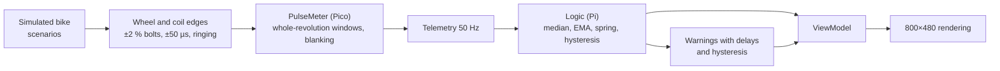

# Interface design

`index.html` is the interactive design proposal for the dashboard (milestone M1): the 800×480 display simulated with the same filters, warnings and states that the Rust app will use. It is an HTML fragment with no dependencies except Google Fonts. It is published:
- as an artifact on claude.ai
- on GitHub Pages by the `pages.yml` workflow, which wraps it in a complete document

To try it locally, just open it in the browser.

The screens of the real software (Rust/Slint), generated with `tdm-dash --screenshot`, are in [`screenshots/`](screenshots/) and in [chapter 11 of the manual](../docs/manual/11-usage.md).

## What it simulates

| Part | Parameters | Reference |
|---|---|---|
| Speed | Median of 3 samples, EMA τ = 0.3 s, ×1.03 + 1 km/h, digits with ±0.6 hysteresis | ADR 0004, manual chapter 00 |
| Needles | Critically damped spring ω = 10 rad/s (speed), 25 rad/s (rpm) | — |
| Temperature | 100 Ω divider, interpolation in ln(R), EMA τ = 3 s | profile `[coolant]` |
| Battery | 100 k/22 k divider, EMA τ = 1 s | profile `[battery]` |
| Brightness | Logarithmic scale, rise τ = 0.7 s, fall τ = 1.5 s; night after 10 s, day after 5 s | profile `[display]` |
| Link | Late after 0.3 s, lost after 1 s | ADR 0002 |
| App hang | Backlight off after 2 s without heartbeat, watchdog at 10 s | ADR 0006 |

## Layouts

| Layout | Idea | Elements |
|---|---|---|
| **Classic** | Two dials like an analogue cluster | Speedometer 0–220 with the 50/90/110/130 marks, tachometer 0–10 with red zone from 8000, temperature column |
| **Sport** | Huge speed, rpm on an arc | 200 px digits (≥ 140 px high), 50-segment arc with shift light at 7500 |
| **Touring** | Trip data | Large speed, rpm bar, trip, average, riding time, estimated range |

Common screens: Trip, Diagnostics, Settings (only when stopped), splash, self-test.

## Tokens

| Token | Day | Night | Use |
|---|---|---|---|
| `bg` | `#eceae4` | `#050607` | Background |
| `panel` | `#dcd9d1` | `#0e1113` | Bottom strip, selection |
| `ink` | `#0f1113` | `#e8e2d6` | Digits and text |
| `dim` | `#575b5d` | `#8b877e` | Labels, units |
| `faint` | `#bdb9b0` | `#2f3234` | Unlit segments, ring |
| `ghost` | `rgba(15,17,19,.11)` | `rgba(232,226,214,.09)` | Unlit warning lights |
| `needle` | `#d9410b` | `#ff6a1a` | Needles, shift light, selection |
| `red` | `#cc1f1a` | `#c3332b` | Red zone, critical values |
| `amberBg` | `#f2a516` | `#c98a14` | Caution banner |
| `critBg` | `#c41c17` | `#9e211b` | Critical band |
| `green` | `#0b9a3b` | `#2bb655` | Turn signals, neutral |
| `blue` | `#1849e6` | `#3b6ff0` | High beam |

**Typography:** Saira Semi Condensed (SIL OFL 1.1), weights 500/600/700. The digits are drawn in fixed-width cells: in Slint every digit is a `Text` in a cell of constant width.

## Rules for the Slint implementation

- No rotation except the needles, which are `Path`s with the points computed in Rust (software renderer).
- Dials pre-rendered at startup with tiny-skia from the profile.
- Rpm arc and bars: image of the lit segments revealed by a clip.
- No blur or shadow.
- While riding, only the needles, critical warnings and the shift light are animated.
