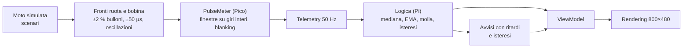

# Design dell'interfaccia

`index.html` è la proposta di design interattiva del quadro (milestone M1): il display 800×480 simulato con gli stessi filtri, avvisi e stati che userà l'app in Rust. È un frammento HTML senza dipendenze tranne i Google Fonts. Viene pubblicato:
- come artifact su claude.ai
- su GitHub Pages dal workflow `pages.yml`, che lo avvolge in un documento completo

Per provarlo in locale basta aprirlo nel browser.

Le schermate del software vero (Rust/Slint), generate con `tdm-dash --screenshot`, sono in [`screenshots/`](screenshots/) e nel [capitolo 11 del manuale](../docs/manuale/11-uso.md).

## Cosa simula

| Parte | Parametri | Riferimento |
|---|---|---|
| Velocità | Mediana su 3 campioni, EMA τ = 0,3 s, ×1,03 + 1 km/h, cifre con isteresi ±0,6 | ADR 0004, manuale cap. 00 |
| Lancette | Molla critica ω = 10 rad/s (velocità), 25 rad/s (giri) | — |
| Temperatura | Partitore 100 Ω, interpolazione in ln(R), EMA τ = 3 s | profilo `[coolant]` |
| Batteria | Partitore 100 k/22 k, EMA τ = 1 s | profilo `[battery]` |
| Luminosità | Scala logaritmica, salita τ = 0,7 s, discesa τ = 1,5 s; notte dopo 10 s, giorno dopo 5 s | profilo `[display]` |
| Collegamento | In ritardo dopo 0,3 s, perso dopo 1 s | ADR 0002 |
| Blocco dell'app | Retroilluminazione spenta dopo 2 s senza heartbeat, watchdog a 10 s | ADR 0006 |

## Layout

| Layout | Idea | Elementi |
|---|---|---|
| **Classic** | Due quadranti come un quadro analogico | Tachimetro 0–220 con le soglie 50/90/110/130, contagiri 0–10 con zona rossa da 8000, colonna della temperatura |
| **Sport** | Velocità enorme, giri ad arco | Cifre da 200 px (≥ 140 px di altezza), arco a 50 segmenti con luce di cambiata a 7500 |
| **Touring** | Dati di viaggio | Velocità grande, barra dei giri, parziale, media, tempo in sella, autonomia stimata |

Schermate comuni: Viaggio, Diagnostica, Impostazioni (solo da fermi), splash, auto-test.

## Token

| Token | Giorno | Notte | Uso |
|---|---|---|---|
| `bg` | `#eceae4` | `#050607` | Fondo |
| `panel` | `#dcd9d1` | `#0e1113` | Striscia inferiore, selezione |
| `ink` | `#0f1113` | `#e8e2d6` | Cifre e scritte |
| `dim` | `#575b5d` | `#8b877e` | Etichette, unità |
| `faint` | `#bdb9b0` | `#2f3234` | Segmenti spenti, anello |
| `ghost` | `rgba(15,17,19,.11)` | `rgba(232,226,214,.09)` | Spie spente |
| `needle` | `#d9410b` | `#ff6a1a` | Lancette, luce di cambiata, selezione |
| `red` | `#cc1f1a` | `#c3332b` | Zona rossa, valori critici |
| `amberBg` | `#f2a516` | `#c98a14` | Banner di attenzione |
| `critBg` | `#c41c17` | `#9e211b` | Fascia critica |
| `green` | `#0b9a3b` | `#2bb655` | Frecce, folle |
| `blue` | `#1849e6` | `#3b6ff0` | Abbaglianti |

**Tipografia:** Saira Semi Condensed (SIL OFL 1.1), pesi 500/600/700. Le cifre sono disegnate in celle a larghezza fissa: in Slint ogni cifra è un `Text` in una cella di larghezza costante.

## Regole per l'implementazione in Slint

- Nessuna rotazione tranne le lancette, che sono `Path` con i punti calcolati in Rust (renderer software).
- Quadranti pre-renderizzati all'avvio con tiny-skia a partire dal profilo.
- Arco e barre dei giri: immagine dei segmenti accesi scoperta da un clip.
- Nessuna sfocatura né ombra.
- Durante la guida si animano solo lancette, avvisi critici e luce di cambiata.
