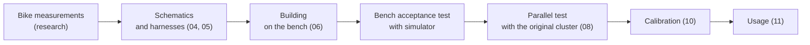

# 00 · Introduction and safety

## What tdm-dash is

tdm-dash is a low-cost, open-source digital instrument cluster that replaces the original cluster of the first-series Yamaha TDM 850 (3VD). It shows:

- speed (needle and digits) and engine rpm
- total odometer and two trips
- coolant temperature and battery voltage, with warnings
- warning lights: neutral, high beam, separate left and right turn signals
- with the bike stopped, trip, settings and diagnostics screens

The project is designed to be **reversible**: the original wiring is not cut and the original cluster is kept. It is also **extensible**: the bike parameters live in a profile file, so the same hardware can serve on other bikes with few changes.

## Who it is for

For people who can use a multimeter, solder through-hole components and remove the bike's fairing. For the software you do not need to know how to program: the ready-made image is written to the SD card and calibration is done from a text file.

## Warnings

> **Danger:** the instrument cluster is there for safe riding. Before relying on tdm-dash on the road, complete the **parallel test** (chapter 08): the new dashboard must work for several rides next to the original one, comparing speed and rpm.

> **Danger:** the ignition coil negative reaches **hundreds of volts** at every spark. Do not touch it with the engine running and do not connect it directly to the electronics: use only the tachometer input circuit described in chapter 04.

> **Caution:** the bike's electrical system can have overvoltages (faulty regulator, battery disconnecting with the engine running). Do not skip the power supply protections: fuse, TVS diode, reverse polarity protection.

> **Caution:** always work with the **ignition key removed** and, when you connect or disconnect power connectors, with the **battery negative disconnected**.

> **Caution:** do not ride while changing the settings. The software prevents it: the settings open only when stopped.

The project is **experimental and not certified**. You use it at your own risk. The authors are not liable for damage to people, to the bike or to third parties (see the licenses in [LICENSING.md](../../LICENSING.md)).

## Legal notes (Italy)

*This section is not legal advice: always check with the Motorizzazione (vehicle registration office) or with the inspection center.*

**Speedometer.** The European rules on speedometers (UNECE Regulation No. 39, Directive 2000/7/EC for two-wheel vehicles) require that the indicated speed is **never lower** than the true speed, and that the excess stays within a limit:

`0 ≤ V_indicated − V_true ≤ 0.1 × V_true + 4 km/h`

tdm-dash meets this rule by construction:
- after GPS calibration a small positive margin is applied (gain 1.03 and +1 km/h)
- an automatic test checks the rule between 5 and 200 km/h

**Odometer.** The original odometer is mechanical and stays in the removed cluster.
- **Before** removing it, photograph the total value.
- In the new dashboard that value is set **only once** (`InitOdometer` command); after that, the total can only increase.
- Keep the photo and the original cluster: at the inspection the km must be consistent with the previous inspections.

**Warning lights.** The mandatory warning lights (high beam in blue, turn signals in green) stay visible even if the electronics fail, thanks to the backup LEDs connected directly to the 12 V lines (chapter 04).

**Inspection.** Ask your inspection center whether it accepts the replaced cluster before mounting it permanently. The adapter harness lets you refit the original cluster in a few minutes.

## Tires and calibration

A new tire has a larger circumference than a worn one.
- If you calibrate with a worn tire and then change it, the dashboard **reads lower** than the true speed: that is the forbidden direction.
- **Recalibrate after every front tire change** (chapter 10). The diagnostics screen reminds you.

## Tools needed

| Tool | What for | Essential? |
|---|---|---|
| Digital multimeter with frequency measurement (Hz) | Bike measurements, acceptance test | Yes |
| 30–60 W soldering iron with fine tip, solder, desoldering braid | Building | Yes |
| Wire stripper and crimper for Superseal/DTM | Harness | Yes |
| Heat-shrink tubing, cable ties | Harness | Yes |
| Wrenches and screwdrivers for fairing and cluster | Installation | Yes |
| microSD card reader and a PC | Software | Yes |
| Cheap oscilloscope (DSO around 40 €) | Tachometer waveform | Recommended |
| Adjustable 0–30 V bench power supply with current limit | Bench acceptance test of the electronics | Recommended |
| 3D printer (or printing service) | Enclosure and bracket | Yes, or external service |
| Raspberry Pi Debug Probe | Firmware development | Only for those who modify the firmware |

## How the work is organized

