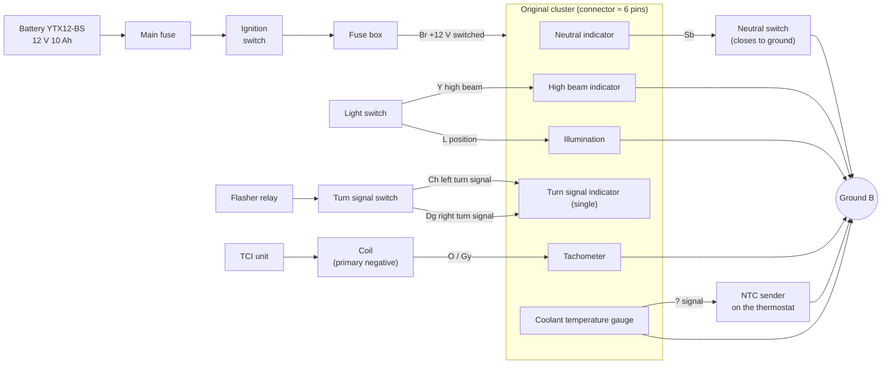
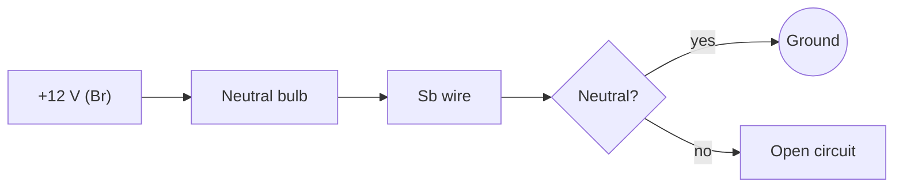
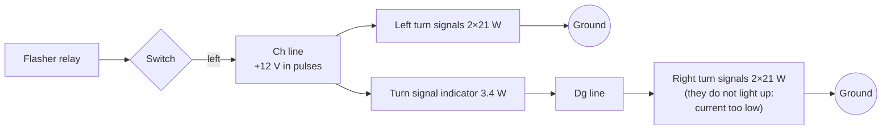

# 01 · The original wiring of the TDM 850

This chapter explains how the original cluster of the first-series TDM 850 (3VD, 1991–1995) works and which signals it offers to the new dashboard. The detailed data, with sources and markers, is in the [research](../research/original-wiring.md).

> **Caution:** the wire colors are reconstructed from the Yamaha convention and from related models. They are **[TO VERIFY]** until the [measurement sheet](../research/bike-measurements.md) is filled in. Do not build the adapter harness before the bike measurements.

## What is in the original cluster

| Instrument or indicator | How it works | Signal for tdm-dash |
|---|---|---|
| Speedometer with odometer | **Mechanical**: a flexible cable turns, driven by the gearbox on the front hub | No electrical signal: a new sensor is needed (inductive sensor on the disc bolts) |
| Tachometer | Electronic, counts the coil pulses | Wire from the coil negative (probably O or Gy) |
| Coolant temperature gauge | Needle moved by the current flowing through the NTC sender | Wire to the sender, read with the ADC |
| Neutral indicator (green) | Bulb between +12 V and the Sb wire; the neutral switch closes to ground | Sb wire, active to ground |
| High beam indicator (blue) | Bulb between the Y wire and ground | Y wire, active at +12 V |
| Turn signal indicator (green, only one) | Bulb **between** the left (Ch) and right (Dg) turn signal wires | Ch and Dg wires, both active at +12 V |
| Instrument illumination | Bulbs between the L wire and ground | L wire (useful only if it is not always on) |

There is no fuel gauge, oil warning light, temperature warning light or clock.

## Reconstructed diagram of the original cluster

## How the individual circuits work

### Neutral indicator (active to ground)

The bulb always receives +12 V when the ignition is on. The other end goes to the Sb wire, which runs to the neutral switch on the engine, on the left near the front sprocket. In neutral the switch closes the circuit to ground and the indicator lights up.

For tdm-dash:
- with the bulb removed, the Sb wire is left "floating": in neutral it is at ground, otherwise it is disconnected.
- The input of the new dashboard must therefore supply the current itself, from +12 V through an optocoupler, to the Sb wire.

### High beam indicator (active at +12 V)

The light switch puts +12 V on the Y wire when the high beam is on. The bulb sits between Y and ground. When the high beam is off, the Y wire stays connected to ground through the filament of the headlight high beam bulb. For tdm-dash it is a normal "active high" input.

### Single turn signal indicator

This is the most interesting circuit. The indicator is connected **between** the left turn signal line (Ch) and the right one (Dg):
- With the left turn signal on, Ch is at +12 V in pulses. The current flows through the indicator, enters the right line and returns to ground through the right turn signal bulbs (2 × 21 W).
- Those bulbs, with so little current, do not light up, but they are enough to close the circuit.
- The same happens the other way round.

For tdm-dash:
- **two separate inputs** are read, Ch and Dg, both active at +12 V, so the new dashboard shows the direction.
- With LED turn signals (much higher resistance than bulbs) a pull-down load to ground is needed on each input. It is included in the schematic.

### Tachometer

The TCI unit switches the current in the coil primary on and off. When it interrupts it, the coil produces the spark and a **peak of a few hundred volts** appears on the primary negative, followed by ringing.

The original tachometer is connected to that point and counts the peaks. The TDM 3VD is a twin with a 360° crankshaft and a single dual-output coil (wasted spark): **probably one pulse per crankshaft revolution**, to be confirmed at idle with the multimeter (see bike measurements).

| rpm | Pulses per second (1 per revolution) |
|---|---|
| 1 000 | 16.7 Hz |
| 1 200 (idle) | 20 Hz |
| 5 000 | 83 Hz |
| 8 000 (red line) | 133 Hz |

The signal must be **reduced and isolated** before it reaches the microcontroller. The circuit is in chapter 04: diode, high-voltage resistors, zener, H11L1 threshold optocoupler, and in the firmware a "blanking" time after each pulse to ignore the ringing.

### Coolant temperature gauge

The sender, screwed into the thermostat housing, is an NTC resistor to ground: the hotter the coolant, the lower its resistance.

| Temperature | Resistance (Haynes data) |
|---|---|
| 80 °C | 47–53 Ω |
| 100 °C | 26–29 Ω |

The original gauge drives current through the sender and the needle follows the current. tdm-dash instead feeds the sender with a small divider from the microcontroller's 3.3 V and measures its voltage with the ADC. The full curve (from 20 to 120 °C) must be measured in a water bath, as described in the bike measurements.

## The bike's power supply

| Item | Value |
|---|---|
| Battery | YTX12-BS, 12 V 10 Ah |
| Voltage with engine off | 12.4–12.8 V (charged battery) |
| Charging voltage | 14.0–14.5 V above 1200–2000 rpm |
| Alternator | Three-phase permanent magnet, ≈ 280 W |
| Regulator | Shindengen SH629A-12, shunt type: a known weak point |

> **Caution:** a faulty regulator can push the voltage beyond 16–18 V. tdm-dash monitors it (overvoltage warning) and protects itself with a TVS diode and a DC-DC regulator rated up to 50 V. The dashboard thus also becomes a **regulator monitor**, useful on this bike.

## What is kept and what is replaced

| Part | Fate |
|---|---|
| Original cluster | Removed and **kept** (odometer, inspection) |
| Speedometer cable | Removed; the gearbox output is capped |
| Gearbox on the front hub | **Stays on the axle**: it is part of the wheel spacer stack |
| Bike harness | **Not cut**: an adapter harness plugs into the original connector |
| Coolant sender | Kept, read by tdm-dash |
| Flasher relay | Kept; check that the frequency does not change without the indicator |
| Indicator bulbs | Replaced by the on-screen warning lights and the backup LEDs |
