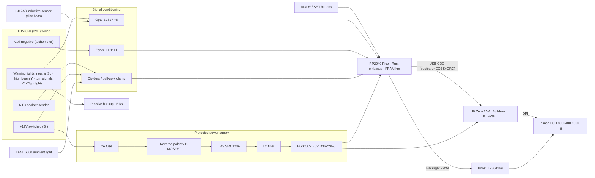
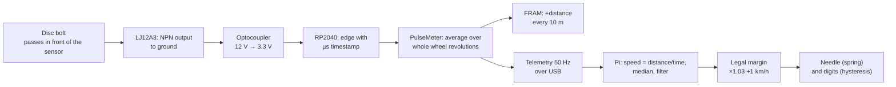
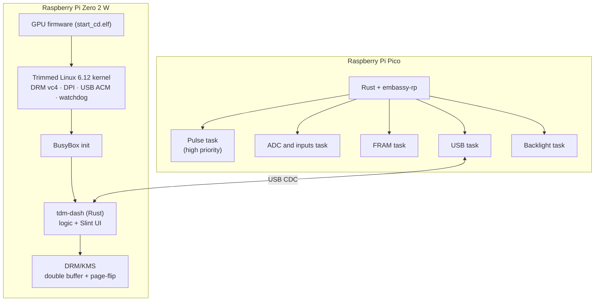
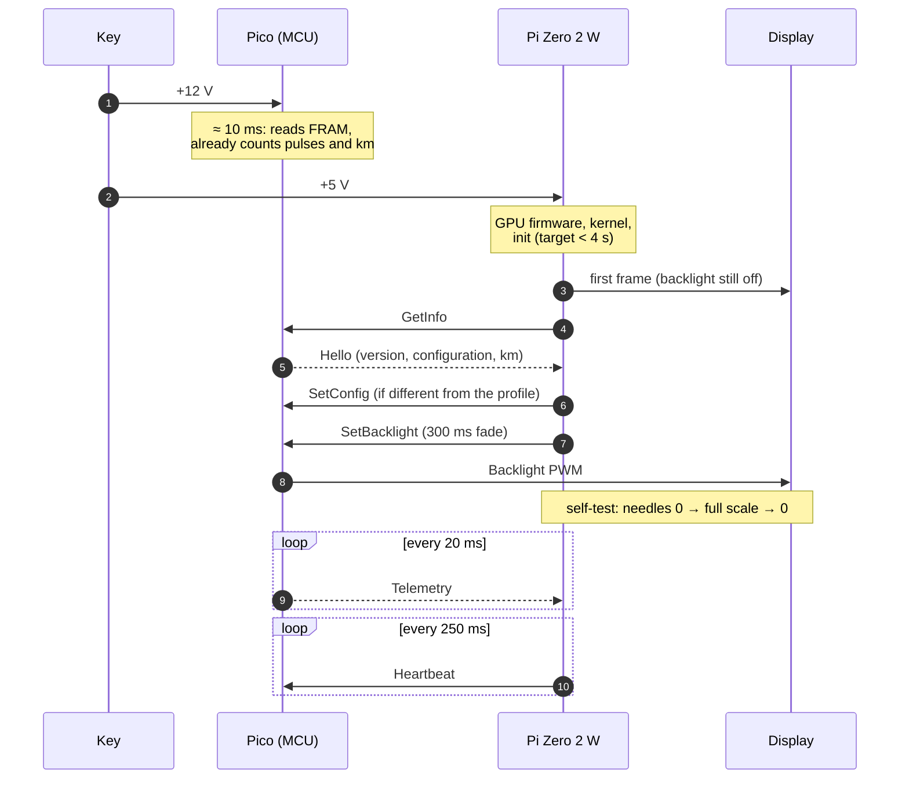
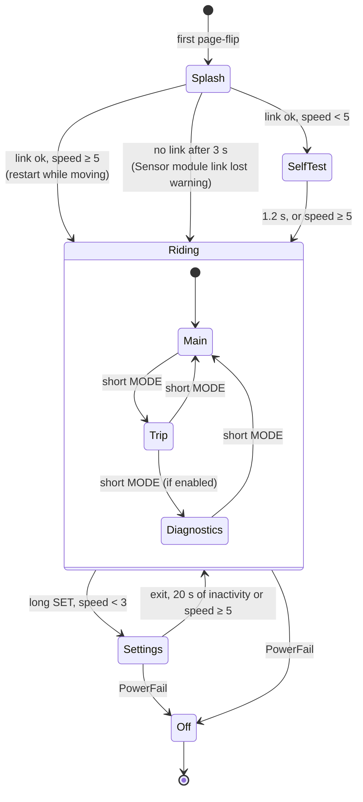
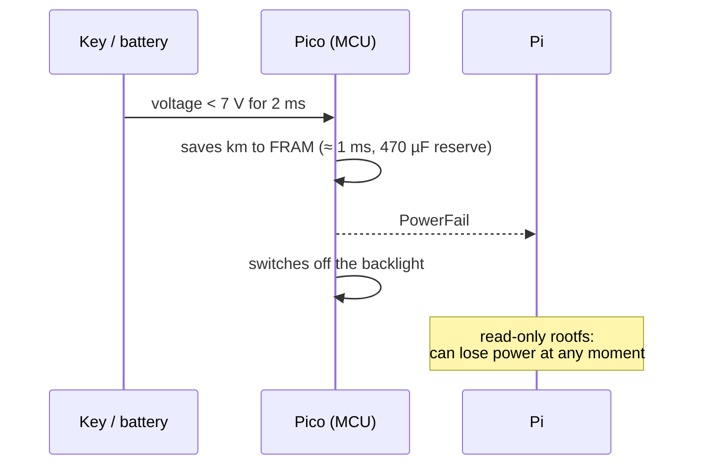

# 02 · System architecture

## In brief

tdm-dash is split into two computers, each with the job it does best:

| Part | Job | Why |
|---|---|---|
| **Raspberry Pi Pico (RP2040)**, microcontroller | Counts wheel and coil pulses, reads warning lights, buttons and voltages, **keeps the km** in a FRAM memory, drives the backlight | It is ready a few milliseconds after power-on, measures time with microsecond precision, does not hang and has no file system to corrupt |
| **Raspberry Pi Zero 2 W**, Linux computer | Draws the graphical interface on the display | It has the power for smooth graphics at 800×480; with a minimal Linux it boots in a few seconds |

The two communicate over **USB** with small packets protected by a CRC. The Pi never writes to the SD card during use: if the key is turned off suddenly, nothing gets corrupted.

## Block diagram

## The path of a reading: from the wheel to the needle

Why the average "over whole revolutions": the disc bolts may not be spaced perfectly evenly. By always measuring a whole number of wheel revolutions, the spacing error cancels out.

## Software

| Component | Choice | Where in the repo |
|---|---|---|
| Operating system | Buildroot 2026.08, read-only EROFS rootfs, no udev, no networking in the release image | `os/` |
| Interface | Rust + Slint, software renderer, own DRM platform | `crates/tdm-dash/` |
| Logic (filters, warnings, states) | Rust, no hardware dependencies, tested on the PC | `crates/tdm-logic/` |
| Protocol | postcard + COBS + CRC-16, shared crate | `crates/tdm-proto/` |
| Measurements and odometer | Rust `no_std`, **the same code** in the firmware and in the simulator | `crates/tdm-core/` |
| Firmware | Rust + embassy-rp | `firmware/` |
| Bike profiles | TOML | `profiles/` |

## Boot

While Linux boots the microcontroller is already working: if you ride off straight away, the km covered in the first seconds are not lost.

## Interface states

**Warnings** are not states, but a layer on top of the active screen:
- **Critical** (red band): link lost, critical temperature, overvoltage.
- **Caution** (amber banner), can be snoozed for 5 minutes with SET: high temperature, battery not charging, battery low.
- **Information** (icon): turn signal left on, fuel estimate.

## Shutdown and power fail

The Pi does not need an orderly shutdown. The FRAM withstands about 10¹² writes: even writing every 10 m, 100 000 km means 10⁷ writes, a tiny fraction of its life.

## Fail-safe behavior ("fail-dark")

| Fault | What happens | Why |
|---|---|---|
| The Pi app hangs | After 2 s without Heartbeat the Pico switches off the backlight; the watchdog restarts the Pi | Better a black screen than a frozen, wrong speed |
| The USB link drops | After 0.3 s dimmed digits; after 1 s "---" and a critical warning; automatic reconnection | Old data must not look valid |
| The Pico restarts | The Pi notices (uptime starting over) and resets the filters | No needle jumps |
| The FRAM is unreadable | The Pico works, reports the fault, does not overwrite the data | The km history is not lost |
| Electronics off or faulty | The **backup LEDs** on the 12 V lines show turn signals, high beam and neutral | Mandatory warning lights always visible |

## Extensibility: bike profiles

Everything that depends on the bike lives in a TOML file (`profiles/`):
- pulses per wheel revolution and circumference
- pulses per engine revolution, red line
- coolant sender curve, battery thresholds
- which inputs are connected and with which logic
- layout and theme

The file in use is on the `/boot` partition of the SD card, readable and editable from any PC. For another bike a new profile is enough; if the profile has an error, the dashboard uses the built-in one and reports it.
