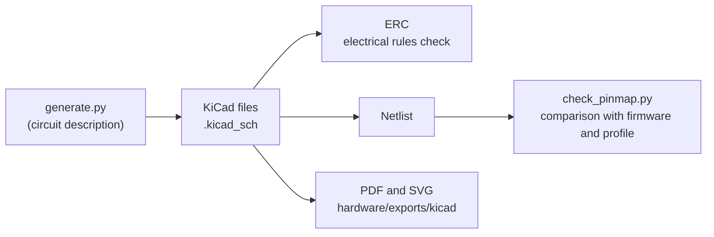
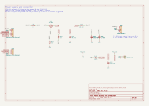
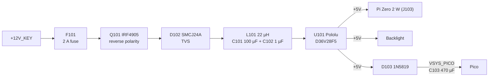
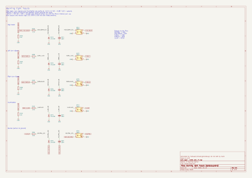
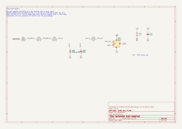
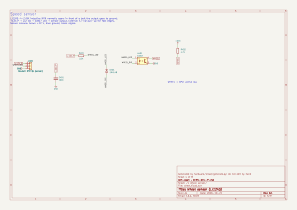
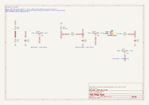
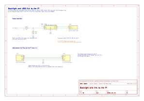
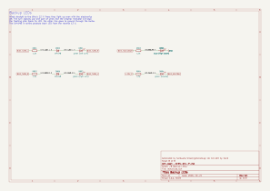

# 04 · Schematics

The schematic of the sensor module (the board with the Pico) is a **KiCad 9** project in [`hardware/kicad/`](../../hardware/kicad/), split into eight sheets. This chapter explains each sheet and how the components were chosen.

The schematic is not drawn by hand: it is written by the [`generate.py`](../../hardware/kicad/generate.py) script, which describes every component and the net on each pin. On every pin there is a short wire stub with the net label: two pins with the same label are connected. It is less elegant than a schematic with drawn wires, but connections cannot be drawn wrong, and the script can be checked.



On every change the CI (`Hardware` workflow):

1. regenerates the schematic and checks that it matches the saved one
2. runs the KiCad **ERC**: zero errors and zero warnings
3. compares the Pico pins with the firmware ([`tools/check_pinmap.py`](../../tools/check_pinmap.py)): every GPIO used by `firmware/src/main.rs` must carry the right net. The same script checks that the battery divider and the coolant sender pull-up are the ones used by the software
4. exports PDF and SVG

To redo it on the PC with Docker, from the repository root:

```sh
docker run --rm -u 0 -v "$PWD":/w -w /w kicad/kicad:9.0.9 \
    sh -c 'python3 hardware/kicad/generate.py && hardware/kicad/export.sh'
```

The complete PDF, to print for building, is [`hardware/exports/kicad/tdm-dash.pdf`](../../hardware/exports/kicad/tdm-dash.pdf).

> **Caution:** the wire colors and the pinout of the bike's original connector are still **[TO VERIFY]** (see the [research](../research/original-wiring.md)). The schematic uses function names (`BIKE_TURN_L`, `BIKE_TACH`…), not colors. Before connecting anything to the bike you need the [bike measurements](../research/bike-measurements.md).

## Net names

| Prefix or name | Meaning |
|---|---|
| `BIKE_…` | Wire coming from the bike harness: voltages up to 14.5 V, noise, spikes |
| `+12V_KEY` | +12 V switched, before the fuse |
| `+12V_P` | Protected +12 V: after the fuse, the reverse-polarity MOSFET and the TVS |
| `+12V_FILT` | +12 V after the LC filter, converter input |
| `+5V` | Converter output: Pi Zero, backlight |
| `VSYS_PICO` | Pico supply, after the diode and with the 470 µF reserve |
| `+3V3` | Pico regulator output: FRAM, pull-ups, light sensor |
| `WHEEL`, `IGN`, `NEUTRAL`… | Signals to the Pico GPIOs, already at 3.3 V |

## 1 · Power and protections





**Consumption and fuse.** From the +5 V:
- the Pi Zero 2 W draws 0.3–0.6 A, with peaks up to 1 A at boot
- the backlight 0.4 A (1.7 W at 85% efficiency)
- the Pico and the rest less than 50 mA

In total at most about 1.5 A, that is 7.5 W. From the 12 V, with 90% converter efficiency, that is about 0.7 A. The 2 A fuse leaves margin at power-on (capacitor charging) and protects the 0.5 mm² wire.

**Reverse polarity protection (Q101, R101, D101).** The P-MOSFET is mounted "backwards": the +12 V enters at the drain and the body diode already conducts before the MOSFET turns on.
- Resistor R101 pulls the gate to ground, the MOSFET turns on and the drop becomes negligible: 20 mΩ × 0.7 A = 14 mV, that is 10 mW, against the 0.5 W of a diode.
- With the battery reversed the gate is at the positive and the MOSFET stays off.
- The 12 V zener D101 limits the gate-source voltage (±20 V maximum) during spikes.

**Overvoltages (D102).**
- **While riding:** the SMCJ24A TVS does not conduct up to 24 V. The TDM charging voltage (14.0–14.5 V) is far below.
- **On a spike:** for example a faulty regulator or a battery disconnecting, the TVS clamps at about 39 V at 38 A.
- **The converter:** the Pololu withstands 50 V at the input. This is why an MP1584 module, which stops at 28 V, is **not** suitable.

**LC filter (L101, C101, C102).** The cut-off frequency is

f = 1 / (2π √(L·C)) = 1 / (2π √(22 µH × 100 µF)) ≈ 3.4 kHz

So the converter noise (hundreds of kHz) does not go back into the bike's wiring, and the wiring noise (ignition, alternator) arrives attenuated.

**Pico reserve (D103, C103).** The Pico is powered through a Schottky, which prevents the Pi from draining the 470 µF capacitor when the key is turned off. Reserve duration:
- **Consumption and voltages:** the Pico draws about 25 mA; its regulator works from 4.7 V (5 V minus the Schottky) down to about 3 V.
- **Duration:** t = C·ΔV / I = 470 µF × 1.7 V / 25 mA ≈ 32 ms.
- **Saving:** the firmware saves the km when the battery drops below 7 V (section 5). The converter holds the 5 V as long as the input is above about 6 V, so saving starts before the Pico begins to use up the reserve. Writing 40 bytes to the FRAM at 1 MHz takes about 0.5 ms.

## 2 · Warning light inputs



Each warning light goes through an **EL817 optocoupler**:
- the Pico never sees the 12 V or its spikes
- the output is a transistor to ground, read with the Pico's internal pull-up (active low)

| Input | Logic on the bike | Circuit | Output |
|---|---|---|---|
| High beam | +12 V when on | 4.7 kΩ → LED → ground | `HIGH_BEAM` → GP7 |
| Left turn signal | +12 V flashing | same | `TURN_L` → GP8 |
| Right turn signal | +12 V flashing | same | `TURN_R` → GP9 |
| Illumination | +12 V with the position lights | same | `ILLUM` → GP10 |
| Neutral | the contact closes **to ground** | +12V_P → 3.3 kΩ → LED → neutral wire | `NEUTRAL` → GP6 |

Logic derived from the Yamaha convention, [TO VERIFY] on the bike.

**LED current.** With the battery at 12.6 V and the LED at 1.2 V: I = (12.6 − 1.2) / 4.7 kΩ = 2.4 mA. While charging (14.5 V) it becomes 2.8 mA.
- **Output:** the EL817 guarantees a current transfer ratio of at least 50% at 5 mA; even counting only 30% at 2.4 mA, the output sinks 0.7 mA. The Pico's internal pull-up (50–80 kΩ) asks for 66 µA: the margin is 10 times.
- **Resistor:** 4.7 kΩ dissipates 40 mW at 14.5 V, so a 1/4 W resistor is enough.
- **On a spike:** at the highest spike the TVS lets through (39 V) the current rises to 8 mA, far from the EL817's 50 mA maximum.

**Neutral.** I = (12.6 − 1.2) / 3.3 kΩ = 3.5 mA when the contact is closed. When open the wire is connected to nothing and the LED stays off. The original 3.4 W bulb drew 270 mA: our input loads the neutral contact much less.

**The other components:**
- 1N4148 in anti-parallel: protects the LED (6 V reverse maximum) from negative voltages and from relay ringing.
- 100 nF across the LED: with the 4.7 kΩ it makes a filter of about 0.5 ms against short noise. The turn signals flash at 1–2 Hz, so they pass without problems.
- 10 kΩ to ground on the +12 V inputs: a disconnected wire or one with small leakage stays at 0 instead of "floating".
- The ground on the bike side is the same as the Pico's. The optocouplers here are for protection and level shifting, not for isolation.

## 3 · Tachometer



The signal is taken from the coil negative, in parallel with the ignition unit. Expected shape (to be checked with the oscilloscope):
- about +12 V at rest
- about 0 V while the coil charges
- then, at each spark, a 200–400 V spike with ringing

The circuit must trigger the H11L1 **only on the spike**:


| Situation | Current in the H11L1 LED | Result |
|---|---|---|
| Rest, 12.6 V | (12.6 − 0.7 − 1.2) / (44 + 2.2) kΩ = 0.23 mA | Off: the threshold is 1.6 mA at most |
| Coil charging, ≈ 0 V | 0 | Off |
| Spike, zener at 15 V | (15 − 1.2) / 2.2 kΩ = 6.3 mA | On |

**Trigger threshold.** To get 1.6 mA in the LED you need about 1.6 mA × 46.2 kΩ + 1.9 V ≈ 76 V on the wire. A coil spike always exceeds it, while 12 V noise stays below.

**22 kΩ 1 W resistors.**
- On a 300 V spike about 6.5 mA flows, that is 0.9 W per resistor, but only for 50–100 µs at each spark.
- At 8000 rpm (133 Hz) the average is about 12 mW.
- The 1 W rating is needed mainly for the **voltage**: each resistor sees half the spike and 1/4 W resistors usually withstand 200–250 V. This is why resistors with at least 350 V working voltage are used.

**2.2 nF capacitor.** With the 44 kΩ the time constant is about 100 µs. A 100 V spike brings the node to 15 V in about 16 µs, a 300 V one in about 5 µs: short enough not to miss the spike, long enough to cut the shortest noise.

**Output.** The H11L1 has a Schmitt trigger output: clean edges even with a slow signal. It is active low, with 4.7 kΩ to 3.3 V and supplied from the Pico's +3V3 (100 nF decoupling). The firmware ignores edges that are too close together (blanking) so as not to count the ringing of the same spike twice.

> **Caution:** this sheet is the most uncertain in the project. Before connecting it:
> - measure the signal with the oscilloscope and, if needed, change C301 or R303
> - check the number of pulses per revolution ([bike measurements](../research/bike-measurements.md))

## 4 · Speed sensor



The **LJ12A3-4-Z/BX** inductive sensor is a normally open NPN: in front of a steel bolt it connects the output (black wire) to ground. It works from 6 to 36 V and is powered from +12V_P.

- **Opto LED:** +12V_P → 2.2 kΩ → EL817 LED → sensor output. With the sensor active (up to 1.5 V residual voltage) (12.6 − 1.2 − 1.5) / 2.2 kΩ ≈ 4.5 mA flows. The sensor withstands 200.
- **Output:** it has an external 4.7 kΩ pull-up to 3.3 V, for faster edges than with the internal pull-up alone.
  - **Current required:** 0.7 mA, while the opto gives at least 2.
  - **Frequency:** at 200 km/h, with 6 bolts and 1.96 m circumference, there are 170 pulses per second: one every 5.9 ms.
  - **EL817 timing:** rise and fall of a few tens of µs.
- **Protections:** the 1N4148 in anti-parallel protects the LED and the 100 nF filters the sensor supply.

## 5 · Analog inputs



Each ADC input has:
- a 100 nF filter
- a **BAT54S** that keeps the pin between 0 V and 3.3 V even if something goes wrong

**Battery (GP26).** 100 kΩ / 22 kΩ divider taken from +12V_P, so after the key: with the bike off it draws nothing.

| Quantity | Value |
|---|---|
| Ratio | (100 + 22) / 22 = 5.545 (`vbat_divider` in the software) |
| Full scale | 3.3 V × 5.545 = 18.3 V |
| Resolution | 18.3 V / 4096 = 4.5 mV (better with the average of 64 readings) |
| Power fail threshold | 7.0 V → 1.262 V on the pin → reading 1569 (`POWER_FAIL_RAW` in the firmware) |
| Divider consumption | 12.6 V / 122 kΩ ≈ 0.1 mA |

**Coolant sender (GP27).** The original sender is an NTC to ground in the thermostat housing: 47–53 Ω at 80 °C and 26–29 Ω at 100 °C [TO VERIFY]. The circuit:
- **Pull-up:** the 100 Ω resistor to 3.3 V forms a divider with the sender, V = 3.3 V × R / (R + 100 Ω).
  - **At 80 °C** (50 Ω): 1.10 V, reading ≈ 1365.
  - **At 100 °C** (27 Ω): 0.70 V, reading ≈ 870.
  - **When cold** the sender rises to a few hundred ohms and the voltage approaches 3.3 V.
- **Value in the software:** 100 Ω is `coolant_pullup_ohm` in the profile. The software derives R from the voltage and the temperature from the profile curve (chapter 10).
- **Current in the sender:** about 22 mA when hot. The original cluster, with a 12 V coil, passed more, so self-heating is negligible.
- **If the wire shorts to ground:** 33 mA flows and the resistor dissipates 0.11 W. A 1/4 W one is enough.
- **Filter:** 1 kΩ in series and the 100 nF separate the pin from the wire.

> **Caution:** the sender wire must never touch the +12 V. Through the 100 Ω it would push 90 mA into the Pico's 3.3 V. The wire only runs from the thermostat to the dashboard, but it must still be routed away from live wires.

**Ambient light (GP28).** The TEMT6000 module is powered at 3.3 V and has its own 10 kΩ load resistor: it gives from 0 V (dark) up to about 3 V (sun). The 1 kΩ in series, the 100 nF and the BAT54S protect the pin from the cable that runs to the enclosure window.

## 6 · Pico, FRAM and buttons


| Pico pin (physical) | GPIO | Net | Function |
|---|---|---|---|
| 4 | GP2 | `WHEEL` | Wheel sensor |
| 5 | GP3 | `IGN` | Tachometer |
| 6 / 7 | GP4 / GP5 | `I2C_SDA` / `I2C_SCL` | FRAM |
| 9, 10, 11, 12, 14 | GP6–GP10 | `NEUTRAL`, `HIGH_BEAM`, `TURN_L`, `TURN_R`, `ILLUM` | Warning lights |
| 15 / 16 | GP11 / GP12 | `BTN_MODE` / `BTN_SET` | Buttons |
| 20 | GP15 | `BL_PWM` | Backlight |
| 31, 32, 34 | GP26, GP27, GP28 | `VBAT_SENSE`, `COOLANT_SENSE`, `LIGHT_SENSE` | ADC |
| 36 | — | `+3V3` | 3.3 V output (300 mA maximum) |
| 39 | — | `VSYS_PICO` | Supply |
| 3, 8, 13, 18, 23, 28, 33, 38 | — | `GND` | Ground |

The other pins stay free for future extensions, for example a fuel sender or a GPS.

**FRAM MB85RC256V.** 32 KB, address 0x50 (A0–A2 to ground), write protection disabled (WP to ground). The I²C pull-up resistors are 2.2 kΩ because the bus runs at 1 MHz (Fast-mode Plus):
- **Rise time:** 0.85 × 2.2 kΩ × 50 pF ≈ 93 ns, within the allowed 120 ns.
- **With the breakout's pull-ups:** the Adafruit one already has its own 10 kΩ, in parallel they become 1.8 kΩ. The current is 1.8 mA, well below the limit.

**MODE and SET buttons.** They are on the enclosure and switch to ground. They arrive from connector J601 through 1 kΩ, with 100 nF to ground on the Pico side. The 0.1 ms filter and the series resistor limit electrostatic discharges (a wet hand on the button). The firmware then does the debouncing.

## 7 · Backlight and Pi link



**TPS61169 driver.**
- **Load:** it is a constant-current boost converter. The Newhaven backlight wants 180 mA at 9.3 V, that is 1.7 W, which at 85% efficiency is 0.4 A from the +5 V.
- **Current:** it is set with the sense resistor, R = 204 mV / 180 mA ≈ 1.13 Ω. On the breakout it must be checked and, if needed, replaced [TO VERIFY].
- **Control:** the Pico drives the CTRL pin with 25 kHz PWM (GP15) through 1 kΩ.
- **Fail-dark:** the 100 kΩ resistor to ground keeps the driver off until the firmware starts. The display stays black instead of showing a stale image.

**USB to the Pi.** Only D+, D− and ground are connected; the Pi's VBUS is **not** connected, because the Pico already takes its power from VSYS. The harness is described in [chapter 05](05-wiring-harnesses.md).

**Display.** The panel connects to the Pi with the Adafruit DPI Kippah adapter, off this board.

## 8 · Backup LEDs



Four 3 mm LEDs connected directly to the bike's 12 V lines: they work even if the Pi, Pico or display fail, and they remain as backup legal warning lights.

**Turn signals.**
- **Connection:** like the original indicator, the LEDs are between the left and right turn signal wires. When the left one flashes, the current flows through the left LED and returns to ground through the right-hand bulbs (off, low resistance).
- **LED protection:** the 1N4148 in series protects each LED from the reverse 12 V when the other side flashes; an LED withstands only 5.

**High beam and neutral.** The blue LED goes from the high beam wire to ground. The green neutral LED goes from +12V_P to the neutral wire, like the original bulb.

**Currents.**

| LED | Calculation at 12.6 V | Current |
|---|---|---|
| Green turn signal LEDs | (12.6 − 2.0 − 0.7) / 1.5 kΩ | 6.6 mA |
| Blue high beam LED | (12.6 − 3.0) / 1.5 kΩ | 6.4 mA |

At 14.5 V the current reaches about 8 mA, far from the 20 mA maximum. The 1.5 kΩ resistors dissipate less than 0.1 W.

## Before building

- **Bike measurements** ([sheet](../research/bike-measurements.md)), which confirm:
  - the wires and the logic of sheets 1, 2 and 8
  - the tachometer wire and the shape of its signal (sheet 3)
  - the coolant sender curve (sheet 5)
- **Breakouts:** check the silkscreens (Pololu, TPS61169, FRAM) and the pin order of the modules; the schematic numbers them in the order given in the notes.
- **Review:** review the SVGs of this chapter together with the [bill of materials](03-bill-of-materials.md).
