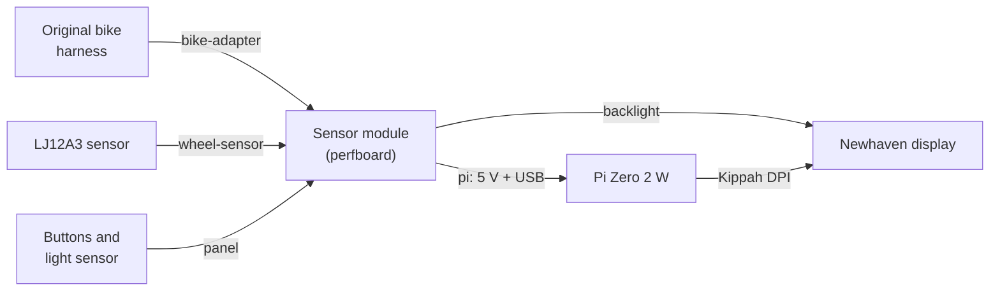
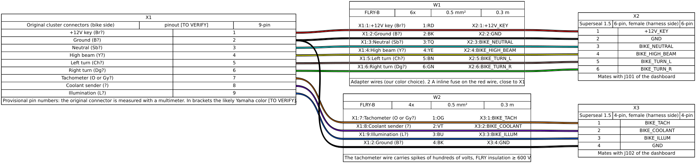
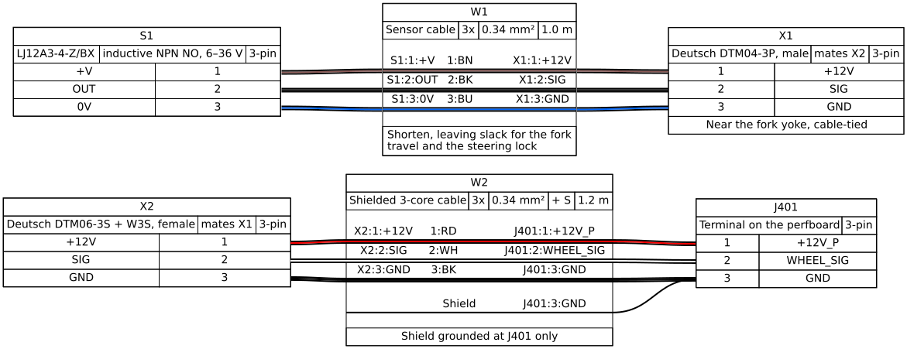
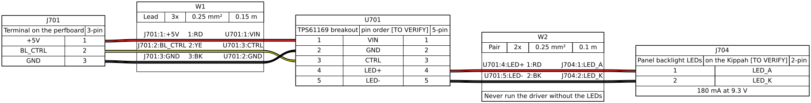
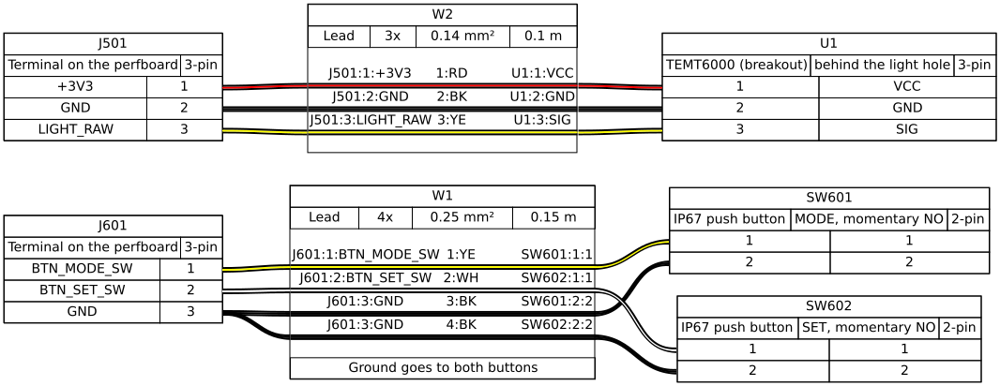

# 05 · Wiring harnesses

The harnesses are described in [WireViz](https://github.com/wireviz/WireViz): one YAML file per harness in [`hardware/harness/`](../../hardware/harness/), from which the drawing (SVG) and the bill of wires and connectors (TSV) are generated. The generated files are in [`hardware/exports/harness/`](../../hardware/exports/harness/).

```sh
pip install wireviz==0.4.1        # Graphviz is needed too (apt install graphviz)
for f in hardware/harness/*.yml; do wireviz -f st -o hardware/exports/harness "$f"; done
```



Rules for all harnesses:
- **Cable:** FLRY-B automotive, 0.5 mm² for the power supplies and the bike signals, thinner only inside the enclosure.
- **Connectors:** all waterproof (Superseal 1.5, Deutsch DTM). Solder joints must be covered with adhesive-lined heat-shrink tubing.
- **Original wiring:** **never cut it**. The adapter starts from a used cluster harness (3VD-83509-00) or from the matching connector.
- **Wire colors:** those of the bike remain [TO VERIFY] until the [bike measurements](../research/bike-measurements.md) are done. The colors of the new wires are our choice and are given in the tables.

Names on the drawings, the same as in the schematic ([chapter 04](04-schematics.md)):
- `J…` are the connectors of the schematic. Most are terminals on the perfboard; J702 is the pads under the Pico, J703 the plug in the Pi USB port and J704 the backlight pins of the panel.
- `P101` and `P102` are the harness plugs that mate J101 and J102.
- `X…` are the other connectors along a harness (bike side, the DTM pair, the plug in the Pi PWR IN port), numbered per harness.
- Parts off the board keep their schematic designator (U701, SW601, SW602); the wheel sensor is S1 and the light sensor U1.

## Adapter from the original cluster



File: [`bike-adapter.yml`](../../hardware/harness/bike-adapter.yml). Bill of materials: [`bike-adapter.bom.tsv`](../../hardware/exports/harness/bike-adapter.bom.tsv).

| From (bike side) | Yamaha color | New wire | To | Net | Function |
|---|---|---|---|---|---|
| +12 V switched | Br [TO VERIFY] | red, with 2 A fuse | P101.1 → J101.1 | `+12V_KEY` | Power supply |
| Ground | B [HYPOTHESIS] | black | P101.2 → J101.2 | `GND` | Ground |
| Neutral indicator | Sb [HYPOTHESIS] | light blue | P101.3 → J101.3 | `BIKE_NEUTRAL` | Neutral, active to ground |
| High beam indicator | Y [HYPOTHESIS] | yellow | P101.4 → J101.4 | `BIKE_HIGH_BEAM` | +12 V with high beam |
| Left turn signal | Ch [TO VERIFY] | brown | P101.5 → J101.5 | `BIKE_TURN_L` | +12 V flashing |
| Right turn signal | Dg [TO VERIFY] | green | P101.6 → J101.6 | `BIKE_TURN_R` | +12 V flashing |
| Tachometer | O or Gy [HYPOTHESIS] | orange | P102.1 → J102.1 | `BIKE_TACH` | Coil negative, spikes of hundreds of volts |
| Coolant sender | ? [TO VERIFY] | violet | P102.2 → J102.2 | `BIKE_COOLANT` | NTC to ground |
| Illumination | L [HYPOTHESIS] | blue | P102.3 → J102.3 | `BIKE_ILLUM` | +12 V with the lights |
| Ground | B [HYPOTHESIS] | black | P102.4 → J102.4 | `GND` | Ground |

P101 and P102 are Superseal 1.5 female plugs (6 and 4 pins); J101 and J102 are the matching male connectors of the dashboard.

> **Caution:** the fuse (F101 in the schematic) goes **on the bike side** of the red wire, as close as possible to the point where the +12 V is taken. This way it also protects the stretch of cable to the dashboard.

## Speed sensor



File: [`wheel-sensor.yml`](../../hardware/harness/wheel-sensor.yml).

| From | Wire | To | Net |
|---|---|---|---|
| S1 brown (+V) | sensor brown | X1.1 (DTM, male) | `+12V_P` |
| S1 black (output) | sensor black | X1.2 | `WHEEL_SIG` |
| S1 blue (0 V) | sensor blue | X1.3 | `GND` |
| X2.1 (DTM, female) | red, shielded cable | J401.1 | `+12V_P` |
| X2.2 | white, shielded cable | J401.2 | `WHEEL_SIG` |
| X2.3 | black, shielded cable | J401.3 | `GND` |
| Shield | — | J401.3, dashboard side only | `GND` |

The sensor colors come from its datasheet. The DTM pair (X1, X2) sits near the fork yoke, so the sensor can be unplugged to remove the wheel. Leave the cable enough slack for the full fork travel and for the steering at full lock on both sides.

## Pi Zero 2 W: power and USB


File: [`pi.yml`](../../hardware/harness/pi.yml). Nothing is soldered on the Pi: the two cables end in micro-USB plugs.

| From | Wire | To | Function |
|---|---|---|---|
| J103.1 (+5V) | red 0.5 mm² | X1.1 (VBUS), plug in the **PWR IN** port | Pi power supply |
| J103.2 (GND) | black 0.5 mm² | X1.5 (GND), plug in the **PWR IN** port | Ground |
| J702.2, Pico pad TP2 (D−) | white, twisted pair | J703.2 (D−), plug in the **USB** port | Data |
| J702.3, Pico pad TP3 (D+) | green, twisted pair | J703.3 (D+), plug in the **USB** port | Data |
| J702.4, Pico pin 38 (GND) | black | J703.5 (GND), plug in the **USB** port | Ground |
| — | jumper in the plug | J703.4 (ID) → J703.5 | The Pi acts as host (like an OTG cable) |

Pin 1 (VBUS) of the data plug **stays disconnected**: the Pico is already powered from VSYS. If the Pi also powered it over USB, the two supplies would be tied together. A snap-on ferrite on the data cable reduces noise; keep the cable short (15 cm) and twisted.

## Backlight



File: [`backlight.yml`](../../hardware/harness/backlight.yml).

The TPS61169 breakout (U701) does not fit on the perfboard: it sits next to the Kippah, on the cover of the display unit, inside the pod. J701 gives it the supply and the dimming signal, and its output goes straight to the backlight LEDs of the panel (J704).

| From | Wire | To | Net |
|---|---|---|---|
| J701.1 | red | U701 VIN | `+5V` |
| J701.2 | yellow | U701 CTRL | `BL_CTRL` |
| J701.3 | black | U701 GND | `GND` |
| U701 LED+ | red | J704.1, display LED anode | `BL_LED_A` |
| U701 LED− | black | J704.2, display LED cathode | `BL_LED_K` |

The pin order of the breakout is [TO VERIFY] on the board in hand: follow the names printed on it, not the numbers of the drawing. Never power the driver without the LEDs connected: a constant-current boost converter with no load raises its output to the maximum.

> **Caution:** the display's 40-pin flat cable goes into the Kippah, which has its own non-adjustable backlight driver. It still has to be checked **[TO VERIFY]** which connector pins carry the LEDs and how to detach them from the Kippah driver to connect them to the TPS61169. Before connecting, check the Newhaven datasheet and the Kippah board: a wrong voltage on the LEDs damages them.

## Panel: buttons and light sensor



File: [`panel.yml`](../../hardware/harness/panel.yml).

| From | Wire | To | Net |
|---|---|---|---|
| J601.1 | yellow | MODE button | `BTN_MODE_SW` |
| J601.2 | white | SET button | `BTN_SET_SW` |
| J601.3 | black (two wires) | other contact of both buttons | `GND` |
| J501.1 | red | TEMT6000 VCC | `+3V3` |
| J501.2 | black | TEMT6000 GND | `GND` |
| J501.3 | yellow | TEMT6000 SIG | `LIGHT_RAW` |

## Reference pinouts

**Raspberry Pi Pico** (top view, USB at the top). Only the pins used; the full list is in [sheet 6](04-schematics.md#6--pico-fram-and-buttons).

| Pin | Function | Pin | Function |
|---|---|---|---|
| 3 | GND | 31 | GP26 battery |
| 4 | GP2 wheel | 32 | GP27 coolant |
| 5 | GP3 tachometer | 33 | AGND |
| 6 | GP4 SDA | 34 | GP28 light |
| 7 | GP5 SCL | 36 | 3V3 (output) |
| 9–12 | GP6–GP9 neutral, high beam, turn signals | 38 | GND |
| 14 | GP10 illumination | 39 | VSYS (5 V input) |
| 15, 16 | GP11 MODE, GP12 SET | 40 | VBUS (not connected) |
| 20 | GP15 backlight | TP2, TP3 | USB D−, D+ (on the back) |

**Raspberry Pi Zero 2 W.**
- Two micro-USB ports: **PWR IN** (power only) and **USB** (data, the one closer to the center of the board).
- The 40-pin header is taken by the Kippah, which uses the GPIOs for the display's DPI signal.

**Micro-USB (plug).**

| Pin | 1 | 2 | 3 | 4 | 5 |
|---|---|---|---|---|---|
| Signal | VBUS | D− | D+ | ID | GND |

**Connectors of the schematic.**

| Connector | Pins |
|---|---|
| J101 (Superseal 6p) | 1 +12V_KEY · 2 GND · 3 neutral · 4 high beam · 5 left turn signal · 6 right turn signal |
| J102 (Superseal 4p) | 1 tachometer · 2 coolant sender · 3 illumination · 4 GND |
| J103 | 1 +5V · 2 GND (to the Pi) |
| J401 (to the sensor DTM) | 1 +12V_P · 2 signal · 3 GND |
| J501 (TEMT6000) | 1 +3V3 · 2 GND · 3 signal |
| J601 (buttons) | 1 MODE · 2 SET · 3 GND |
| J701 (TPS61169 breakout) | 1 +5V · 2 CTRL · 3 GND |
| J702 (Pico pads) | 1 VBUS, not wired · 2 TP2 D− · 3 TP3 D+ · 4 GND (pin 38) |
| J703 (plug in the Pi USB port) | micro-USB: 1 VBUS, not wired · 2 D− · 3 D+ · 4 ID · 5 GND |
| J704 (panel backlight) | 1 LED anode · 2 LED cathode, on the Kippah [TO VERIFY] |
