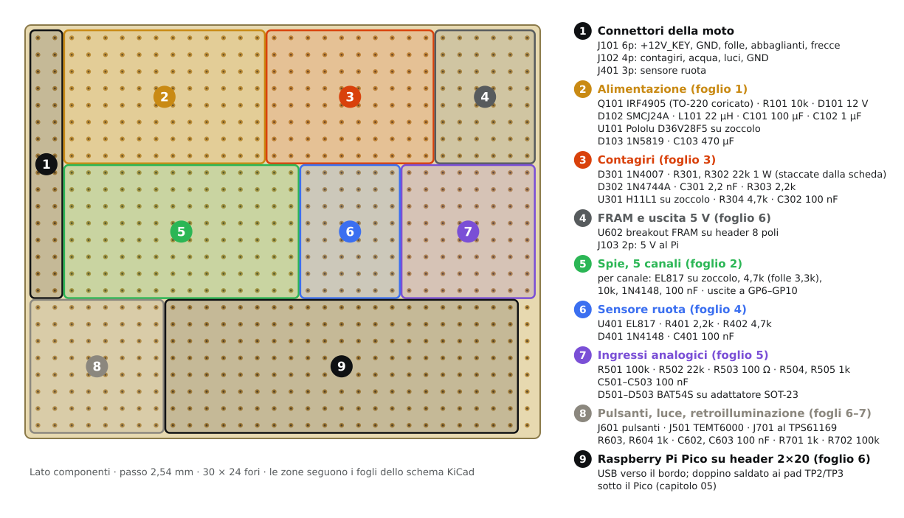
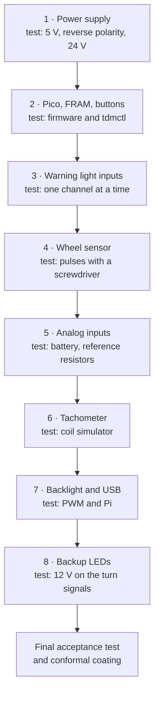

# 06 · Building the electronics

The sensor module is built on a **9 × 7 cm double-sided perfboard** (30 × 24 holes, 2.54 mm pitch), following the [schematic](04-schematics.md). Build it **one section at a time**, and test each section with the multimeter before moving on to the next: a mistake found right away costs five minutes, one found at the end costs an afternoon.

> **Caution:** until the last stage, power the board only from a **bench power supply with current limiting** (13.8 V, 200 mA), never from the bike battery. A short circuit on the bench supply burns nothing.

## Tools and materials

| What | Notes |
|---|---|
| Temperature-controlled soldering iron | 330–350 °C, 2 mm chisel tip |
| 0.7 mm solder with flux | Sn99Cu1 or Sn60Pb40 |
| Multimeter | Voltage, resistance, continuity with buzzer |
| 0–30 V bench power supply with current limiting | Recommended; alternatively a battery with a 500 mA fuse |
| Pliers, wire strippers, desoldering braid | |
| 0.5 mm solid wire (links), 0.25 mm² insulated wire | Different colors for +12 V, +5 V, 3.3 V, ground |
| Turned-pin sockets | DIP-4 (×6), DIP-6 (×1), 2×20 female header for the Pico, 1×5 for the Pololu, 1×8 for the FRAM |
| SOT-23 → 2.54 pitch adapters (×3) | For the BAT54S. Alternatively two BAT85 per channel |

## Layout



The board is divided into zones, one per schematic sheet; the drawing comes from [`hardware/perfboard/layout.py`](../../hardware/perfboard/layout.py). Rules:

- **Star ground:** a wide ground track (doubled 0.5 mm wire) along the bottom edge. Each zone's ground reaches it with its own wire.
- **Tachometer high voltage:** D301, R301 and R302 sit in a corner, away from the other tracks. The 1 W resistors must be mounted **raised 3–4 mm** off the board, with at least 3 mm between the leads of different inputs.
- **Decoupling:** the 100 nF supply capacitors (C302, C601) go as close as possible to the supply pin of their IC.
- **Delicate parts in sockets:** Pico, Pololu, optocouplers and FRAM. They can be removed for testing and replaced without desoldering.

## Assembly order



### 1 · Power supply (zone 2)

Fit Q101, R101, D101, D102, L101, C101, C102, the Pololu socket, D103, C103 and the +12 V and ground pins of J101 and J103. Do **not** insert the Pololu yet.

| Test (13.8 V supply, 200 mA limit) | Expected |
|---|---|
| Current drawn without Pololu | < 5 mA |
| Voltage on `+12V_P` (cathode of D102) | 13.8 V, i.e. the same as the input: the MOSFET is conducting |
| **Reversed** input | Current ≈ 0, `+12V_P` at 0 V |

Insert the Pololu and test again:

| Test | Expected |
|---|---|
| `+5V` (J103.1) | 5.0 V ± 0.1 V |
| `VSYS_PICO` (cathode of D103) | 4.6–4.8 V |
| No-load current | < 15 mA |
| 24 V input | Still 5.0 V: the TVS is not conducting yet |

### 2 · Pico, FRAM and buttons (zones 9, 4, 8)

1. Fit the Pico headers, the I²C pull-up resistors (R601, R602), C601, the FRAM header, R603, R604, C602, C603 and J601.
2. Load the firmware onto the Pico (chapter 09) **before** inserting it.
3. Insert the Pico and the FRAM and connect the Pico to the PC with the USB cable. The bench supply stays on: the Pico takes power from VSYS and from the PC together, through its diodes.

```sh
tdmctl list               # the module must appear (VID:PID 1209:0001)
tdmctl monitor -n 5       # first line "FRAM Blank" (new memory) or "FRAM Ok", then the telemetry
```

The battery reading must be about 13.8 V. The `inputs` column of `tdmctl monitor` shows the digital inputs as a hexadecimal mask; each active input adds its value:

| Input | Value |
|---|---|
| Neutral | `0x0001` |
| High beam | `0x0002` |
| Left turn signal | `0x0004` |
| Right turn signal | `0x0008` |
| Position lights | `0x0010` |
| MODE key | `0x0100` |
| SET key | `0x0200` |

Pressing MODE, the mask must become `0x0100`; with SET, `0x0200`.

### 3 · Warning light inputs (zone 5)

Fit **one channel at a time**: R2x1, R2x2, D2x1, C2x1 and the socket of U2x1. Test each channel before moving on to the next.

| Test | Expected in `tdmctl monitor` |
|---|---|
| 13.8 V on `BIKE_HIGH_BEAM` (then `TURN_L`, `TURN_R`, `ILLUM`) | The input's value appears (`0x0002`, `0x0004`, `0x0008`, `0x0010`) |
| Input disconnected | The value disappears |
| Neutral: `BIKE_NEUTRAL` to ground | `0x0001` |
| Current into an input at 13.8 V | 2.5–3 mA |

### 4 · Wheel sensor (zone 6)

Fit U401, R401, R402, D401, C401 and J401, then connect the LJ12A3 sensor with its DTM connector (chapter 05).

- Bringing a steel screwdriver close to the sensor face lights the sensor's red LED.
- With a sheet-metal disc carrying 6 screws, spun with a drill, the speed shown by `tdmctl monitor` must be steady, without jumps.

### 5 · Analog inputs (zone 7)

Fit R501–R505, C501–C503, the adapters with the BAT54S and J501.

| Test | Expected |
|---|---|
| Supply at 10.0 / 12.0 / 14.5 V | Battery reading within ± 0.1 V (can be corrected in calibration, chapter 10) |
| 27 Ω between `BIKE_COOLANT` and ground | ≈ 100 °C |
| 47 Ω | ≈ 80–82 °C |
| `BIKE_COOLANT` disconnected | Warning "Coolant sender disconnected" |
| Phone torch on the TEMT6000 | Ambient light at maximum |

### 6 · Tachometer (zone 3)

Fit D301, R301, R302 raised, D302, C301, R303, the H11L1 socket, R304 and C302.

To test it you need a **coil simulator**:
- **Parts:** a 12 V relay **without a diode** across its coil and a push button, in series with the bench supply. The side of the relay towards the button goes to `BIKE_TACH`.
- **How it works:** every time the button opens, the relay coil produces a spike of a few hundred volts, like the ignition coil.
- **What to look for:** pressing and releasing the button twice a second, `tdmctl monitor` must show about 120 rpm. With a steady 13.8 V on `BIKE_TACH` the rpm stays at 0.

> **Danger:** the simulator's spike exceeds 100 V. Do not touch the contacts while you press the button.

### 7 · Backlight and USB (zone 8)

Fit R701, R702, J701 and connect the TPS61169 breakout (chapter 05). Without the display, leave the breakout **disconnected from the LEDs**: a constant-current boost converter with no load raises its voltage to the maximum.

- The Pico turns the backlight on only when the Pi is drawing and sends it the brightness, so the PWM is tested in the final acceptance test. Between GP15 and ground, the multimeter on DC volts reads the PWM average: 0 V with the screen off, up to 3.3 V at maximum brightness.
- Solder the USB twisted pair to the Pico's TP2/TP3 pads, as in chapter 05.

### 8 · Backup LEDs

Fit R801–R804, D801–D806 on the panel or on the board.
- **Turn signals:** 13.8 V between `BIKE_TURN_L` and `BIKE_TURN_R` lights the left green LED. Reversing the voltage lights the right one.
- **High beam:** 13.8 V on `BIKE_HIGH_BEAM` lights the blue one.
- **Neutral:** with `BIKE_NEUTRAL` to ground, the neutral green LED lights.

## Final acceptance test on the bench

With everything fitted, display included, and the supply at 13.8 V limited to 1.5 A:

| Test | Expected |
|---|---|
| Start-up | Dashboard on in less than 4 s, warning light test at start-up |
| Steady-state current | 0.5–0.7 A at 13.8 V |
| Sudden power cut after 1 simulated km | At power-on the km have not gone backwards (chapter 09) |
| USB cable unplugged and plugged back in | The dashboard resumes within 1 s; after 2 s without data the screen turns off |
| 1 hour on at 13.8 V | No component above 50 °C to the touch, apart from the Pololu |

## Conformal coating

When all the tests have passed:

1. Clean the flux off the board with isopropyl alcohol.
2. Cover sockets, headers and connectors with masking tape.
3. Apply two thin coats of conformal coating on the solder side and on the component side.
4. Remove the tape when the coating is dry.

The coating protects against the condensation that forms in the enclosure with temperature swings.
