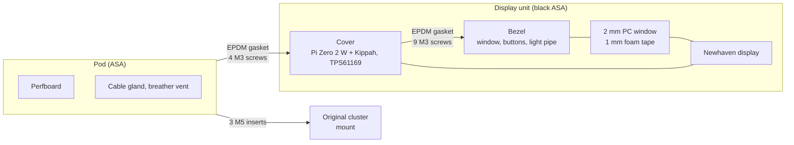

# 07 · Enclosure and bracket

The enclosure and the bracket are designed in [OpenSCAD](https://openscad.org) with parameters, so they can be adapted by changing a few measurements at the top of the files:

| Part | Source | Ready files in [`hardware/exports/cad/`](../../hardware/exports/cad/) |
|---|---|---|
| Bezel with window and button wings | [`enclosure.scad`](../../hardware/enclosure/enclosure.scad), `part="front"` | `enclosure-front.stl` |
| Cover of the display unit | same, `part="cover"` | `enclosure-cover.stl` |
| Rear pod | same, `part="rear"` | `enclosure-rear.stl` |
| Sensor bracket | [`sensor-bracket.scad`](../../hardware/bracket/sensor-bracket.scad) | `sensor-bracket.dxf` (aluminum), `sensor-bracket.stl` (trial) |

The dimensioned drawings are in [`hardware/exports/drawings/`](../../hardware/exports/drawings/), as SVG and as PDF to print at 100 %: the [enclosure](../../hardware/exports/drawings/enclosure.pdf) at 1:2 and the [sensor bracket](../../hardware/exports/drawings/sensor-bracket.pdf) at 1:1. They read their values from the `.scad` files, and the values marked [TO VERIFY] are orange.

To regenerate everything after changing a parameter (you need Docker, or OpenSCAD 2021.01 installed), first the models, then the drawings:

```sh
docker run --rm -u 0 -v "$PWD":/w -w /w openscad/openscad:2021.01 hardware/cad-export.sh
python3 hardware/drawings/generate.py
```

| Assembled | Exploded: bezel, window, display, cover with the Pi, pod with the perfboard |
|---|---|
|  |  |

## The enclosure

A thin display unit with a small pod behind it, like the aftermarket TFT dashboards:
- **Display unit:** 213.8 × 130.8 mm, 14.5 mm thick. It is made of the bezel and a thin cover.
- **Pod:** 109 × 89 mm, 51 mm deep, behind the lower half of the display.
- **Total depth:** 65.6 mm.

The pod depth follows the heights of the boards inside it, which are still [TO VERIFY].




- **Bezel:**
  - **Outline:** as wide as the display plus the two "wings", where the buttons sit (SET on the left, MODE on the right). The bottom corners are chamfered.
  - **Opening:** as large as the active area of the display plus 0.5 mm per side, with a 45° chamfer towards the rider that does not shade the image. Behind it are the window seat, the foam tape and the display, which ends flush with the back of the bezel.
  - **Hollow rim:** the rim around the display is hollow. The nuts of the buttons sit there, and so does the TEMT6000 behind the light pipe. The wires of the buttons and of the sensor run along it to the hole that leads into the pod.
- **Cover:**
  - **Display:** a 2.5 mm plate that closes the display unit and presses the display against the window through adhesive foam pads.
  - **Buttons:** two cups on its back take the button bodies.
  - **Inside the pod:** the slot for the display ribbon cable, the wire hole, the four standoffs of the Pi Zero 2 W (with the Kippah on top) and the TPS61169 breakout.
- **Pod:**
  - **Contents:** the 90 × 70 mm perfboard on four standoffs.
  - **Bottom face:** the PG7 cable gland and the M12 breather vent, close to the cover, above the parts of the perfboard.
  - **Mount:** three lugs with M5 inserts take the bike mount.
- **Light sensor:** a 4 mm hole in the bottom of the bezel, closed by a glued-in clear acrylic rod. The TEMT6000 is glued behind it, inside the rim.
- **Color:** black ASA, like the photo the shape comes from. The display and the Pi go up to 70 °C at most. If the bike stands in the sun for long, the pod can be printed in a light color.

The `.scad` file checks itself before exporting. Every `assert` at the end stops the export if a changed parameter makes two parts collide, for example:
- a button touching the display
- the pod reaching the button cups
- the boards not fitting the pod depth

### Measurements to check before printing

The measurements marked **[TO VERIFY]** in the file come from datasheets or are estimates: they must be checked on the real parts.

| Parameter | Current value | How to check it |
|---|---|---|
| `panel_t` (display thickness) | 6.0 mm | Calipers on the display |
| `aa_dx`, `aa_dy` (center of the active area) | 0, 0 | Measure the black borders on all four sides of the display while it is on |
| `ffc_y`, `ffc_w` (ribbon cable slot) | 46.4 mm below the center, 34 mm | Where the ribbon cable leaves the display; it must reach the Kippah connector |
| `pi_stack` (Pi Zero 2 W with the Kippah) | 15 mm | From the bottom of the Pi to the top of the Kippah |
| `perf_parts` (tallest part on the perfboard) | 20 mm | The Pololu in its socket, the Pico on its headers |
| `perf_w`, `perf_h`, `perf_holes` (perfboard) | 90 × 70 mm, holes 84 × 64 mm | Calipers on the board |
| `button_body` (button behind the face) | 22 mm | Body and terminals of the buttons you bought |
| `mount_points` (mounting to the bike) | 3 lugs | Original cluster mount (chapter 08 and [measurements](../research/bike-measurements.md)) |

## Printing

| Setting | Value |
|---|---|
| Material | **ASA**: it withstands UV and heat. PETG yellows and warps in the sun; PLA is not suitable |
| Nozzle and bed | 250–260 °C, 100–110 °C, enclosed printer (ASA cracks in drafts) |
| Layer | 0.2 mm |
| Perimeters | 4 |
| Solid top and bottom layers | 5 |
| Infill | 30% gyroid |
| Supports | Only for the gland and vent holes of the pod, if the printer cannot bridge 12.5 mm |

Orientation:
- **Bezel:** front face on the bed (better on textured PEI, which gives a matte surface)
- **Cover:** front face on the bed, cups and standoffs upwards
- **Pod:** back on the bed, opening at the top

## Assembling the enclosure

| Pod, open side: standoffs, screw columns, gland and vent | Back: the pod with the three mount lugs |
|---|---|
|  |  |

1. **Heat-set inserts** (with the soldering iron at 220–240 °C, pushing without forcing):
   - **Bezel:** nine M3 inserts in the rim (4 mm holes, 6 mm deep).
   - **Cover:** four M3 inserts in the bosses inside the pod outline.
   - **Pod:** three M5 inserts in the lugs.
2. **Bezel:**
   - **Window:** 2 mm anti-glare polycarbonate or PMMA, cut to 165.4 × 104.4 mm. It rests in the seat and is sealed at the edge with a bead of clear neutral-cure silicone.
   - **Display:** 1 mm foam tape on the edge of the window, outside the active area, then the display with the ribbon cable pointing down.
   - **Buttons:** fit the two 12 mm buttons in the wings and tighten their nuts from behind.
   - **Light sensor:** glue the acrylic rod and the TEMT6000 behind it.
   - **Wires:** solder the button and sensor wires, long enough to reach the pod, and run them along the rim to the wire hole.
3. **Cover:**
   - screw the Pi Zero 2 W with the Kippah to the standoffs (M2.5 × 6 self-tapping screws)
   - fix the TPS61169 breakout next to it with double-sided tape
   - stick 2 mm foam pads where the cover touches the back of the display
   - pass the ribbon cable through the slot and the wires through the hole, then plug the ribbon cable into the Kippah
4. **Closing the display unit:** cut a flat gasket from 1 mm EPDM foam in the shape of the edge, with holes for the screws. Close with nine M3 × 10 screws, tightening crosswise and without forcing.
5. **Pod:**
   - screw the perfboard to its standoffs (M2.5 × 6)
   - fit the cable gland and the breather vent
   - wire the perfboard to the Pi, the backlight and the buttons (chapter 05)
   - close it on the cover with a gasket cut to its edge and four M3 × 30 screws from the back

## The sensor bracket


The LJ12A3 sensor reads the bolt heads of the front disc. The bracket is a flat plate parallel to the disc:
- **Mounting:** one of the bike's bolts.
- **Against rotation:** a second hole, or a tab against the fork leg.
- **Adjustment:** a slot lets you adjust the radius of the sensor. The sensor's two M12 nuts set the distance from the bolts, **1–2 mm**.

| Parameter | Current value | Meaning |
|---|---|---|
| `bolt_d` | 10.5 mm | Hole for the mounting bolt [TO VERIFY] |
| `second_bolt`, `bolt_pitch` | yes, 83 mm | Second hole against rotation [TO VERIFY] |
| `reach`, `angle` | 48 mm, 35° | Sensor position relative to the first hole [TO VERIFY] |
| `slot` | 8 mm | Radial adjustment |
| `t` | 3 mm | Thickness |

**Where to mount it.**
- **Preferred:** a bolt that is **not** part of the braking system, such as the mudguard bolts on the fork leg.
- **On the caliper bolts:**
  - the bracket must be **aluminum** and the bolts longer by the thickness of the bracket, of the same grade
  - torque to the workshop manual value, with medium-strength threadlocker
  - test the brakes while stationary before riding off

> **Danger:** a printed bracket under a brake caliper bolt slowly gives way under load and the bolt loosens. The printed version (`sensor-bracket.stl`) is **only** for checking the measurements.

**Making it in aluminum.**
1. Print the [drawing](../../hardware/exports/drawings/sensor-bracket.pdf) at 100 % (actual size, no "fit to page") and check the 50 mm bar with a ruler. Glue it onto a 3 mm sheet of 5754 or 6082.
2. Center-punch where the center lines cross, drill the holes first, then cut the outline with the hacksaw and file. The `.dxf` file also works for a laser-cutting service.
3. Deburr the edges and paint or anodize.

**Adjustment.**
1. Fit the sensor with one nut on each side.
2. Turn the wheel by hand and bring the sensor over the bolt circle.
3. Set the distance to 1–2 mm with a feeler gauge, then tighten the nuts.
4. Push the bike at walking pace with `tdmctl monitor` running: the speed must be steady. If a bolt is not read, the speed fluctuates at every wheel turn. Also try with the handlebar at full lock right and full lock left.
