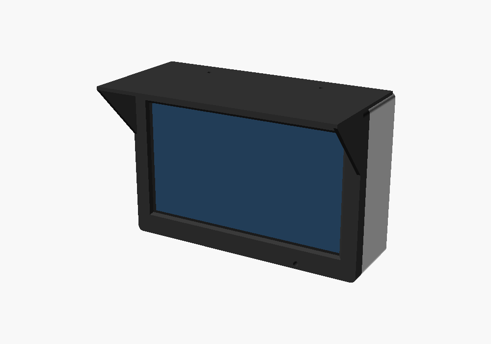
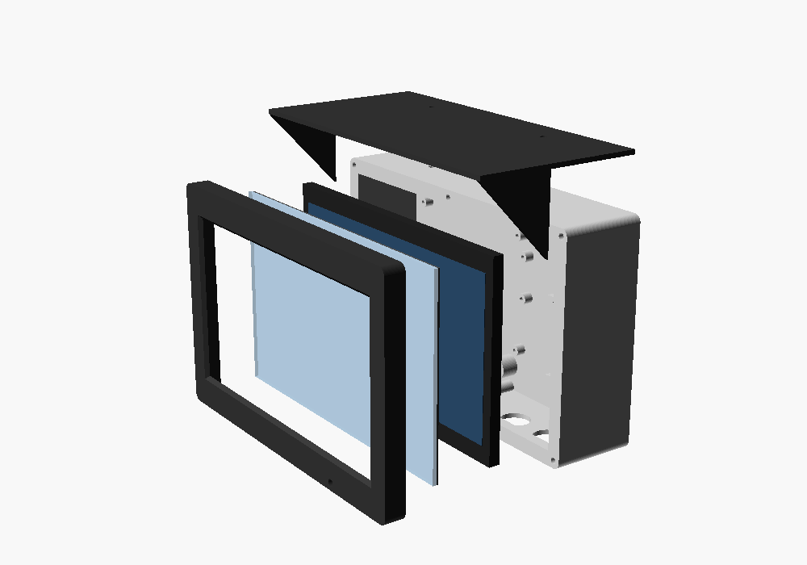
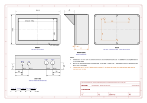
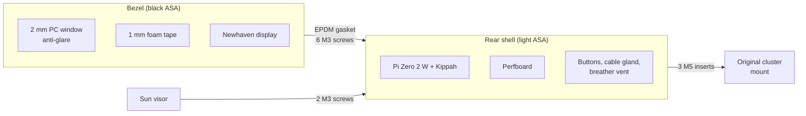
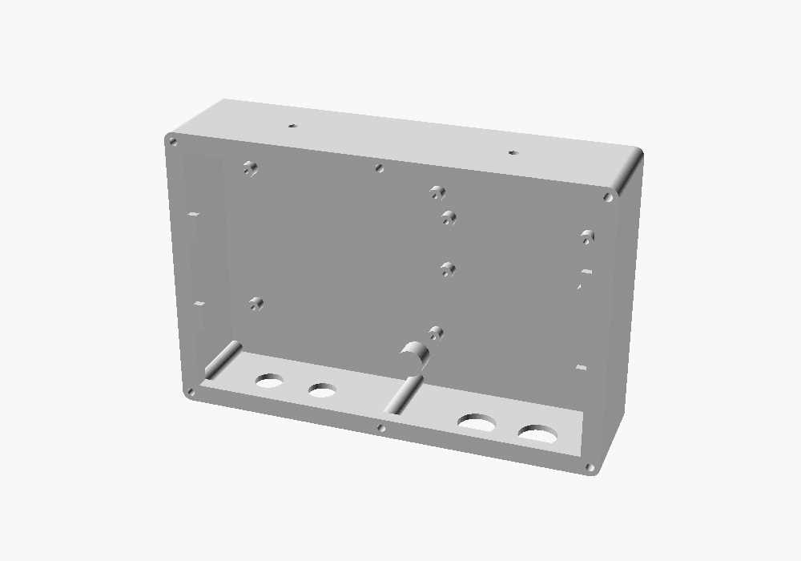
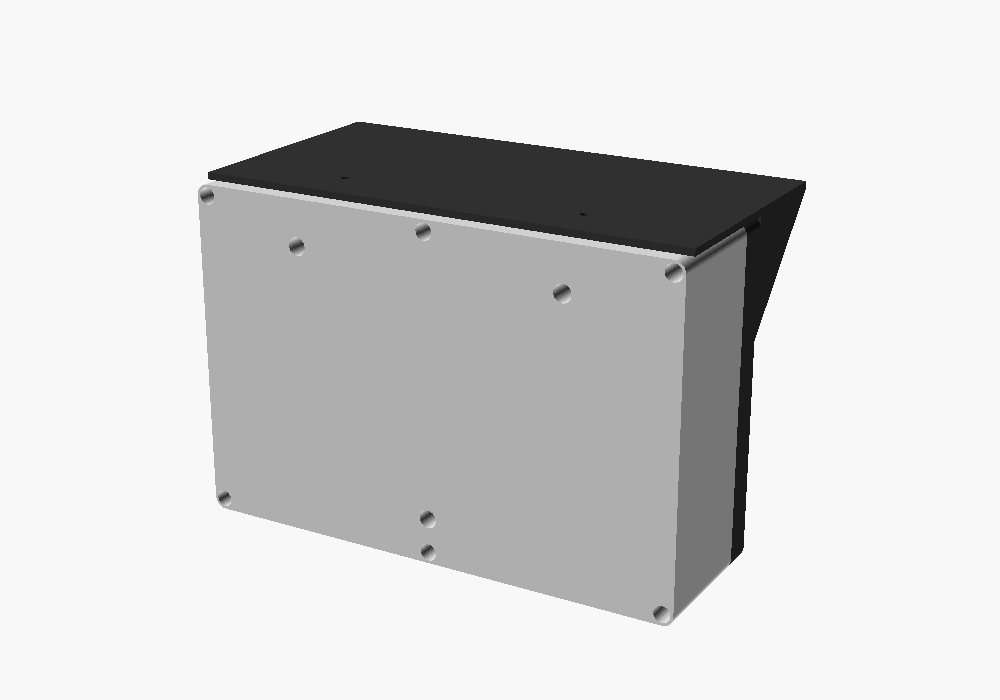
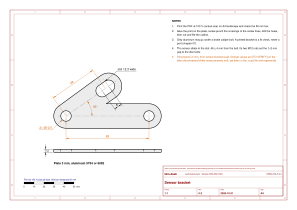

# 07 · Enclosure and bracket

The enclosure and the bracket are designed in [OpenSCAD](https://openscad.org) with parameters, so they can be adapted by changing a few measurements at the top of the files:

| Part | Source | Ready files in [`hardware/exports/cad/`](../../hardware/exports/cad/) |
|---|---|---|
| Front bezel with window | [`enclosure.scad`](../../hardware/enclosure/enclosure.scad), `part="front"` | `enclosure-front.stl` |
| Rear shell | same, `part="rear"` | `enclosure-rear.stl` |
| Sun visor | same, `part="visor"` | `enclosure-visor.stl` |
| Sensor bracket | [`sensor-bracket.scad`](../../hardware/bracket/sensor-bracket.scad) | `sensor-bracket.dxf` (aluminum), `sensor-bracket.stl` (trial) |

The dimensioned drawings are in [`hardware/exports/drawings/`](../../hardware/exports/drawings/), as SVG and as PDF to print at 100 %: the [enclosure](../../hardware/exports/drawings/enclosure.pdf) at 1:2 and the [sensor bracket](../../hardware/exports/drawings/sensor-bracket.pdf) at 1:1. They read their values from the `.scad` files, and the values marked [TO VERIFY] are orange.

To regenerate everything after changing a parameter (you need Docker, or OpenSCAD 2021.01 installed), first the models, then the drawings:

```sh
docker run --rm -u 0 -v "$PWD":/w -w /w openscad/openscad:2021.01 hardware/cad-export.sh
python3 hardware/drawings/generate.py
```

| Assembled | Exploded: bezel, window, display, rear shell and sun visor |
|---|---|
|  |  |

## The enclosure

Outside dimensions: **181.8 × 120.8 mm**, depth 57 mm plus the sun visor.





- **Bezel:** the opening is as large as the active area of the display plus 0.5 mm per side, with a 45° chamfer towards the rider that does not shade the image. Behind it is the window seat, then the foam tape and the display, which ends flush with the edge.
- **Rear shell:**
  - **Display:** four small tabs press it against the window.
  - **Boards:** standoffs for the Pi Zero 2 W (holes 58 × 23 mm) and for the 90 × 70 mm perfboard.
  - **Screws:** six bosses for the M3 screws that go into the bezel inserts.
  - **Bottom face:** PG7 cable gland, M12 breather vent and the two 16 mm buttons.
- **Sun visor:** a flat roof screwed on top of the rear shell, protruding 40 mm, with side cheeks. It shields from low sun and rain.
- **Light sensor:** a 4 mm hole in the bottom edge of the bezel, closed by a glued-in clear acrylic rod. Behind it is the TEMT6000, glued to the rear shell.
- **Color:** the rear shell is light-colored because it heats up less in the sun. The display and the Pi go up to 70 °C at most.

### Measurements to check before printing

The measurements marked **[TO VERIFY]** in the file come from datasheets or are estimates: they must be checked on the real parts.

| Parameter | Current value | How to check it |
|---|---|---|
| `panel_t` (display thickness) | 6.0 mm | Calipers on the display |
| `aa_dx`, `aa_dy` (center of the active area) | 0, 0 | Measure the black borders on all four sides of the display while it is on |
| Ribbon cable position | at the bottom | Look at the display: the tabs of the rear shell must not press on the ribbon cable |
| `perf_holes` (perfboard holes) | 84 × 64 mm | Calipers on the board |
| `mount_points` (mounting to the bike) | 3 points | Original cluster mount (chapter 08 and [measurements](../research/bike-measurements.md)) |
| `button_d` (button hole) | 16.2 mm | Thread diameter of the buttons you bought |

## Printing

| Setting | Value |
|---|---|
| Material | **ASA**: it withstands UV and heat. PETG yellows and warps in the sun; PLA is not suitable |
| Nozzle and bed | 250–260 °C, 100–110 °C, enclosed printer (ASA cracks in drafts) |
| Layer | 0.2 mm |
| Perimeters | 4 |
| Solid top and bottom layers | 5 |
| Infill | 30% gyroid |
| Supports | Only for the side holes of the rear shell, if the printer cannot bridge 16 mm |

Orientation:
- **Bezel:** front face on the bed (better on textured PEI, which gives a matte surface)
- **Rear shell:** bottom on the bed, opening at the top
- **Sun visor:** top face on the bed

## Assembling the enclosure

| Rear shell, open side: standoffs and screw columns | Back: the three M5 inserts for the bike mount |
|---|---|
|  |  |

1. **Heat-set inserts:**
   - **Bezel:** six M3 inserts (4 mm holes, 6 mm deep).
   - **Rear shell:** two M3 inserts on the top face for the sun visor and three M5 inserts on the back for mounting.
   - **How:** with the soldering iron at 220–240 °C, pushing without forcing.
2. **Window:** 2 mm anti-glare polycarbonate or PMMA, cut to 165.4 × 104.4 mm. It rests in the bezel seat and is sealed at the edge with a bead of clear neutral-cure silicone.
3. **Display:** 1 mm foam tape on the edge of the window, outside the active area, then the display with the ribbon cable pointing down.
4. **Rear shell:**
   - screw the Pi Zero 2 W with the Kippah and the perfboard to the standoffs (M2.5 × 6 self-tapping screws)
   - fit the buttons, cable gland and breather vent
   - glue the TEMT6000 behind the light hole
5. **Closing:**
   - cut a flat gasket from 1 mm EPDM foam in the shape of the edge, with holes for the screws
   - close with six M3 × 16 socket cap screws, tightening crosswise and without forcing
6. **Sun visor:** two M3 × 8 screws.

## The sensor bracket



The LJ12A3 sensor reads the bolt heads of the front disc. The bracket is a flat plate parallel to the disc:
- **Mounting:** one of the bike's bolts.
- **Against rotation:** a second hole, or a tab against the fork leg.
- **Adjustment:** a slot lets you adjust the radius of the sensor. The sensor's two M12 nuts set the distance from the bolts, **1–2 mm**.

| Parameter | Current value | Meaning |
|---|---|---|
| `bolt_d` | 10.5 mm | Hole for the mounting bolt [TO VERIFY] |
| `second_bolt`, `bolt_pitch` | yes, 83 mm | Second hole against rotation [TO VERIFY] |
| `reach`, `angle` | 48 mm, 35° | Sensor position relative to the first hole [TO VERIFY] |
| `slot` | 8 mm | Radial adjustment |
| `t` | 3 mm | Thickness |

**Where to mount it.**
- **Preferred:** a bolt that is **not** part of the braking system, such as the mudguard bolts on the fork leg.
- **On the caliper bolts:**
  - the bracket must be **aluminum** and the bolts longer by the thickness of the bracket, of the same grade
  - torque to the workshop manual value, with medium-strength threadlocker
  - test the brakes while stationary before riding off

> **Danger:** a printed bracket under a brake caliper bolt slowly gives way under load and the bolt loosens. The printed version (`sensor-bracket.stl`) is **only** for checking the measurements.

**Making it in aluminum.**
1. Print the [drawing](../../hardware/exports/drawings/sensor-bracket.pdf) at 100 % (actual size, no "fit to page") and check the 50 mm bar with a ruler. Glue it onto a 3 mm sheet of 5754 or 6082.
2. Center-punch where the center lines cross, drill the holes first, then cut the outline with the hacksaw and file. The `.dxf` file also works for a laser-cutting service.
3. Deburr the edges and paint or anodize.

**Adjustment.**
1. Fit the sensor with one nut on each side.
2. Turn the wheel by hand and bring the sensor over the bolt circle.
3. Set the distance to 1–2 mm with a feeler gauge, then tighten the nuts.
4. Push the bike at walking pace with `tdmctl monitor` running: the speed must be steady. If a bolt is not read, the speed fluctuates at every wheel turn. Also try with the handlebar at full lock right and full lock left.
