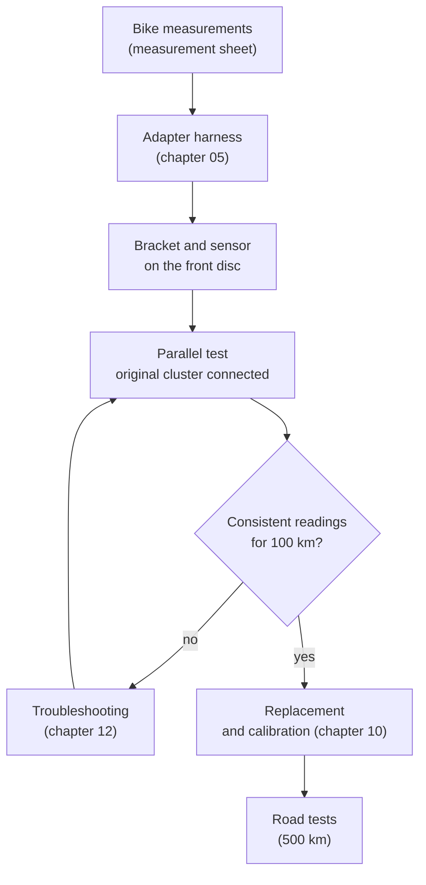

# 08 · Installation on the bike

Installation is done in two stages:
1. **In parallel:** the new dashboard is connected together with the original one, which stays in place. The readings are compared for a few days.
2. **Replacement:** only after the comparison is the original cluster removed, and kept.

The bike's wiring is **never cut**: all connections go through the adapter harness of [chapter 05](05-wiring-harnesses.md).

> **Danger:** before working on the wiring, disconnect the battery **negative**. Work with the engine cold: exhaust headers and coil get very hot.

> **Caution:** the colors and pinouts of the bike's wires are still [TO VERIFY]. The [measurement sheet](../research/bike-measurements.md) must be filled in **before** building the adapter.



## 1 · Preparation

1. **Photo of the original odometer:** with the cluster on, together with the number plate or the frame number. It is used to set the initial km and as proof of the mileage (chapter 00).
2. **Removing the instruments:**
   - remove the fairing and the two nuts under the cluster, following the workshop manual. Keep the two rubber grommets, their collars, washers and nuts: the new dashboard uses them
   - disconnect the connectors of the original cluster, photographing them before you disconnect them
3. **Speedometer cable:**
   - unhook it from the drive on the front hub. The drive **stays in place**: it acts as a spacer between hub and fork and must not be removed
   - close the drive outlet with a rubber cap against water and dirt

## 2 · Adapter harness and sensor

1. **Adapter:** connect the adapter harness to the original cluster connectors. At this stage use a **Y harness**, with the original connectors going both to the original cluster and to the adapter.
2. **Fuse:** check that the 2 A fuse is on the red wire, close to the bike's connector.
3. **Bracket and sensor:** fit the bracket and the sensor as in [chapter 07](07-enclosure-and-bracket.md).
4. **Sensor cable:**
   - run it up along the brake hose, securing it with cable ties every 10–15 cm
   - the DTM connector stays under the fork yoke
   - turn the handlebar from lock to lock and compress the fork: the cable must not pull or get pinched
5. **Cable routing:** away from exhaust headers, coil and steering lock, and tied to the original harness.

## 3 · The enclosure

The dashboard goes where the original cluster was, on the fairing stay, which is bolted to the frame: it does not turn with the handlebar ([chapter 07](07-enclosure-and-bracket.md#the-bike-mount)).

1. **Fit check:** before printing and cutting, try the cardboard [fit template](../../hardware/exports/drawings/fit-template.pdf) on two M6 rods in the grommets, as in the [measurements](../research/bike-measurements.md#8-mechanical-measurements-for-the-mount). Set the values you read in `enclosure.scad` and cut the mount plate.
2. **Mounting:**
   - put the two M6 screws in the mount plate, heads on the pod side, then screw the plate to the pod lugs with three M5 × 10 button head screws and medium-strength threadlocker
   - fit an original grommet in each hole of the fairing stay, with its collar inside
   - put the M6 screws through the grommets, then the washer and the nut. Tighten until the collar is clamped, about 7 Nm ([HYPOTHESIS]: the value of the 1996 manual, whose cluster uses the same parts)
3. **Clearance:**
   - turn the handlebar from lock to lock: nothing may touch the dashboard, the ignition key included
   - the window must be tilted so that it does not reflect the sky into your eyes
3. **Cables:** they enter through the cable gland and make a downward loop, so water running along the cable drips off instead of getting in.

## 4 · First power-on

Reconnect the battery and, with the engine off:

| Test | Expected |
|---|---|
| Ignition key ON | The dashboard turns on in less than 4 s with the warning light test; the original cluster works as before |
| Left and right turn signals | Dashboard indicator and backup LED flash on the correct side |
| High beam | Blue indicator |
| Neutral (gearbox in neutral) | Green indicator; it goes off when a gear is engaged |
| Position lights | The dashboard switches to the night theme if the ambient light is low |
| Voltage | Same as the multimeter on the battery, ± 0.2 V |
| Ignition key OFF | The screen turns off at once; on power-on again, the km are the same as before |

Set the initial km, once only, to those in the photo:

```sh
tdmctl init-odo 41250      # km of the original odometer
```

The Pico accepts the command only if the FRAM does not hold a value yet: the km cannot be "turned back" later.

## 5 · Parallel test

With the engine running:

| Test | Expected |
|---|---|
| Idle | The rpm of the new dashboard and of the original tachometer agree within 3%. If they are double or half, change `pulses_per_rev` in the profile |
| 3000 rpm | Battery voltage 13.8–14.6 V |
| Engine warming up | The temperature rises together with the original needle |

Then, on the road, for at least 100 km:

1. Compare the speed with a GPS navigator (or the phone) at 50, 90 and 130 km/h. The new dashboard must read **the same or slightly more**, never less: fine calibration is in chapter 10.
2. Record a ride, which will be used for calibration and troubleshooting:

   ```sh
   tdmctl record ride.bin    # from the development image, or with a laptop connected to the Pico
   ```

## 6 · Replacement

1. **Original cluster:** remove it and keep it in an antistatic bag together with the photo of the odometer.
2. **Y harness:** replace it with the adapter's direct connector.
3. **Measurements:** copy everything you have measured (colors, pins, pulses per revolution) into the [measurement sheet](../research/bike-measurements.md). Then update the [TO VERIFY] markers in [`original-wiring.md`](../research/original-wiring.md) and chapters 04 and 05.

Before normal use you need the [calibration](10-calibration.md) and 500 km without faults: rain, night, tunnels, polarized sunglasses, heat.
