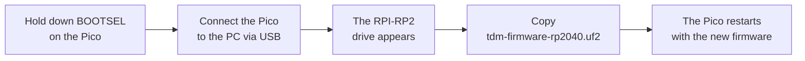
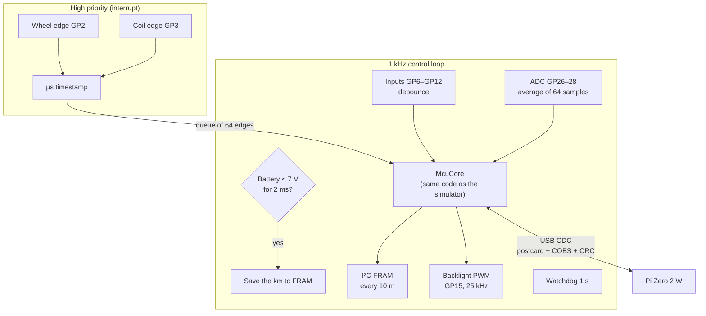
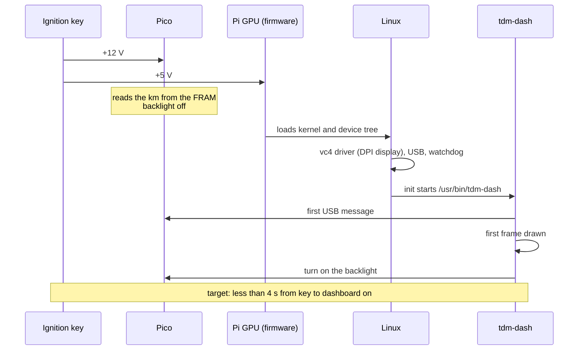

# 09 · Software: firmware, image and profile

The tdm-dash software is made of three parts, each of which can be updated on its own:

| Part | Where it runs | File | How to update it |
|---|---|---|---|
| Sensor module firmware | Raspberry Pi Pico | `tdm-firmware-rp2040.uf2` (or `-rp2350.uf2` for the Pico 2) | By copying it to the Pico's USB drive (below) |
| Operating system and dashboard | Raspberry Pi Zero 2 W | `tdm-dash-release-sdcard.img.xz` | By rewriting the microSD card (section "System image") |
| Bike profile | SD card, `boot` partition | `tdm-dash.toml` | By editing it from any PC |

The ready-made files are in the repository **releases** on GitHub. The latest development builds are in the CI *artifacts* ("Actions" tab).

## Pico firmware

### Loading it the first time



1. Hold down the **BOOTSEL** button on the Pico and connect it to the PC with a micro-USB cable.
2. Release the button: a drive called **RPI-RP2** (or **RP2350** for the Pico 2) appears.
3. Copy the file `tdm-firmware-rp2040.uf2` (Pico) or `tdm-firmware-rp2350.uf2` (Pico 2) to the drive.
4. The drive disappears and the Pico restarts with the firmware. The Pico's LED is not used.

### Updating it when it is already installed

The Pico is soldered inside the enclosure and the button cannot be reached. From the Pi's development image, or from a PC connected to its USB:

```sh
tdmctl bootsel        # the Pico restarts into the USB bootloader
# copy the .uf2 file to the RPI-RP2 drive that appears
```

The km, the trips and the settings are in the FRAM, not in the Pico's memory: a firmware update does not touch them.

### Checking that it works

With the Pico connected to a Linux PC:

```sh
tdmctl list           # must list /dev/ttyACM0 (or similar)
tdmctl monitor -n 10  # 10 seconds of telemetry: speed, rpm, voltages, inputs
```

On Linux, if `ModemManager` is running, it can "grab" the port for a few seconds after connection. To avoid this, create the file `/etc/udev/rules.d/99-tdm-dash.rules`:

```
ATTRS{idVendor}=="1209", ATTRS{idProduct}=="0001", ENV{ID_MM_DEVICE_IGNORE}="1", MODE="0666"
```

### Building it from source

```sh
cd firmware
cargo build --release                                     # Pico (RP2040)
cargo build --release --target thumbv8m.main-none-eabihf \
    --no-default-features --features rp2350               # Pico 2 (RP2350)
python3 ../tools/elf2uf2.py target/thumbv6m-none-eabi/release/tdm-firmware tdm-firmware-rp2040.uf2
```

With a **Raspberry Pi Debug Probe** connected to the Pico's SWD pins, `cargo run --release` loads the firmware and shows the log messages (defmt), without touching BOOTSEL.

### What the firmware does



| Function | Pico pin | Notes |
|---|---|---|
| Wheel sensor | GP2 | Optocoupler output, active low |
| Tachometer | GP3 | H11L1 output, active low |
| FRAM SDA / SCL | GP4 / GP5 | I²C at 1 MHz, address 0x50 |
| Neutral, high beam, left turn signal, right turn signal, lights | GP6 – GP10 | Optocouplers, active low, internal pull-up |
| MODE, SET keys | GP11, GP12 | To ground, internal pull-up |
| Backlight | GP15 | 25 kHz PWM to the TPS61169 |
| Battery, coolant sender, light | GP26, GP27, GP28 | 12-bit ADC, 3.3 V reference |

Important behaviors:
- **Silent until the Pi speaks.** After every USB connection the Pico sends nothing until it receives a valid message. This way an echo on the port cannot be mistaken for a command.
- **Fail-dark.** If the Pi stops sending the heartbeat for 2 s, the Pico turns off the backlight.
- **Odometer.** It is saved every 10 m and on power fail, in two alternating copies with CRC. A corrupted FRAM is never overwritten.
- **Configuration saved in the FRAM.** Wheel circumference and pulses per revolution stay saved, so the km are counted correctly even before Linux has finished booting.

## System image

The Pi Zero 2 W runs a minimal Linux built with [Buildroot](https://buildroot.org) 2026.08. There is no distribution: there is the kernel, BusyBox and the dashboard program. There are two images:

| Image | File | What for | Root filesystem |
|---|---|---|---|
| **Release** | `tdm-dash-release-sdcard.img.xz` | On the bike | Read-only EROFS: removing the ignition key at any moment does no harm |
| **Development** | `tdm-dash-dev-sdcard.img.xz` | On the bench | Writable ext4, Wi-Fi, SSH access. **Not** for the road |

### Writing the SD card

1. Download the image from the repository releases (or from the artifacts of the "OS image" workflow).
2. Write it with [Raspberry Pi Imager](https://www.raspberrypi.com/software/) ("Use custom") or with [balenaEtcher](https://etcher.balena.io): both accept the `.img.xz` file directly. From Linux:

   ```sh
   xz -dc tdm-dash-release-sdcard.img.xz | sudo dd of=/dev/sdX bs=4M conv=fsync status=progress
   ```

   > **Caution:** with `dd`, a wrong disk name (`/dev/sdX`) erases another disk. Check with `lsblk` first.

3. Put the card back into the PC: the **TDMBOOT** partition appears. It contains the profile `tdm-dash.toml` (section "Bike profile" below) and `config.txt`.

### What happens at boot



- **No udev and no init scripts:** BusyBox `init` mounts the virtual filesystems and the boot partition (read-only), then starts the dashboard. If the program exits it is restarted at once.
- **Watchdog:** the program "feeds" the Pi's watchdog; if it hangs for more than 10 s the Pi reboots. Meanwhile, the Pico turns off the screen after 2 s without a heartbeat (fail-dark).
- **Display:** the kernel shows neither logo nor text, so the screen stays black until the dashboard draws the first frame.

### The display in `config.txt`

The Newhaven panel is connected over DPI through the Kippah and configured in `config.txt` on the boot partition:

```
dtoverlay=vc4-kms-v3d,nohdmi,noaudio
dtoverlay=vc4-kms-dpi-generic,clock-frequency=25000000,hactive=800,hfp=8,hsync=4,hbp=8,vactive=480,vfp=16,vsync=4,vbp=16,width-mm=154,height-mm=86
```

The timings come from the datasheet. The sync and clock polarities are the overlay defaults, intended for the Kippah, and are **[TO VERIFY]** on the bench:
- if the image "flickers" or the colors are wrong, add `,pixclk-invert` to the second line
- if the image is shifted, try `hsync-invert,vsync-invert`

### Development image

1. Rename `wpa_supplicant.conf.example` to `wpa_supplicant.conf` on the TDMBOOT partition and write your network name and password in it.
2. Start the Pi and connect with `ssh root@<address>`, using the IP address assigned by the router (it is the new device on its connected-devices page, sometimes without a name). The password is `tdmdash`: change it with `passwd`.
3. To try a new version of the program, build it on the PC (`cargo build --release --target aarch64-unknown-linux-gnu -p tdm-dash --no-default-features --features kms`) and copy it with `scp` to `/usr/bin/`, then `killall tdm-dash`: `init` restarts it.

### Building the image

You need a Linux PC (or WSL2) with about 15 GB free and an hour of time the first time:

```sh
git submodule update --init --depth 1 os/buildroot
make -C os release        # or: make -C os dev
# result: os/output/release/images/sdcard.img
```

The details (structure, customizations, licenses) are in [`os/README.md`](../../os/README.md).

## Bike profile

The profile is a [TOML](https://toml.io) text file with all the data that depend on the bike. The dashboard looks, in order, for:

1. `/boot/tdm-dash.toml`: on the `boot` partition of the SD card, which is visible from Windows, macOS and Linux
2. `/etc/tdm-dash/default.toml`: the profile included in the image
3. the profile built into the program

If the file on the SD card has an error, the dashboard uses the built-in profile and shows the warning "Profile error: using the built-in profile". The line with the error appears on the Diagnostics screen.

The TDM 850 profile is [`profiles/yamaha-tdm850-3vd.toml`](../../profiles/yamaha-tdm850-3vd.toml); the example for other bikes is [`profiles/generic-example.toml`](../../profiles/generic-example.toml). The most important keys:

| Section | Key | Meaning |
|---|---|---|
| `[speed]` | `pulses_per_rev` | Bolts (or magnets) read by the sensor per wheel revolution |
| | `wheel_circumference_mm` | Rolling circumference, calibrated with GPS (chapter 10) |
| | `display_gain`, `display_offset_kmh` | Legal margin: the dashboard must never read less than the true speed. The program refuses values below 1 and 0 |
| `[tach]` | `pulses_per_rev` | Coil pulses per engine revolution (1 on the TDM, 0.5 on a single-cylinder) |
| | `redline_rpm`, `shift_rpm` | Start of the red zone and shift light |
| `[coolant]` | `curve` | [ohm, °C] pairs of the sender, measured in a water bath |
| | `warn_c`, `critical_c` | Warning thresholds |
| `[battery]` | thresholds | Battery low, not charging, overvoltage |
| `[inputs]` | channels | Which Pico input corresponds to which indicator; `invert = true` inverts the logic |
| `[display]` | `layout`, `theme` | Default layout and theme |
| | `language` | Language of the dashboard texts: `"en"` (default) or `"it"`. The TDM 850 profile ships with `"it"` |
| `[fuel]` | `tank_l`, `l_per_100km` | For the range estimate |

To try a profile on the PC before copying it to the SD card:

```sh
cargo run -p tdm-dash -- --profile my-profile.toml
```
