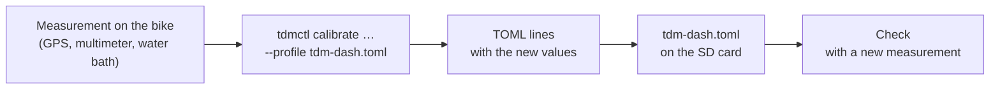

# 10 · Calibration

The dashboard ships with the values of the TDM 850 profile: estimated wheel circumference, 1 pulse per revolution, coolant curve from the workshop manual. They are good starting points, but every bike is different: tire, wear, component tolerances. Calibration corrects the values with measurements taken on your bike.

All corrections end up in the **profile** `tdm-dash.toml` on the boot partition of the SD card (chapter 09). The `tdmctl calibrate` command does the calculations and prints the lines to paste:



`tdmctl` runs on the PC (Linux, macOS, Windows with WSL) or on the Pi's development image. Always pass the profile in use with `--profile`, so the calculation starts from the current values:

```sh
tdmctl calibrate wheel 25.41 25.12 --profile /media/TDMBOOT/tdm-dash.toml
```

To edit the profile:
1. Switch off the bike and remove the SD card.
2. Open it on the PC and edit `tdm-dash.toml` with any text editor.
3. Put the card back into the Pi.

If the file has an error, the dashboard reports it ("Profile error: using the built-in profile") and uses the built-in values: no risk of being left without instruments.

## Speed and odometer

The speed is calculated from the time between the disc bolts and from the wheel's **rolling circumference**. The estimated circumference (1975 mm for a 110/80-18) can be off by 2–3%: it depends on the brand, pressure and wear of the tire.

**Measurement.**
1. Correct tire pressure, tire not brand new (after the first 300 km).
2. Reset trip B (on the TRIP screen: short SET to select it, long SET to reset it; chapter 11) and start recording a route on a GPS app on the phone.
3. Ride **at least 10 km**, better 20–30, on roads without too many tight bends: GPS underestimates in bends and at stops.
4. At the end read the km from the GPS and from trip B.

```sh
tdmctl calibrate wheel KM_GPS KM_TRIP --profile tdm-dash.toml
```

Example: 25.41 km on the GPS and 25.12 km on the trip.

```
circumference: 1975.0 → 1997.8 mm (+1.15 %)

[speed]
wheel_circumference_mm = 1997.8
```

Replace the value of `wheel_circumference_mm` in the `[speed]` section of the profile. The command refuses corrections beyond ±10%: such a large difference means that `pulses_per_rev` (the number of bolts) is wrong, or that the sensor is missing pulses (chapter 12).

**Legal margin.** The **displayed** speed is the calculated one, multiplied by `display_gain` (1.03) plus `display_offset_kmh` (1 km/h): the dashboard always reads a little more than the true speed, as the UNECE R39 regulation requires. Do **not** lower these values below 1 and 0; indeed the program refuses them. The odometer and the trips, on the other hand, use the true distance, without margin.

**Check.** Ride the same route again: the difference between GPS and trip must be below 1%. Then check at constant speed (50, 90, 130 km/h with the GPS cruise display): the dashboard must read 2–5 km/h more than the GPS, never less.

## Tachometer

The tachometer counts the coil pulses. The TDM 850 has a coil that fires at every crankshaft revolution, so `pulses_per_rev = 1` [TO VERIFY]. If the rpm shown is double or half the true rpm, the value is wrong.

**Measurement.** You need a reference:
- the original tachometer, during the parallel test (chapter 08)
- or a workshop tachometer (inductive clamp or optical)

Bring the warm engine to a steady speed, for example idle or 3000 rpm, and read both:

```sh
tdmctl calibrate tach TRUE_RPM SHOWN_RPM --profile tdm-dash.toml
```

```
pulses per revolution: 1 → 0.997, rounded to 1

[tach]
pulses_per_rev = 1
```

The value is rounded to the nearest half, because an ignition always gives 0.5, 1, 2… pulses per revolution. If the command warns that the exact value is far from the rounded one, the measurement was not taken at a steady speed or the tachometer circuit is miscounting (chapter 12).

## Coolant temperature

The profile contains the resistance → temperature curve of the original sender, but only two points come from the manual (≈ 50 Ω at 80 °C, ≈ 27 Ω at 100 °C). The others are estimated. For an accurate reading, the curve is measured **in a water bath**.

**What you need:**
- a sender identical to the bike's one (a spare, so you do not have to drain the system) or the one removed from the bike
- a small pan of water, a stove, a kitchen thermometer up to 100 °C
- the multimeter on ohms

**Measurement.**
1. Connect the multimeter between the sender terminal and its metal body, which acts as ground.
2. Immerse the sender (only the metal part) and the thermometer, close together.
3. Heat slowly. At 20, 40, 60, 80, 90 and 100 °C stir, wait for the resistance to settle and note °C and ohms.
4. Write the measurements in a text file, one pair per line:

   ```
   # coolant sender, water bath 12/05
   20  1050
   40  452
   60  198.5
   80  50.2
   90  37
   100 27.4
   ```

5. Calculate the curve:

   ```sh
   tdmctl calibrate coolant measurements.txt
   ```

   ```
   6 points

   [coolant]
   curve = [[1050.0, 20], [452.0, 40], [198.5, 60], [50.2, 80], [37.0, 90], [27.4, 100]]
   ```

Replace the `curve = …` line in the `[coolant]` section. The dashboard interpolates between the points on the logarithm of the resistance, which follows the behavior of an NTC well.

> **Danger:** water at 100 °C. Use pliers to hold the sender and do not cover the pan.

**Check on the bike.** With the engine warm, when the fan cuts in, the temperature shown must be close to the fan switch-on temperature [TO VERIFY in the workshop manual].

## Battery voltage

The 100k/22k divider has 1% resistors: the voltage can be off by 0.1–0.2 V.

**Measurement.** With the engine off and the lights on, so that the voltage stays steady:
1. Measure with the multimeter on the battery terminals.
2. At the same moment, read the voltage on the Diagnostics screen, or with `tdmctl monitor`.

```sh
tdmctl calibrate battery V_METER V_SHOWN --profile tdm-dash.toml
```

```
divider: 5.5455 → 5.5965 (+0.92 %)

[board]
vbat_divider = 5.5965
```

Add or replace the `[board]` section of the profile. The odometer save threshold (7 V in the firmware) does not change: it has a wide margin.

## Ambient light and brightness

The light sensor decides the switch between the Day and Night themes and the backlight brightness. The thresholds are in the `[display]` section:

| Key | Meaning | Initial value |
|---|---|---|
| `light_raw_dark` | Sensor reading considered "dark" (night, tunnel) | 300 |
| `light_raw_bright` | Reading considered "full sun" | 3500 |
| `night_below`, `day_above` | Theme thresholds, as a fraction between dark and sun: below, it switches to Night; above, it goes back to Day | 0.25 and 0.40 |
| `brightness_min_pct` | Minimum brightness at night | see profile |

**Measurement.** With the Diagnostics screen (or `tdmctl monitor`, column `light`):
- read the value at night on a lit street (`light_raw_dark`)
- read the value in full sun with the dashboard installed (`light_raw_bright`)

If the screen dazzles at night, raise `light_raw_dark` or lower `brightness_min_pct`. If the theme changes too late in tunnels, raise `night_below`.

## Summary

| What | Command | Profile section | When to redo it |
|---|---|---|---|
| Wheel circumference | `tdmctl calibrate wheel` | `[speed] wheel_circumference_mm` | New tire, different brand or size |
| Wheel pulses per revolution | (by hand: number of bolts) | `[speed] pulses_per_rev` | Different disc |
| Tachometer | `tdmctl calibrate tach` | `[tach] pulses_per_rev` | Once |
| Coolant curve | `tdmctl calibrate coolant` | `[coolant] curve` | Sender replaced |
| Battery | `tdmctl calibrate battery` | `[board] vbat_divider` | Board rebuilt |
| Light | (by hand) | `[display]` | If the theme changes at the wrong moment |

After every change, keep a copy of the profile on the PC: it is all you need to make an identical SD card.
