# 11 · Usage

How to read the dashboard, how to use the MODE and SET keys and what the warnings mean. The images are captured from the real software (`tdm-dash --screenshot`), at the resolution of the reference display (800×480). The screens of elongated bar displays and other sizes are in [`design/screenshots/`](../../design/screenshots/) ([chapter 09](09-software.md#other-displays)). The dashboard texts are in English or Italian depending on `language` in the profile (chapter 09).

## Power-on

When you turn the ignition key:

1. The **Pico** starts in a few milliseconds and immediately begins counting pulses and km.
2. The **Pi** boots Linux with the screen off (target: less than 4 s).
3. The **splash** appears, then the **self-test**: needles to full scale and back, all warning lights on for an instant. If a warning light does not come on during the self-test, there is a problem to check.
4. The dashboard switches to the riding screen.

If you ride off before the self-test has finished, the dashboard skips it and shows the speed at once.

| Splash | Self-test |
|---|---|
| 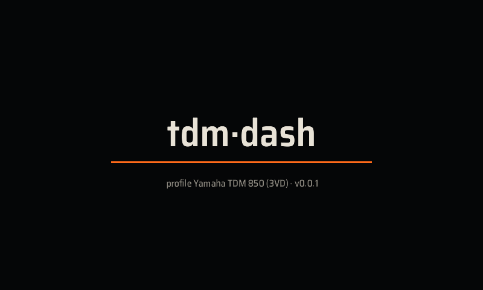 | 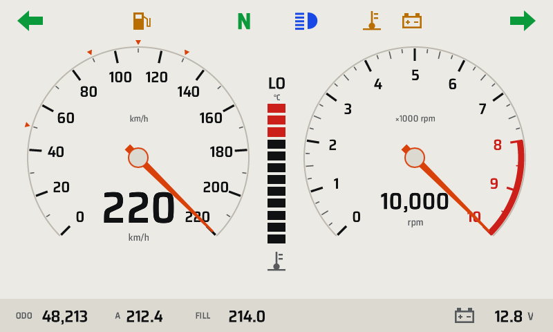 |

## The three riding layouts

The layout is chosen from **SETTINGS → Riding layout**, or in the profile (`[display] layout`). The default is **Classic** ([ADR 0010](../adr/0010-default-layout.md)).

### Classic

Two dials, like an analog cluster. Speedometer from 0 to 220 km/h, with small orange triangles at the Italian speed limits (50, 90, 110, 130). Tachometer from 0 to 10 000 with the red zone from 8000. In the middle, the coolant temperature column.

| Day | Night |
|---|---|
| 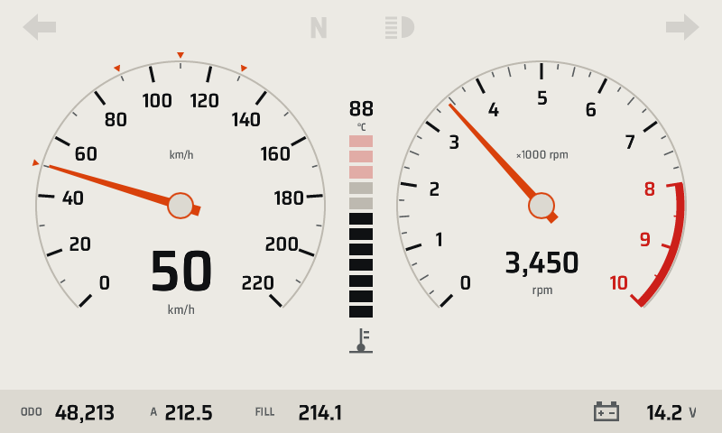 | 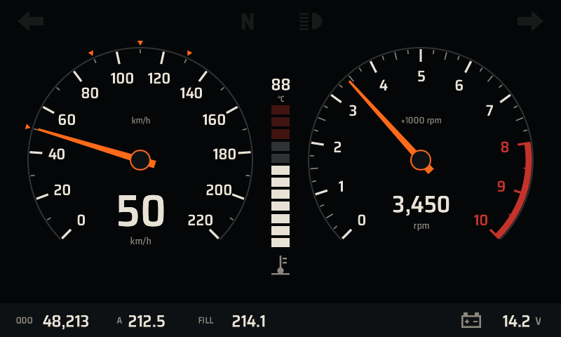 |

### Sport

Very large speed in the center, rpm on a 50-segment arc. Above 7500 rpm the arc flashes orange: it is the **shift light**.

| Day | Night |
|---|---|
| 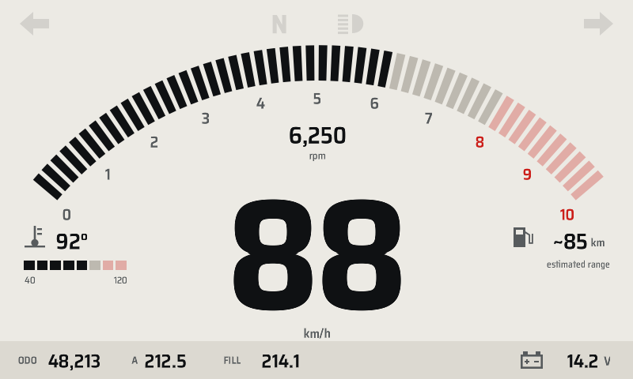 | 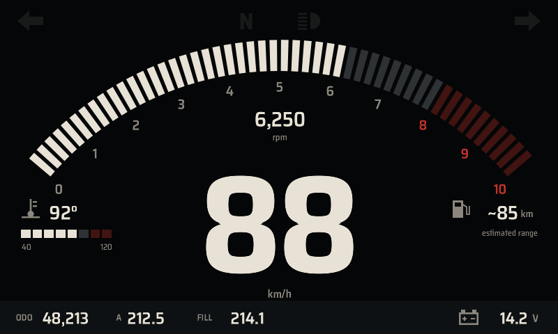 |

### Touring

Large speed with an rpm bar, and on the right the trip data: trip A, average, riding time, estimated range.

| Day | Night |
|---|---|
| 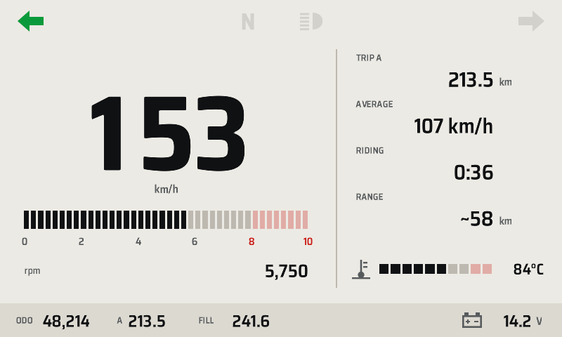 | 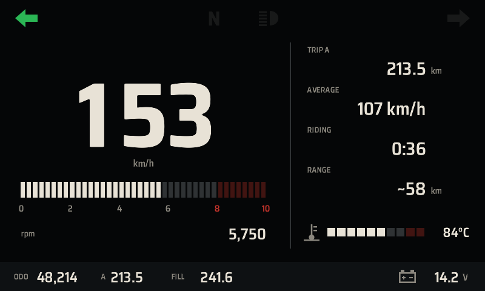 |

## Always-visible elements

**Warning lights** (at the top):

| Indicator | Color | When |
|---|---|---|
| Left / right turn signal | Green | Turn signals on, they flash with the bike's flasher |
| N | Green | Neutral engaged |
| High beam | Blue | High beam on |
| Thermometer | Amber or red | Coolant temperature warning |
| Battery | Amber or red | Voltage warning |
| Crossed-out link | Red | The Pi receives no data from the Pico |

Warning lights that are off remain faintly visible (transparent gray): you learn where they are. Turn signals, high beam and neutral also have the **backup LEDs** on the bezel, which work even with the dashboard off.

**Bottom strip:**
- total odometer (ODO)
- trip A
- trip "FILL", to be reset at every fill-up: it is used to estimate the range
- battery voltage, which turns amber below 11.8 V or above 15 V, and red above 15.5 V

## Keys

| Key | Press | What it does |
|---|---|---|
| MODE | short (< 0.6 s) | Next screen: Riding → TRIP → DIAGNOSTICS → Riding |
| SET | short | Snoozes the visible amber warning for 5 minutes; on the TRIP screen it selects the trip |
| SET | long (≥ 1 s) | When stopped, opens the **SETTINGS**; on the TRIP screen it **resets** the selected trip |

While moving, the settings do not open ("Settings only when stopped" appears) and they close by themselves if the bike moves off.

## Trip, diagnostics, settings

| TRIP | DIAGNOSTICS | SETTINGS |
|---|---|---|
| 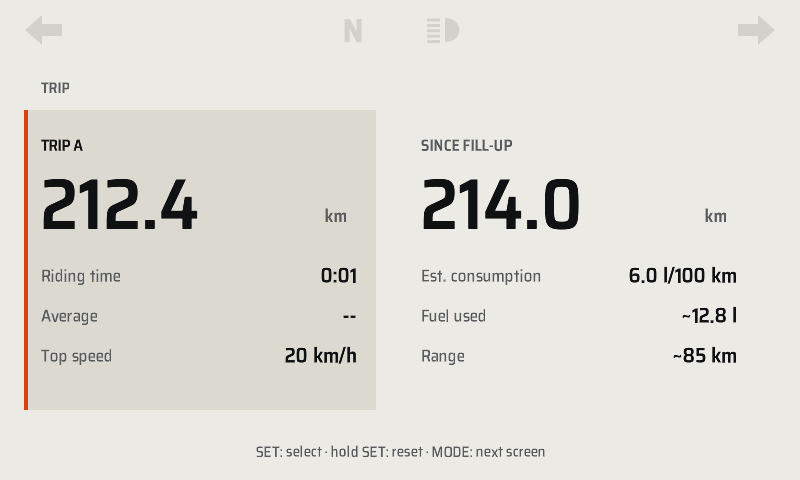 | 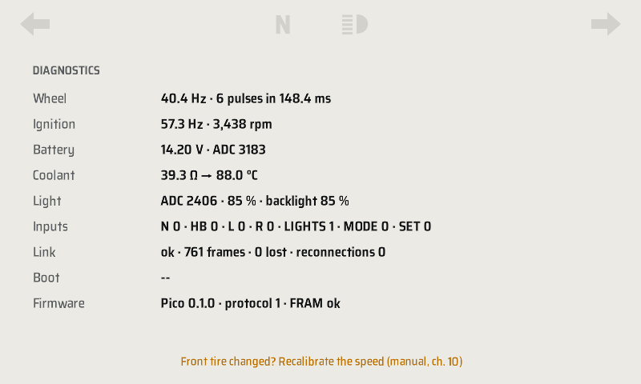 | 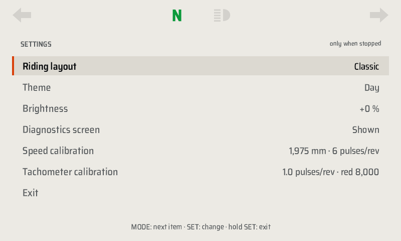 |

**TRIP.** Two columns:
- **TRIP A**: km, riding time, average and top speed since power-on.
- **SINCE FILL-UP**: km since the fill-up, estimated consumption, fuel used and range.

The TDM 3VD has no fuel level sender: the range is an **estimate** based on the average consumption in the profile (6 l/100 km) and on the 18 l tank. Reset "since fill-up" at every fill-up.

**DIAGNOSTICS.** Raw values read from the Pico:
- frequency of the wheel and coil pulses
- battery voltage and ADC reading
- coolant sender resistance
- ambient light
- state of the inputs
- quality of the USB link
- boot time, firmware version and FRAM state

It is used for calibration (chapter 10) and for troubleshooting (chapter 12). It can be hidden from SETTINGS.

**SETTINGS.** Short MODE moves to the next item, short SET changes the value, long SET exits. The choices are saved in the Pico's FRAM and are kept even if you change the SD card.

| Item | Values |
|---|---|
| Riding layout | Classic, Sport, Touring |
| Theme | Auto, Day, Night |
| Brightness | −20 … +20 % relative to the automatic adjustment |
| Diagnostics screen | Shown, Hidden |
| Speed calibration and Tachometer calibration | Show the profile values (they are edited in the file `/boot/tdm-dash.toml`) |

## Day and night

With the **Auto** theme, the light sensor decides theme and brightness:
- it switches to **Night** after 10 s of darkness (long tunnel, evening)
- it goes back to **Day** after 5 s of light

The delays stop the dashboard from flickering when you pass under a bridge. The backlight brightness follows the ambient light continuously: it rises quickly when leaving a tunnel and falls slowly.

## Warnings

| Type | Appearance | Can it be snoozed? |
|---|---|---|
| **Critical** | Red band below the warning lights | No, it stays until the cause goes away |
| **Caution** | Amber banner | Yes, short SET for 5 minutes; it comes back if the cause returns |
| **Information** | Amber icon and text in the bottom strip | It goes off by itself |

| Caution | Critical | Link lost |
|---|---|---|
| 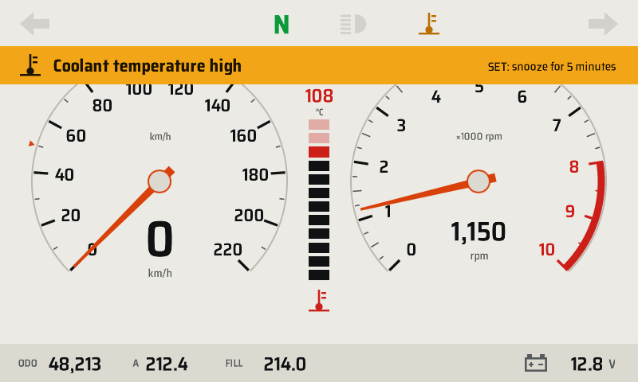 | 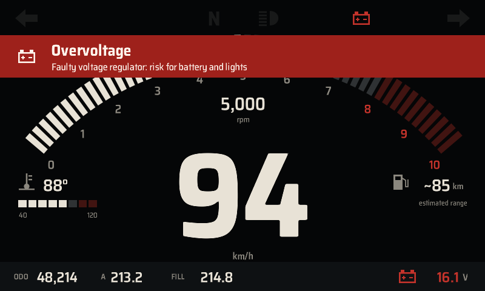 | 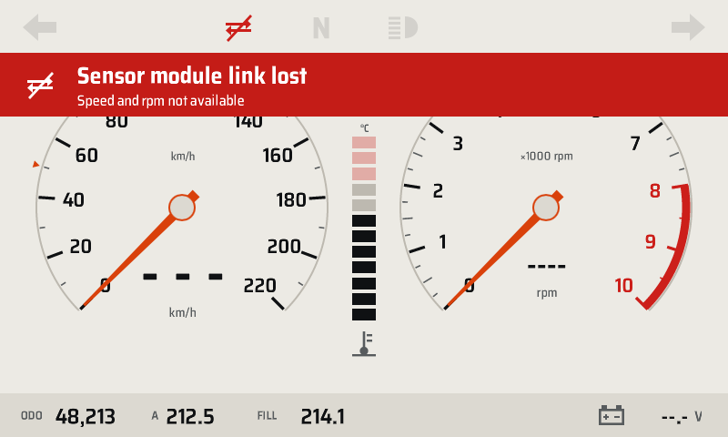 |

| Warning | Type | When it appears | What to do |
|---|---|---|---|
| Coolant temperature critical | Critical | ≥ 112 °C for 2 s | Stop and switch off the engine; check coolant and fan |
| Coolant temperature high | Caution | ≥ 105 °C for 3 s | Reduce the load; check the fan |
| Coolant sender disconnected | Caution | Sender open or shorted for 5 s | Check the sender wire |
| Overvoltage | Critical | > 15.5 V for 1 s | Faulty regulator: switch off accessory lights, head home, replace the regulator |
| High voltage | Caution | > 15.0 V for 2 s | Check the regulator |
| Battery not charging | Caution | < 12.8 V above 3000 rpm for 30 s | Stator, stator connector or regulator |
| Battery low | Caution | < 11.8 V for 10 s with the engine running | Charge or replace the battery |
| Sensor module link lost | Critical | No data from the Pico for 1 s | Speed and rpm become "---"; check the USB cable and the Pico's power supply |
| Module firmware not compatible | Caution | Different protocol version | Update the Pico firmware (chapter 09) |
| Profile error: using the built-in profile | Caution | `/boot/tdm-dash.toml` unreadable | The dashboard uses the built-in profile; fix the file |
| Odometer memory fault | Caution | FRAM corrupted or missing | See DIAGNOSTICS and chapter 12 |
| Turn signal on | Information | Turn signal flashing for more than 30 s above 20 km/h | Switch off the turn signal |
| Estimated reserve | Information | Estimated range below the reserve (≈ 58 km) | Refuel and reset "since fill-up" |

**Fail-dark.** If the application on the Pi hangs, the Pico no longer receives the heartbeat and after 2 s turns off the backlight. A black screen is safer than a frozen, wrong speed. The watchdog then reboots the Pi; the backup LEDs stay on.

## Trying the dashboard on the PC

The same software runs on a Linux PC, with a bike simulator in place of the Pico:

```sh
cargo run -p tdm-dash                                # city scenario
cargo run -p tdm-dash -- --source sim:mountain --layout sport
cargo run -p tdm-dash -- --size 1280x400                # an elongated bar display
cargo run -p tdm-link --bin tdmctl -- scenarios      # list of scenarios
```

| Key | Function |
|---|---|
| M | MODE (hold ≥ 1 s for a long press) |
| S | SET (hold ≥ 1 s for a long press) |
| ← / → | Left / right turn signal for 5 s |
| H | High beam |
| L / K | More / less ambient light |
| U | Disconnects the USB for 4 s |
| 1 / 2 / 3 | Classic / Sport / Touring layout |
