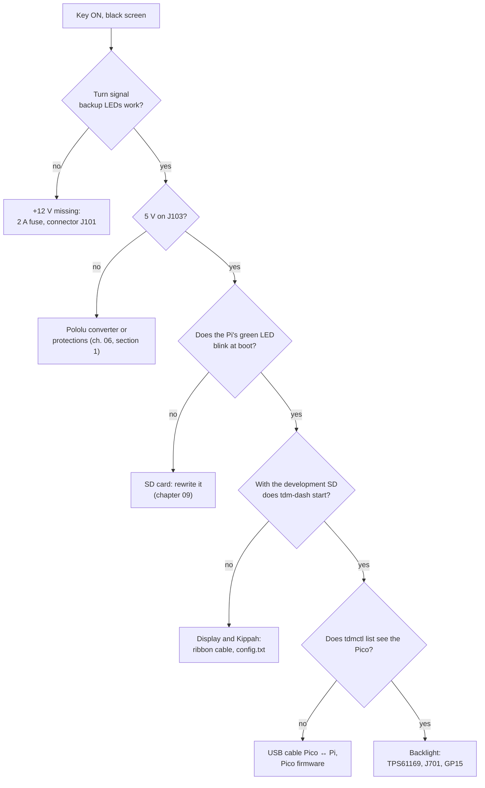
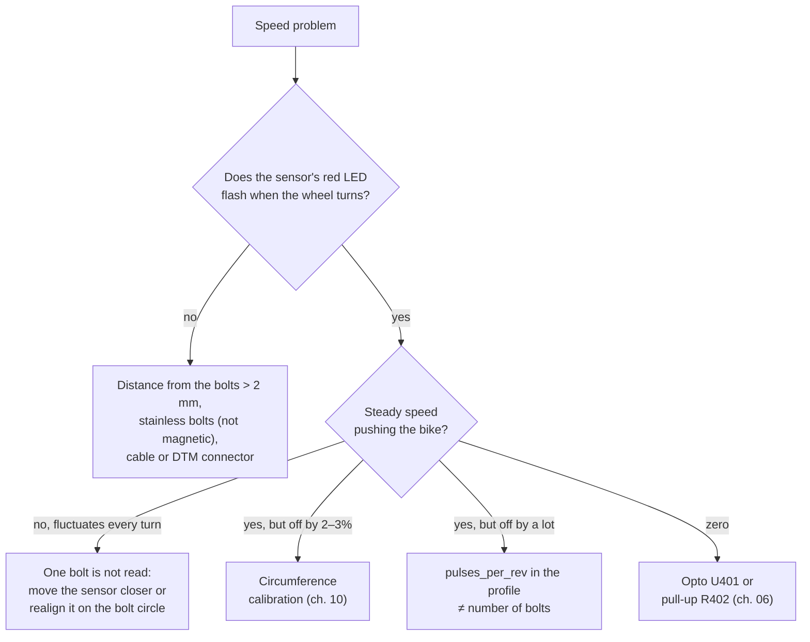
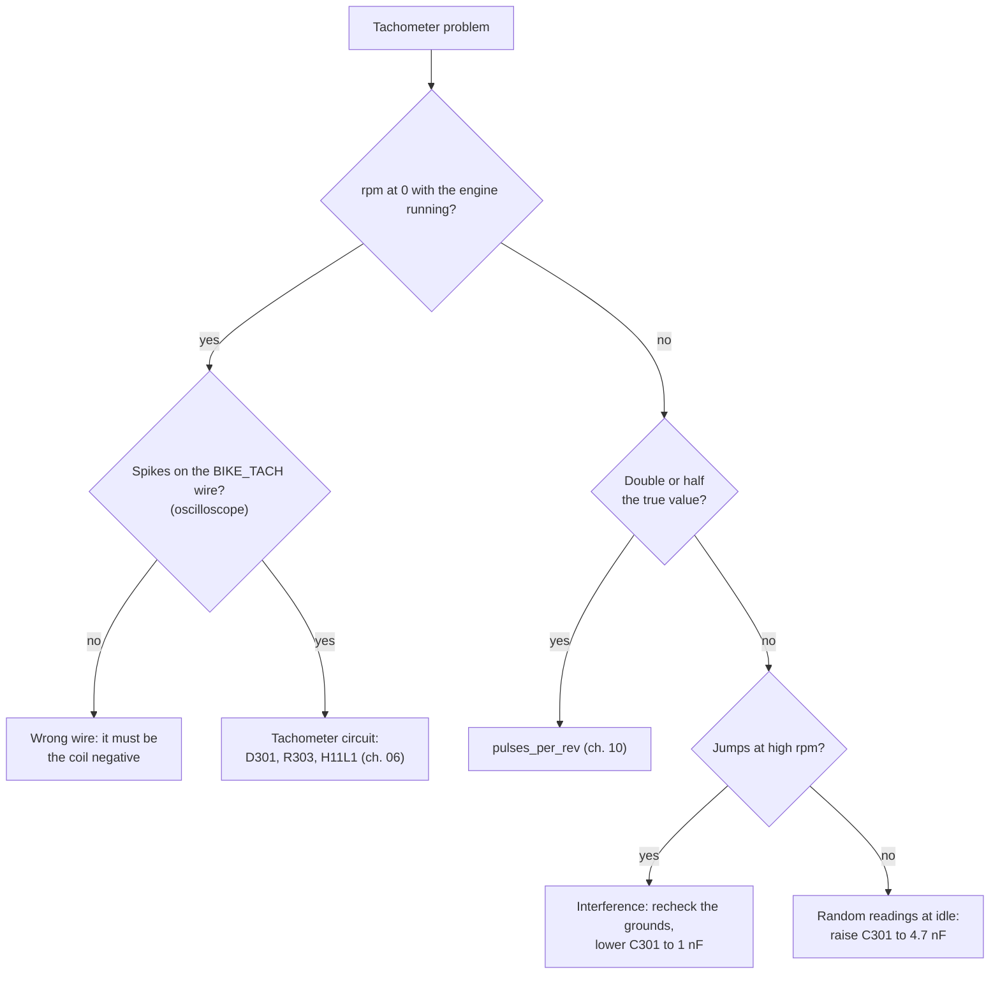

# 12 · Diagnostics and troubleshooting

Before taking anything apart, look at the **DIAGNOSTICS screen** (short MODE until "DIAGNOSTICS", chapter 11). It shows the raw values arriving from the Pico. The same can be seen from a PC connected to the Pico with:

```sh
tdmctl monitor
```

```
module: firmware 0.0.1, protocol 1, FRAM Ok, up 812 s
   12.0 s   50 frame/s   48.3 km/h   3120 rpm  14.21 V  coolant Celsius(86.0) (41.2 Ω)  light 2210  inputs 0x0004
           km 41 250 · A 12.3 · B 210.4
```

| Column | What it tells you |
|---|---|
| `frame/s` | Messages per second from the Pico: there must be 50. Fewer means interference on the USB |
| `km/h`, `rpm` | Values calculated from the profile; `NaN` = no pulses |
| `V` | Battery voltage |
| `coolant` | Temperature and resistance of the sender; `Fault` = wire broken or shorted, `Low` = colder than the first point of the curve |
| `light` | Light sensor reading, from 0 to 4095 |
| `inputs` | Active warning lights and keys, as a mask (chapter 06): neutral `0x0001`, high beam `0x0002`, left turn signal `0x0004`, right `0x0008`, lights `0x0010`, MODE `0x0100`, SET `0x0200` |

## The screen does not turn on



The dashboard stays black on purpose if the Pico does not receive the heartbeat from the Pi for 2 s (fail-dark). A screen that turns on and goes off after a few seconds therefore means that the program on the Pi has hung or that the USB link is dropping.

## Speed missing, jerky or wrong



Expected values at the sensor connector, with the dashboard on:

| Point | Bolt away | Bolt in front of the sensor |
|---|---|---|
| DTM pin 1 (+12 V) | 12–14.5 V | 12–14.5 V |
| DTM pin 2 (signal), to ground | ≈ 12 V | < 1.5 V |
| Pico GP2 | 3.3 V | < 0.4 V |

## Tachometer missing or unstable



> **Danger:** there are hundreds of volts on the tachometer wire with the engine running. Measure only with the oscilloscope and a ×10 probe, never with the multimeter on bare probes.

## Warning lights that do not come on or stay on

| Symptom | Check |
|---|---|
| A warning light never comes on | With the function active, measure the voltage on the J101 pin: ≈ 12 V for high beam and turn signals, ≈ 0 V for neutral. If it is there, check the optocoupler and socket of that channel |
| A warning light is always on | The wire carries voltage even with the function off: check in the measurements that it is the right one. The channel's `invert` value in the profile must be correct |
| The turn signals are swapped | Side wires swapped in the adapter: swap them, or swap the `turn_left` and `turn_right` channels in the profile |
| Neutral comes on in gear | The neutral switch leaks to ground: measure the resistance of the wire to ground in gear (it must be > 10 kΩ) |
| The turn signal flashes faster | The flasher sees less load: it does not depend on the dashboard (load < 3 mA), check the bulbs |

## Coolant temperature

| Symptom | Likely cause |
|---|---|
| "Coolant sender disconnected" | Wire broken or sender connector oxidized: measure the resistance between the wire and ground, it must be between 20 Ω and 2 kΩ |
| Temperature always at maximum | Sender wire to ground (short) |
| Values off by 5–10 °C | Profile curve to be measured in a water bath (chapter 10) |

## Voltage and charging

| Warning | Check |
|---|---|
| "Battery not charging" | At 3000 rpm the voltage at the terminals measured with the multimeter must be 13.8–14.6 V. If it is lower, check the stator connector (a known weak point of the TDM) and the regulator |
| "High voltage" or "Overvoltage" | Faulty regulator: risk for battery and bulbs. Head home with as few lights on as possible |
| Voltage shown differs from the multimeter | Divider calibration (chapter 10) |

## USB link and odometer

| Symptom | Check |
|---|---|
| "Sensor module link lost" now and then | USB twisted pair too long or not twisted, ferrite missing, Pico ground. `frame/s` below 50 in `tdmctl monitor` confirms the interference |
| "Module firmware not compatible" | Pico and image of different versions: update the firmware (chapter 09) |
| "Odometer memory fault" | FRAM disconnected or damaged. The `FRAM` line of `tdmctl monitor` says `Missing` (not responding) or `Corrupt` (invalid data). With a new FRAM you need `tdmctl init-odo` with the last known value |
| Km lost after a sudden power cut | Up to 10 m is normal. More: check C103 (470 µF) and D103 |

## Recording a problem

A problem that only appears on the road can be recorded and replayed on the PC:

```sh
tdmctl record problem.bin          # during the ride (development image)
cargo run -p tdm-dash -- --source replay:problem.bin   # on the PC, from the repository
```

The dashboard on the PC behaves exactly as on the bike with that data. Attach the file to an issue in the repository.
