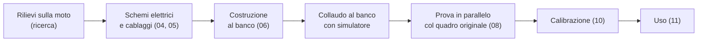

# 00 · Introduzione e sicurezza

## Che cos'è tdm-dash

tdm-dash è un quadro strumenti digitale, economico e open-source, che sostituisce il quadro originale della Yamaha TDM 850 prima serie (3VD). Mostra:

- velocità (lancetta e cifre) e giri motore
- contachilometri totale e due parziali
- temperatura dell'acqua e tensione della batteria, con avvisi
- spie: folle, abbaglianti, frecce sinistra e destra separate
- a moto ferma, schermate di viaggio, impostazioni e diagnostica

Il progetto è pensato per essere **reversibile**: l'impianto originale non si taglia e il quadro originale si conserva. È anche **estensibile**: i parametri della moto stanno in un file di profilo, quindi lo stesso hardware può servire su altre moto con poche modifiche.

## A chi è rivolto

A chi sa usare un tester, saldare componenti a foro passante e smontare il cupolino della moto. Per il software non serve saper programmare: l'immagine pronta si scrive sulla scheda SD e la calibrazione si fa da un file di testo.

## Avvertenze

> **Pericolo:** il quadro strumenti serve a guidare in sicurezza. Prima di affidarti a tdm-dash su strada, completa la **prova in parallelo** (capitolo 08): il quadro nuovo deve funzionare per diverse uscite accanto a quello originale, confrontando velocità e giri.

> **Pericolo:** il negativo della bobina d'accensione arriva a **centinaia di volt** a ogni scintilla. Non toccarlo con il motore acceso e non collegarlo direttamente all'elettronica: si usa solo il circuito di ingresso del contagiri descritto nel capitolo 04.

> **Attenzione:** l'impianto della moto può avere sovratensioni (regolatore guasto, batteria che si stacca col motore acceso). Non saltare le protezioni dell'alimentazione: fusibile, diodo TVS, protezione dall'inversione di polarità.

> **Attenzione:** lavora sempre con la **chiave tolta** e, quando colleghi o scolleghi connettori di alimentazione, con il **negativo della batteria staccato**.

> **Attenzione:** non si guida mentre si cambiano le impostazioni. Il software lo impedisce: le impostazioni si aprono solo da fermi.

Il progetto è **sperimentale e non certificato**. Lo usi a tuo rischio. Gli autori non rispondono di danni a persone, alla moto o a terzi (vedi le licenze in [LICENSING.md](../../LICENSING.md)).

## Note legali (Italia)

*Questa sezione non è una consulenza legale: verifica sempre con la Motorizzazione o con il centro revisioni.*

**Tachimetro.** Le regole europee sui tachimetri (Regolamento UNECE n. 39, Direttiva 2000/7/CE per i veicoli a due ruote) chiedono che la velocità indicata **non sia mai inferiore** a quella reale, e che l'eccesso resti entro un limite:

`0 ≤ V_indicata − V_reale ≤ 0,1 × V_reale + 4 km/h`

tdm-dash rispetta questa regola per costruzione:
- dopo la calibrazione col GPS si applica un piccolo margine positivo (guadagno 1,03 e +1 km/h)
- un test automatico verifica la regola tra 5 e 200 km/h

**Contachilometri.** Il contachilometri originale è meccanico e resta nel quadro tolto.
- **Prima** di smontarlo, fotografa il valore totale.
- Nel nuovo quadro quel valore si imposta **una sola volta** (comando `InitOdometer`); dopo, il totale può solo crescere.
- Conserva la foto e il quadro originale: alla revisione i km devono essere coerenti con le revisioni precedenti.

**Spie.** Le spie obbligatorie (abbaglianti in blu, frecce in verde) restano visibili anche se l'elettronica si guasta, grazie ai LED di backup collegati direttamente alle linee a 12 V (capitolo 04).

**Revisione.** Chiedi al tuo centro revisioni se accetta il quadro sostituito prima di montarlo in modo definitivo. Il cablaggio adattatore permette di rimontare il quadro originale in pochi minuti.

## Gomme e calibrazione

Una gomma nuova ha una circonferenza maggiore di una consumata.
- Se calibri con una gomma consumata e poi la cambi, il quadro **segna meno** del reale: è la direzione vietata.
- **Ricalibra dopo ogni cambio della gomma anteriore** (capitolo 10). La schermata di diagnostica lo ricorda.

## Attrezzi necessari

| Attrezzo | Per cosa | Indispensabile? |
|---|---|---|
| Tester digitale con misura di frequenza (Hz) | Rilievi, collaudo | Sì |
| Saldatore 30–60 W con punta fine, stagno, treccia dissaldante | Costruzione | Sì |
| Pinza spelafili e crimpatrice per Superseal/DTM | Cablaggio | Sì |
| Guaina termorestringente, fascette | Cablaggio | Sì |
| Chiavi e cacciaviti per cupolino e quadro | Installazione | Sì |
| Lettore di schede microSD e un PC | Software | Sì |
| Oscilloscopio economico (DSO da circa 40 €) | Forma d'onda del contagiri | Consigliato |
| Alimentatore da banco regolabile 0–30 V con limite di corrente | Collaudo dell'elettronica al banco | Consigliato |
| Stampante 3D (o servizio di stampa) | Contenitore e staffa | Sì, o servizio esterno |
| Raspberry Pi Debug Probe | Sviluppo del firmware | Solo per chi modifica il firmware |

## Come è organizzato il lavoro

