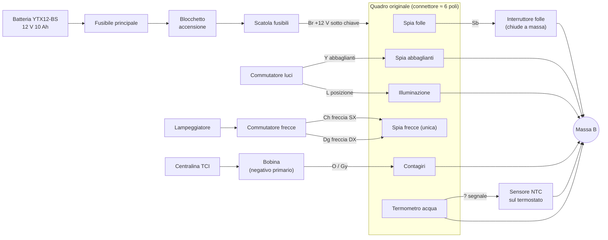
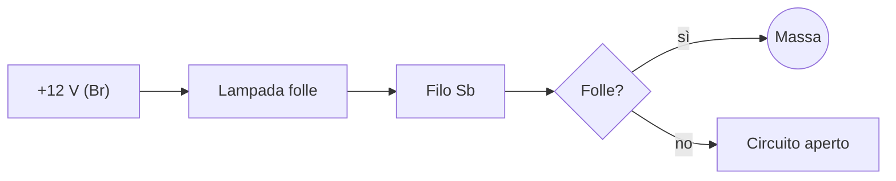
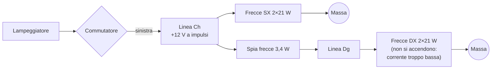

# 01 · L'impianto originale della TDM 850

Questo capitolo spiega come funziona il quadro originale della TDM 850 prima serie (3VD, 1991–1995) e quali segnali offre al quadro nuovo. I dati di dettaglio, con fonti e marcature, sono nella [ricerca](../ricerca/impianto-originale.md).

> **Attenzione:** i colori dei fili sono ricostruiti dalla convenzione Yamaha e da modelli parenti. Sono **[DA VERIFICARE]** finché non si compila la [scheda dei rilievi](../ricerca/rilievi-sulla-moto.md). Non costruire il cablaggio adattatore prima dei rilievi.

## Cosa c'è nel quadro originale

| Strumento o spia | Come funziona | Segnale per tdm-dash |
|---|---|---|
| Tachimetro con contachilometri | **Meccanico**: un cavo flessibile gira, mosso dal rinvio sul mozzo anteriore | Nessun segnale elettrico: serve un sensore nuovo (sensore induttivo sui bulloni del disco) |
| Contagiri | Elettronico, conta gli impulsi della bobina | Filo dal negativo della bobina (probabilmente O o Gy) |
| Termometro acqua | Lancetta mossa dalla corrente che passa nel sensore NTC | Filo verso il sensore, letto con l'ADC |
| Spia folle (verde) | Lampadina tra +12 V e il filo Sb; l'interruttore del folle chiude a massa | Filo Sb, attivo verso massa |
| Spia abbaglianti (blu) | Lampadina tra il filo Y e massa | Filo Y, attivo a +12 V |
| Spia frecce (verde, una sola) | Lampadina **tra** il filo freccia sinistra (Ch) e destra (Dg) | Fili Ch e Dg, entrambi attivi a +12 V |
| Illuminazione strumenti | Lampadine tra il filo L e massa | Filo L (utile solo se non è sempre acceso) |

Non ci sono indicatore della benzina, spia dell'olio, spia della temperatura, orologio.

## Schema ricostruito del quadro originale

## Come funzionano i singoli circuiti

### Spia del folle (attiva verso massa)

La lampadina riceve sempre +12 V quando la chiave è accesa. L'altro capo va al filo Sb, che arriva all'interruttore del folle sul motore, a sinistra vicino al pignone. In folle l'interruttore chiude il circuito verso massa e la spia si accende.

Per tdm-dash:
- tolta la lampadina, il filo Sb resta "appeso": in folle è a massa, altrimenti è scollegato.
- L'ingresso del quadro nuovo deve quindi fornire lui la corrente, da +12 V attraverso un optoaccoppiatore, verso il filo Sb.

### Spia degli abbaglianti (attiva a +12 V)

Il commutatore delle luci porta +12 V sul filo Y quando gli abbaglianti sono accesi. La lampadina va tra Y e massa. Quando gli abbaglianti sono spenti, il filo Y resta collegato a massa attraverso il filamento della lampada abbagliante del faro. Per tdm-dash è un normale ingresso "attivo alto".

### Spia unica delle frecce

È il circuito più interessante. La spia è collegata **tra** la linea della freccia sinistra (Ch) e quella destra (Dg):
- Con la freccia sinistra accesa, Ch è a +12 V a impulsi. La corrente passa nella spia, entra nella linea destra e torna a massa attraverso le lampade delle frecce destre (2 × 21 W).
- Quelle lampade, con così poca corrente, non si accendono, ma bastano a chiudere il circuito.
- Lo stesso succede a parti invertite.

Per tdm-dash:
- si leggono **due ingressi separati**, Ch e Dg, entrambi attivi a +12 V, così il quadro nuovo mostra la direzione.
- Con frecce a LED (resistenza molto più alta delle lampade) serve un carico di richiamo verso massa su ciascun ingresso. È previsto nello schema.

### Contagiri

La centralina TCI accende e spegne la corrente nel primario della bobina. Quando la interrompe, la bobina produce la scintilla e sul negativo del primario compare un **picco di alcune centinaia di volt**, seguito da oscillazioni.

Il contagiri originale è collegato a quel punto e conta i picchi. La TDM 3VD è un bicilindrico con albero a 360° e una sola bobina a doppia uscita (scintilla persa): **probabilmente un impulso per ogni giro dell'albero**, da confermare al minimo con il tester (vedi rilievi).

| Giri/min | Impulsi al secondo (1 per giro) |
|---|---|
| 1 000 | 16,7 Hz |
| 1 200 (minimo) | 20 Hz |
| 5 000 | 83 Hz |
| 8 000 (zona rossa) | 133 Hz |

Il segnale va **ridotto e isolato** prima di arrivare al microcontrollore. Il circuito sarà nel capitolo 04: diodo, resistenze ad alta tensione, zener, optoaccoppiatore con soglia H11L1, e nel firmware un tempo di "cieco" (blanking) dopo ogni impulso per ignorare le oscillazioni.

### Termometro dell'acqua

Il sensore, avvitato nel corpo del termostato, è una resistenza NTC verso massa: più l'acqua è calda, meno resiste.

| Temperatura | Resistenza (dato Haynes) |
|---|---|
| 80 °C | 47–53 Ω |
| 100 °C | 26–29 Ω |

Lo strumento originale fa passare corrente nel sensore e la lancetta segue la corrente. tdm-dash invece alimenta il sensore con un piccolo partitore dai 3,3 V del microcontrollore e ne misura la tensione con l'ADC. La curva completa (da 20 a 120 °C) va misurata a bagnomaria, come descritto nei rilievi.

## L'alimentazione della moto

| Dato | Valore |
|---|---|
| Batteria | YTX12-BS, 12 V 10 Ah |
| Tensione a motore spento | 12,4–12,8 V (batteria carica) |
| Tensione di ricarica | 14,0–14,5 V sopra 1200–2000 giri |
| Alternatore | Trifase a magneti permanenti, ≈ 280 W |
| Regolatore | Shindengen SH629A-12, a derivazione: noto punto debole |

> **Attenzione:** un regolatore guasto può portare la tensione oltre i 16–18 V. tdm-dash lo controlla (avviso di sovratensione) e si protegge con un diodo TVS e un regolatore DC-DC adatto fino a 50 V. Il quadro diventa così anche un **monitor del regolatore**, utile su questa moto.

## Cosa si tiene e cosa si sostituisce

| Parte | Destino |
|---|---|
| Quadro originale | Smontato e **conservato** (contachilometri, revisione) |
| Cavo del tachimetro | Rimosso; l'uscita del rinvio si tappa |
| Rinvio sul mozzo anteriore | **Resta sull'asse**: fa parte del pacco distanziali della ruota |
| Cablaggio della moto | **Non si taglia**: si usa un cablaggio adattatore che si innesta nel connettore originale |
| Sensore temperatura acqua | Si tiene, letto da tdm-dash |
| Lampeggiatore | Si tiene; da verificare che la frequenza non cambi senza la spia |
| Lampadine spia | Sostituite dalle spie a schermo e dai LED di backup |
