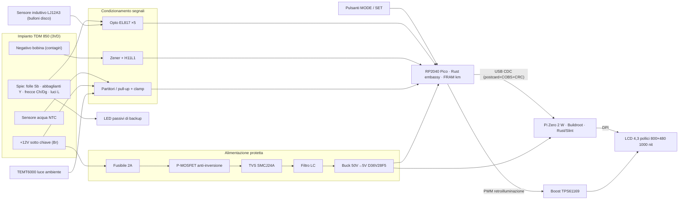
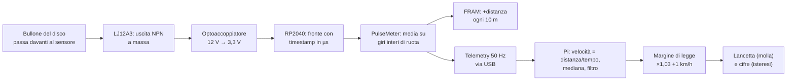
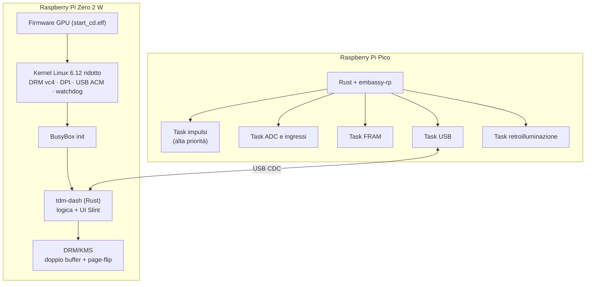
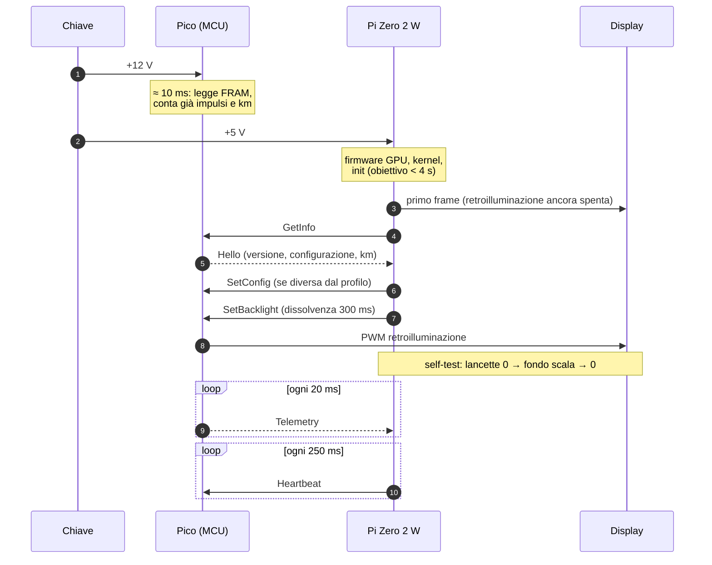
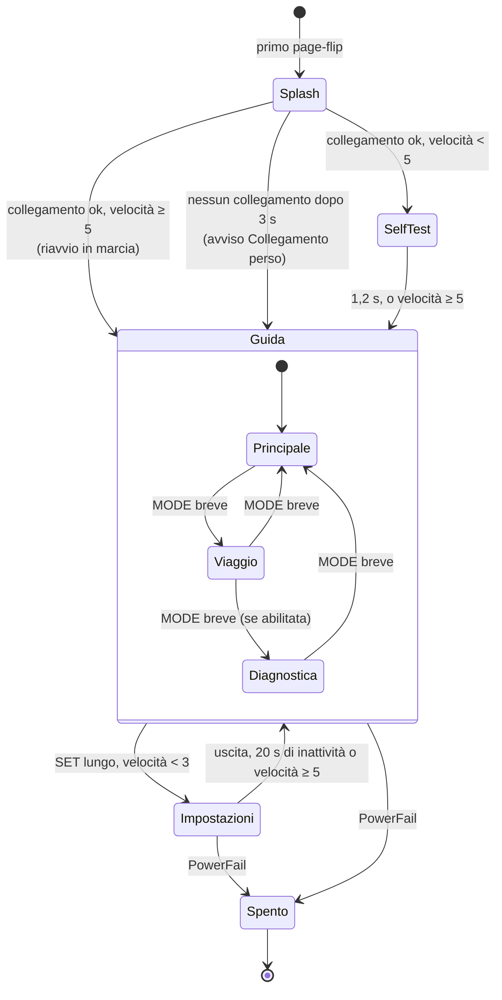
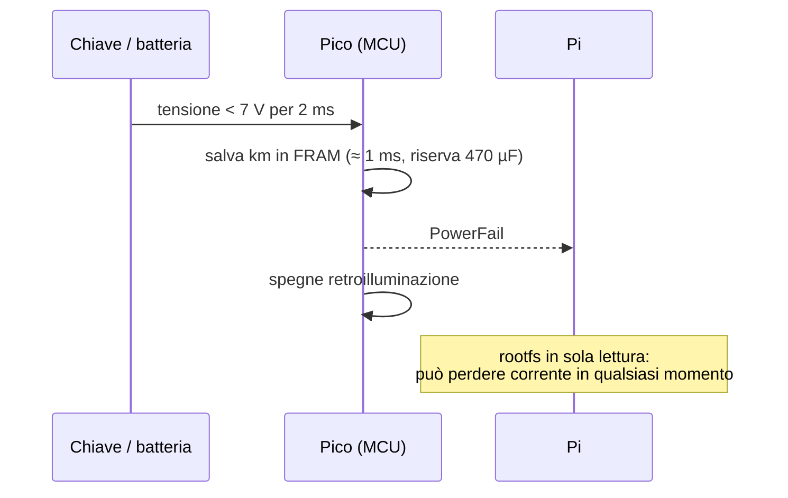

# 02 · Architettura del sistema

## In breve

tdm-dash è diviso in due computer, ognuno col compito che sa fare meglio:

| Parte | Compito | Perché |
|---|---|---|
| **Raspberry Pi Pico (RP2040)**, microcontrollore | Conta gli impulsi di ruota e bobina, legge spie, pulsanti e tensioni, **custodisce i km** in una memoria FRAM, comanda la retroilluminazione | È pronto in pochi millisecondi dall'accensione, misura i tempi con precisione al microsecondo, non si blocca e non ha un file system da rovinare |
| **Raspberry Pi Zero 2 W**, computer Linux | Disegna l'interfaccia grafica sul display | Ha la potenza per grafica fluida a 800×480; con Linux minimale si avvia in pochi secondi |

I due comunicano via **USB** con pacchetti piccoli e protetti da CRC. Il Pi non scrive mai sulla scheda SD durante l'uso: se si gira la chiave di colpo non si rovina nulla.

## Schema a blocchi

## Il percorso di un dato: dalla ruota alla lancetta

Perché la media "su giri interi": i bulloni del disco possono non essere distanziati in modo perfettamente uguale. Misurando sempre un numero intero di giri di ruota, l'errore di spaziatura si annulla.

## Software

| Componente | Scelta | Dove nel repo |
|---|---|---|
| Sistema operativo | Buildroot 2026.08, rootfs EROFS in sola lettura, nessun udev, nessuna rete nell'immagine di rilascio | `os/` |
| Interfaccia | Rust + Slint, renderer software, piattaforma DRM propria | `crates/tdm-dash/` |
| Logica (filtri, avvisi, stati) | Rust, senza dipendenze dall'hardware, testata sul PC | `crates/tdm-logic/` |
| Protocollo | postcard + COBS + CRC-16, crate condiviso | `crates/tdm-proto/` |
| Misure e contachilometri | Rust `no_std`, **lo stesso codice** nel firmware e nel simulatore | `crates/tdm-core/` |
| Firmware | Rust + embassy-rp | `firmware/` |
| Profili moto | TOML | `profiles/` |

## Avvio

Mentre Linux si avvia il microcontrollore lavora già: se si parte subito, i km percorsi nei primi secondi non vanno persi.

## Stati dell'interfaccia

Gli **avvisi** non sono stati, ma uno strato sopra la schermata attiva:
- **Critico** (fascia rossa): collegamento perso, temperatura critica, sovratensione.
- **Attenzione** (banner ambra), da silenziare per 5 minuti con SET: temperatura alta, mancata ricarica, batteria bassa.
- **Informazione** (icona): freccia dimenticata accesa, stima benzina.

## Spegnimento e cadute di tensione

Il Pi non ha bisogno di uno spegnimento ordinato. La FRAM sopporta circa 10¹² scritture: anche scrivendo ogni 10 m, in 100 000 km si fanno 10⁷ scritture, una frazione minima della durata.

## Sicurezza di funzionamento ("fail-dark")

| Guasto | Cosa succede | Perché |
|---|---|---|
| L'app del Pi si blocca | Dopo 2 s senza Heartbeat il Pico spegne la retroilluminazione; il watchdog riavvia il Pi | Meglio uno schermo nero che una velocità ferma e sbagliata |
| Il collegamento USB cade | Dopo 0,3 s cifre attenuate; dopo 1 s "---" e avviso critico; riconnessione automatica | I dati vecchi non devono sembrare validi |
| Il Pico si riavvia | Il Pi se ne accorge (uptime che riparte), azzera i filtri | Nessun salto delle lancette |
| La FRAM è illeggibile | Il Pico funziona, segnala il guasto, non sovrascrive i dati | Non si perde lo storico dei km |
| Elettronica spenta o guasta | I **LED di backup** sulle linee a 12 V mostrano frecce, abbaglianti e folle | Spie obbligatorie sempre visibili |

## Estensibilità: i profili moto

Tutto ciò che dipende dalla moto sta in un file TOML (`profiles/`):
- impulsi per giro di ruota e circonferenza
- impulsi per giro motore, zona rossa
- curva del sensore della temperatura, soglie della batteria
- quali ingressi sono collegati e con che logica
- layout e tema

Il file in uso si trova sulla partizione `/boot` della scheda SD, leggibile e modificabile da qualsiasi PC. Per un'altra moto basta un profilo nuovo; se il profilo ha un errore, il quadro usa quello integrato e lo segnala.
