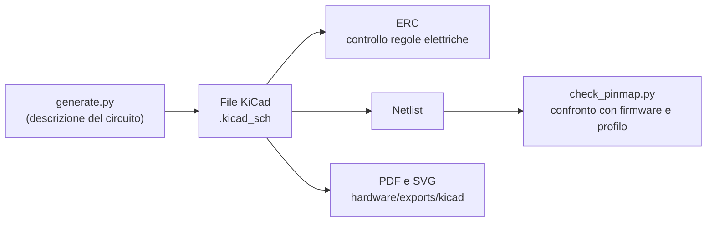
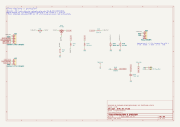
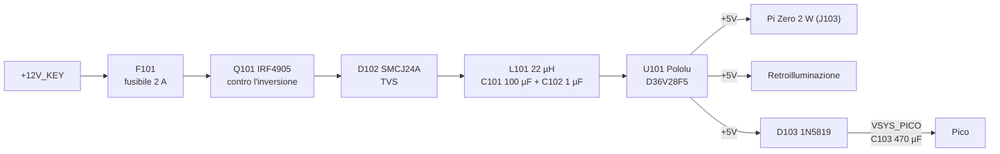
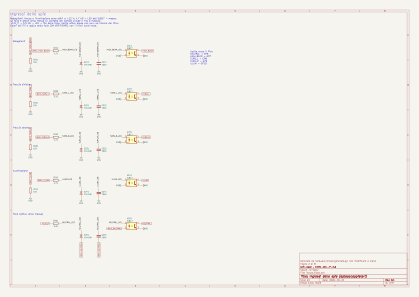
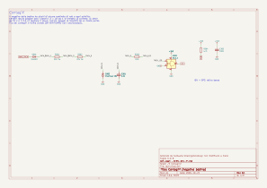
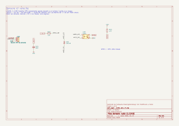
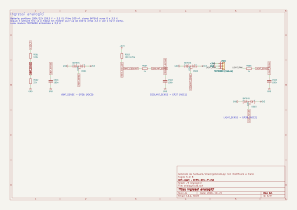
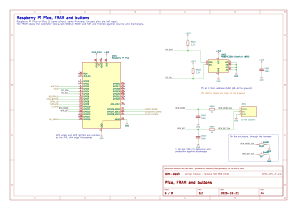
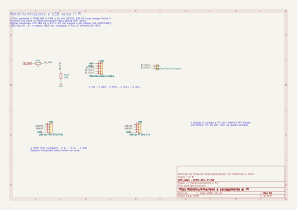
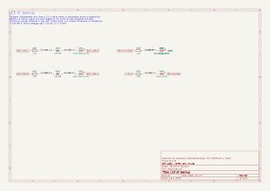

# 04 · Schemi elettrici

Lo schema elettrico del modulo sensori (la scheda con il Pico) è un progetto **KiCad 9** in [`hardware/kicad/`](../../hardware/kicad/), diviso in otto fogli. Questo capitolo spiega ogni foglio e come sono stati scelti i componenti.

Lo schema non si disegna a mano: lo scrive lo script [`generate.py`](../../hardware/kicad/generate.py), che descrive ogni componente e la rete su ciascun pin. Su ogni pin c'è un tratto di filo con l'etichetta della rete: due pin con la stessa etichetta sono collegati. È meno elegante di uno schema con i fili tracciati, ma non si possono sbagliare i collegamenti disegnando, e lo script si controlla.



Ad ogni modifica la CI (workflow `Hardware`):

1. rigenera lo schema e controlla che coincida con quello salvato
2. esegue l'**ERC** di KiCad: zero errori e zero avvisi
3. confronta i pin del Pico con il firmware ([`tools/check_pinmap.py`](../../tools/check_pinmap.py)): ogni GPIO usato da `firmware/src/main.rs` deve portare la rete giusta. Lo stesso script controlla che il partitore della batteria e il pull-up del sensore dell'acqua siano quelli usati dal software
4. esporta PDF e SVG

Per rifarlo sul PC con Docker, dalla radice del repository:

```sh
docker run --rm -u 0 -v "$PWD":/w -w /w kicad/kicad:9.0.9 \
    sh -c 'python3 hardware/kicad/generate.py && hardware/kicad/export.sh'
```

Il PDF completo, da stampare per la costruzione, è [`hardware/exports/kicad/tdm-dash.pdf`](../../hardware/exports/kicad/tdm-dash.pdf).

> **Attenzione:** i colori dei fili e la piedinatura del connettore originale della moto sono ancora **[DA VERIFICARE]** (vedi la [ricerca](../ricerca/impianto-originale.md)). Lo schema usa nomi di funzione (`BIKE_TURN_L`, `BIKE_TACH`…), non colori. Prima di collegare qualcosa alla moto servono i [rilievi](../ricerca/rilievi-sulla-moto.md).

## Nomi delle reti

| Prefisso o nome | Significato |
|---|---|
| `BIKE_…` | Filo che arriva dal cablaggio della moto: tensioni fino a 14,5 V, disturbi, picchi |
| `+12V_KEY` | +12 V sotto chiave, prima del fusibile |
| `+12V_P` | +12 V protetto: dopo fusibile, MOSFET contro l'inversione e TVS |
| `+12V_FILT` | +12 V dopo il filtro LC, ingresso del convertitore |
| `+5V` | Uscita del convertitore: Pi Zero, retroilluminazione |
| `VSYS_PICO` | Alimentazione del Pico, dopo il diodo e con la riserva da 470 µF |
| `+3V3` | Uscita del regolatore del Pico: FRAM, pull-up, sensore di luce |
| `WHEEL`, `IGN`, `NEUTRAL`… | Segnali verso i GPIO del Pico, già a 3,3 V |

## 1 · Alimentazione e protezioni





**Consumo e fusibile.** Dal +5 V:
- il Pi Zero 2 W assorbe 0,3–0,6 A, con picchi fino a 1 A all'avvio
- la retroilluminazione 0,4 A (1,7 W con rendimento dell'85%)
- il Pico e il resto meno di 50 mA

In tutto al massimo circa 1,5 A, cioè 7,5 W. Dal 12 V, con il 90% di rendimento del convertitore, sono circa 0,7 A. Il fusibile da 2 A lascia margine all'accensione (carica dei condensatori) e protegge il cavo da 0,5 mm².

**Protezione contro l'inversione (Q101, R101, D101).** Il P-MOSFET è montato "al contrario": il +12 V entra dal drain e il diodo interno conduce già prima che il MOSFET si accenda.
- La resistenza R101 porta il gate a massa, il MOSFET si accende e la caduta diventa trascurabile: 20 mΩ × 0,7 A = 14 mV, cioè 10 mW, contro gli 0,5 W di un diodo.
- Con la batteria al contrario il gate è al positivo e il MOSFET resta spento.
- Lo zener D101 da 12 V limita la tensione gate-source (massimo ±20 V) durante i picchi.

**Sovratensioni (D102).**
- **Durante la marcia:** la TVS SMCJ24A non conduce fino a 24 V. La ricarica della TDM (14,0–14,5 V) è lontana.
- **Su un picco:** per esempio un regolatore guasto o una batteria che si stacca, la TVS taglia a circa 39 V a 38 A.
- **Il convertitore:** il Pololu regge 50 V in ingresso. Per questo **non** va bene un modulo MP1584, che si ferma a 28 V.

**Filtro LC (L101, C101, C102).** La frequenza di taglio è

f = 1 / (2π √(L·C)) = 1 / (2π √(22 µH × 100 µF)) ≈ 3,4 kHz

Così i disturbi del convertitore (centinaia di kHz) non tornano sull'impianto della moto e quelli dell'impianto (accensione, alternatore) arrivano attenuati.

**Riserva del Pico (D103, C103).** Il Pico è alimentato attraverso uno Schottky, che impedisce al Pi di scaricare il condensatore da 470 µF quando si toglie la chiave. Durata della riserva:
- **Consumo e tensioni:** il Pico consuma circa 25 mA; il suo regolatore funziona da 4,7 V (5 V meno lo Schottky) fino a circa 3 V.
- **Durata:** t = C·ΔV / I = 470 µF × 1,7 V / 25 mA ≈ 32 ms.
- **Salvataggio:** il firmware salva i km quando la batteria scende sotto 7 V (sezione 5). Il convertitore tiene i 5 V finché l'ingresso è sopra circa 6 V, quindi il salvataggio parte prima che il Pico cominci a consumare la riserva. Scrivere 40 byte nella FRAM a 1 MHz richiede circa 0,5 ms.

## 2 · Ingressi delle spie



Ogni spia passa da un **optoaccoppiatore EL817**:
- il Pico non vede mai i 12 V né i loro picchi
- l'uscita è un transistor verso massa, letto con il pull-up interno del Pico (attivo basso)

| Ingresso | Logica sulla moto | Circuito | Uscita |
|---|---|---|---|
| Abbaglianti | +12 V quando accesi | 4,7 kΩ → LED → massa | `HIGH_BEAM` → GP7 |
| Freccia sinistra | +12 V lampeggiante | idem | `TURN_L` → GP8 |
| Freccia destra | +12 V lampeggiante | idem | `TURN_R` → GP9 |
| Illuminazione | +12 V con le luci di posizione | idem | `ILLUM` → GP10 |
| Folle | il contatto chiude **a massa** | +12V_P → 3,3 kΩ → LED → filo della folle | `NEUTRAL` → GP6 |

Logiche ricavate dalla convenzione Yamaha, [DA VERIFICARE] sulla moto.

**Corrente nel LED.** Con la batteria a 12,6 V e il LED a 1,2 V: I = (12,6 − 1,2) / 4,7 kΩ = 2,4 mA. In ricarica (14,5 V) diventa 2,8 mA.
- **Uscita:** l'EL817 garantisce un rapporto di trasferimento di almeno il 50% a 5 mA; anche contando solo il 30% a 2,4 mA, l'uscita assorbe 0,7 mA. Il pull-up interno del Pico (50–80 kΩ) ne chiede 66 µA: il margine è di 10 volte.
- **Resistenza:** 4,7 kΩ dissipano 40 mW a 14,5 V, quindi basta una resistenza da 1/4 W.
- **Sul picco:** al picco massimo che passa la TVS (39 V) la corrente sale a 8 mA, lontano dai 50 mA massimi dell'EL817.

**Folle.** I = (12,6 − 1,2) / 3,3 kΩ = 3,5 mA quando il contatto è chiuso. Da aperto il filo non è collegato a nulla e il LED resta spento. La lampadina originale da 3,4 W chiedeva 270 mA: il nostro ingresso carica il contatto del folle molto meno.

**Gli altri componenti:**
- 1N4148 in antiparallelo: protegge il LED (massimo 6 V inversi) da tensioni negative e dalle oscillazioni dei relè.
- 100 nF sul LED: con i 4,7 kΩ fa un filtro da circa 0,5 ms contro i disturbi brevi. Le frecce lampeggiano a 1–2 Hz, quindi passano senza problemi.
- 10 kΩ verso massa sugli ingressi a +12 V: un filo scollegato o con piccole perdite resta a 0 invece di "galleggiare".
- La massa del lato moto è la stessa del Pico. Gli optoaccoppiatori qui servono a proteggere e a cambiare livello, non a isolare.

## 3 · Contagiri



Il segnale si prende dal negativo della bobina, in parallelo alla centralina. Forma attesa (da verificare con l'oscilloscopio):
- circa +12 V a riposo
- circa 0 V mentre la bobina si carica
- poi, a ogni scintilla, un picco di 200–400 V con oscillazioni

Il circuito deve far scattare l'H11L1 **solo sul picco**:


| Situazione | Corrente nel LED dell'H11L1 | Risultato |
|---|---|---|
| Riposo, 12,6 V | (12,6 − 0,7 − 1,2) / (44 + 2,2) kΩ = 0,23 mA | Spento: la soglia è 1,6 mA al massimo |
| Bobina in carica, ≈ 0 V | 0 | Spento |
| Picco, zener a 15 V | (15 − 1,2) / 2,2 kΩ = 6,3 mA | Acceso |

**Soglia di scatto.** Per avere 1,6 mA nel LED servono circa 1,6 mA × 46,2 kΩ + 1,9 V ≈ 76 V sul filo. Un picco di bobina li supera sempre, mentre i disturbi a 12 V restano sotto.

**Resistenze da 22 kΩ 1 W.**
- Su un picco di 300 V passano circa 6,5 mA, cioè 0,9 W per resistenza, ma solo per 50–100 µs a ogni scintilla.
- A 8000 giri (133 Hz) la media è di circa 12 mW.
- La potenza da 1 W serve soprattutto per la **tensione**: ogni resistenza vede metà del picco e quelle da 1/4 W reggono di solito 200–250 V. Per questo si usano resistenze da almeno 350 V di lavoro.

**Condensatore da 2,2 nF.** Con i 44 kΩ la costante di tempo è di circa 100 µs. Un picco di 100 V porta il nodo a 15 V in circa 16 µs, uno di 300 V in circa 5 µs: abbastanza corto per non perdere il picco, abbastanza lungo per tagliare i disturbi più brevi.

**Uscita.** L'H11L1 ha l'uscita a trigger di Schmitt: fronti netti anche con un segnale lento. È attiva bassa, con 4,7 kΩ verso 3,3 V e alimentazione dal +3V3 del Pico (100 nF di disaccoppiamento). Il firmware ignora i fronti troppo vicini (blanking) per non contare due volte le oscillazioni dello stesso picco.

> **Attenzione:** questo foglio è il più incerto del progetto. Prima di collegarlo:
> - misura il segnale con l'oscilloscopio e, se serve, cambia C301 o R303
> - verifica il numero di impulsi per giro ([rilievi](../ricerca/rilievi-sulla-moto.md))

## 4 · Sensore di velocità



Il sensore induttivo **LJ12A3-4-Z/BX** è un NPN normalmente aperto: davanti a un bullone d'acciaio collega l'uscita (filo nero) a massa. Funziona da 6 a 36 V ed è alimentato dal +12V_P.

- **LED dell'opto:** +12V_P → 2,2 kΩ → LED dell'EL817 → uscita del sensore. Con il sensore attivo (fino a 1,5 V di tensione residua) passano (12,6 − 1,2 − 1,5) / 2,2 kΩ ≈ 4,5 mA. Il sensore ne regge 200.
- **Uscita:** ha un pull-up esterno da 4,7 kΩ verso 3,3 V, per fronti più veloci di quelli del solo pull-up interno.
  - **Corrente richiesta:** 0,7 mA, mentre l'opto ne dà almeno 2.
  - **Frequenza:** a 200 km/h, con 6 bulloni e 1,96 m di circonferenza, gli impulsi sono 170 al secondo: uno ogni 5,9 ms.
  - **Tempi dell'EL817:** salita e discesa di qualche decina di µs.
- **Protezioni:** il 1N4148 in antiparallelo protegge il LED e il 100 nF filtra l'alimentazione del sensore.

## 5 · Ingressi analogici



Ogni ingresso ADC ha:
- un filtro da 100 nF
- un **BAT54S** che tiene il pin tra 0 V e 3,3 V anche se qualcosa va storto

**Batteria (GP26).** Partitore 100 kΩ / 22 kΩ preso dal +12V_P, quindi dopo la chiave: a moto spenta non consuma.

| Grandezza | Valore |
|---|---|
| Rapporto | (100 + 22) / 22 = 5,545 (`vbat_divider` nel software) |
| Fondo scala | 3,3 V × 5,545 = 18,3 V |
| Risoluzione | 18,3 V / 4096 = 4,5 mV (meglio con la media di 64 letture) |
| Soglia di caduta tensione | 7,0 V → 1,262 V sul pin → lettura 1569 (`POWER_FAIL_RAW` nel firmware) |
| Consumo del partitore | 12,6 V / 122 kΩ ≈ 0,1 mA |

**Sensore dell'acqua (GP27).** Il sensore originale è una NTC verso massa nel corpo del termostato: 47–53 Ω a 80 °C e 26–29 Ω a 100 °C [DA VERIFICARE]. Il circuito:
- **Pull-up:** la resistenza da 100 Ω verso 3,3 V fa da partitore con il sensore, V = 3,3 V × R / (R + 100 Ω).
  - **A 80 °C** (50 Ω): 1,10 V, lettura ≈ 1365.
  - **A 100 °C** (27 Ω): 0,70 V, lettura ≈ 870.
  - **A freddo** il sensore sale a qualche centinaio di ohm e la tensione si avvicina a 3,3 V.
- **Valore nel software:** 100 Ω è `coolant_pullup_ohm` nel profilo. Il software ricava R dalla tensione e la temperatura dalla curva del profilo (capitolo 10).
- **Corrente nel sensore:** a caldo circa 22 mA. Il quadro originale, con una bobina a 12 V, ne faceva passare di più, quindi l'autoriscaldamento è trascurabile.
- **Se il filo va a massa:** passano 33 mA e la resistenza dissipa 0,11 W. Basta da 1/4 W.
- **Filtro:** 1 kΩ in serie e il 100 nF separano il pin dal filo.

> **Attenzione:** il filo del sensore non deve mai toccare il +12 V. Attraverso i 100 Ω spingerebbe 90 mA nel 3,3 V del Pico. Il filo va solo dal termostato al quadro, ma va comunque fatto passare lontano dai fili sotto tensione.

**Luce ambiente (GP28).** Il modulo TEMT6000 è alimentato a 3,3 V e ha la sua resistenza di carico da 10 kΩ: dà da 0 V (buio) fino a circa 3 V (sole). Il 1 kΩ in serie, il 100 nF e il BAT54S proteggono il pin dal cavo che va alla finestra del contenitore.

## 6 · Pico, FRAM e pulsanti



| Pin Pico (fisico) | GPIO | Rete | Funzione |
|---|---|---|---|
| 4 | GP2 | `WHEEL` | Sensore ruota |
| 5 | GP3 | `IGN` | Contagiri |
| 6 / 7 | GP4 / GP5 | `I2C_SDA` / `I2C_SCL` | FRAM |
| 9, 10, 11, 12, 14 | GP6–GP10 | `NEUTRAL`, `HIGH_BEAM`, `TURN_L`, `TURN_R`, `ILLUM` | Spie |
| 15 / 16 | GP11 / GP12 | `BTN_MODE` / `BTN_SET` | Pulsanti |
| 20 | GP15 | `BL_PWM` | Retroilluminazione |
| 31, 32, 34 | GP26, GP27, GP28 | `VBAT_SENSE`, `COOLANT_SENSE`, `LIGHT_SENSE` | ADC |
| 36 | — | `+3V3` | Uscita 3,3 V (massimo 300 mA) |
| 39 | — | `VSYS_PICO` | Alimentazione |
| 3, 8, 13, 18, 23, 28, 33, 38 | — | `GND` | Massa |

Gli altri pin restano liberi per estensioni future, per esempio un sensore della benzina o un GPS.

**FRAM MB85RC256V.** 32 KB, indirizzo 0x50 (A0–A2 a massa), protezione dalla scrittura disattivata (WP a massa). Le resistenze di pull-up I²C sono da 2,2 kΩ perché il bus va a 1 MHz (Fast-mode Plus):
- **Tempo di salita:** 0,85 × 2,2 kΩ × 50 pF ≈ 93 ns, entro i 120 ns ammessi.
- **Con le pull-up della breakout:** quella di Adafruit ha già le sue da 10 kΩ, in parallelo diventano 1,8 kΩ. La corrente è 1,8 mA, molto sotto il limite.

**Pulsanti MODE e SET.** Sono sul contenitore e vanno verso massa. Arrivano dal connettore J601 attraverso 1 kΩ, con 100 nF verso massa sul lato del Pico. Il filtro da 0,1 ms e la resistenza in serie limitano le scariche elettrostatiche (la mano bagnata sul pulsante). Il firmware fa poi il debounce.

## 7 · Retroilluminazione e collegamento al Pi



**Driver TPS61169.**
- **Carico:** è un convertitore boost a corrente costante. La retroilluminazione del Newhaven vuole 180 mA a 9,3 V, cioè 1,7 W, che col rendimento dell'85% sono 0,4 A dal +5 V.
- **Corrente:** si regola con la resistenza di misura, R = 204 mV / 180 mA ≈ 1,13 Ω. Sulla breakout va verificata e, se serve, sostituita [DA VERIFICARE].
- **Comando:** il Pico pilota il pin CTRL in PWM a 25 kHz (GP15) attraverso 1 kΩ.
- **Fail-dark:** la resistenza da 100 kΩ verso massa tiene il driver spento finché il firmware non parte. Il display resta nero invece di mostrare un'immagine non aggiornata.

**USB verso il Pi.** Si collegano solo D+, D− e massa; il VBUS del Pi **non** si collega, perché il Pico prende già l'alimentazione da VSYS. Il cablaggio è descritto nel [capitolo 05](05-schemi-collegamenti.md).

**Display.** Il pannello si collega al Pi con l'adattatore Adafruit DPI Kippah, fuori da questa scheda.

## 8 · LED di backup



Quattro LED da 3 mm collegati direttamente alle linee a 12 V della moto: funzionano anche se Pi, Pico o display sono guasti, e restano come spie di legge di riserva.

**Frecce.**
- **Collegamento:** come la spia originale, i LED sono tra i fili della freccia sinistra e destra. Quando lampeggia la sinistra, la corrente passa nel LED sinistro e torna a massa attraverso le lampadine della destra (spente, a bassa resistenza).
- **Protezione dei LED:** il 1N4148 in serie protegge ciascun LED dai 12 V inversi quando lampeggia l'altro lato; un LED ne regge solo 5.

**Abbaglianti e folle.** Il LED blu va dal filo degli abbaglianti a massa. Il verde della folle va dal +12V_P al filo della folle, come la lampadina originale.

**Correnti.**

| LED | Calcolo a 12,6 V | Corrente |
|---|---|---|
| Verdi delle frecce | (12,6 − 2,0 − 0,7) / 1,5 kΩ | 6,6 mA |
| Blu degli abbaglianti | (12,6 − 3,0) / 1,5 kΩ | 6,4 mA |

A 14,5 V la corrente arriva a circa 8 mA, lontano dai 20 mA massimi. Le resistenze da 1,5 kΩ dissipano meno di 0,1 W.

## Prima della costruzione

- **Rilievi sulla moto** ([scheda](../ricerca/rilievi-sulla-moto.md)), che confermano:
  - i fili e le logiche dei fogli 1, 2 e 8
  - il filo del contagiri e la forma del suo segnale (foglio 3)
  - la curva del sensore dell'acqua (foglio 5)
- **Breakout:** controllare le serigrafie (Pololu, TPS61169, FRAM) e l'ordine dei pin dei moduli; lo schema li numera nell'ordine indicato nelle note.
- **Revisione:** rivedere gli SVG di questo capitolo insieme alla [distinta componenti](03-distinta-componenti.md).
