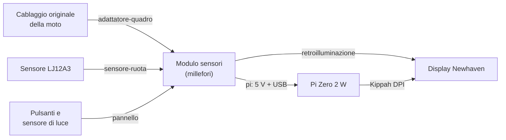
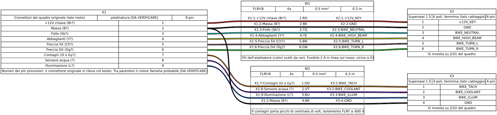
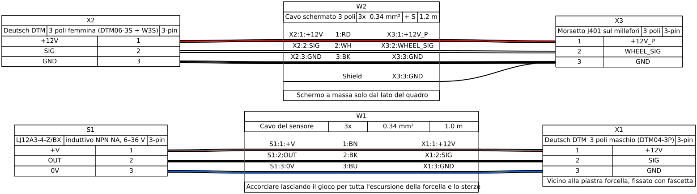
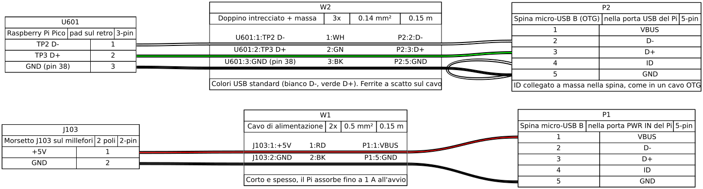
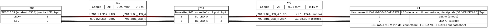
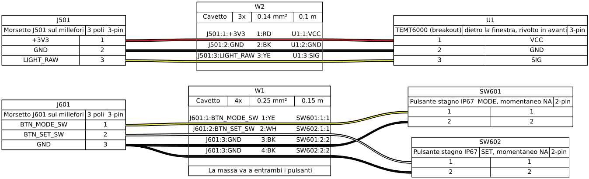

# 05 · Schemi dei collegamenti

I cablaggi sono descritti in [WireViz](https://github.com/wireviz/WireViz): un file YAML per cablaggio in [`hardware/harness/`](../../hardware/harness/), da cui si generano il disegno (SVG) e la distinta di fili e connettori (TSV). I file generati sono in [`hardware/exports/harness/`](../../hardware/exports/harness/).

```sh
pip install wireviz==0.4.1        # serve anche Graphviz (apt install graphviz)
for f in hardware/harness/*.yml; do wireviz -f st -o hardware/exports/harness "$f"; done
```



Regole per tutti i cablaggi:
- **Cavo:** automotive FLRY-B, 0,5 mm² per le alimentazioni e i segnali della moto, più sottile solo dentro il contenitore.
- **Connettori:** tutti stagni (Superseal 1.5, Deutsch DTM). Le saldature vanno coperte con guaina termorestringente con colla.
- **Impianto originale:** **non si taglia mai**. L'adattatore parte da un cablaggio quadro usato (3VD-83509-00) o dal connettore corrispondente.
- **Colori dei fili:** quelli della moto restano [DA VERIFICARE] finché non si fanno i [rilievi](../ricerca/rilievi-sulla-moto.md). I colori dei fili nuovi li scegliamo noi e sono indicati nelle tabelle.

## Adattatore dal quadro originale



File: [`adattatore-quadro.yml`](../../hardware/harness/adattatore-quadro.yml). Distinta: [`adattatore-quadro.bom.tsv`](../../hardware/exports/harness/adattatore-quadro.bom.tsv).

| Da (lato moto) | Colore Yamaha | Filo nuovo | A | Rete | Funzione |
|---|---|---|---|---|---|
| +12 V sotto chiave | Br [DA VERIFICARE] | rosso, con fusibile 2 A | Superseal 6p pin 1 → J101.1 | `+12V_KEY` | Alimentazione |
| Massa | B [IPOTESI] | nero | Superseal 6p pin 2 → J101.2 | `GND` | Massa |
| Spia folle | Sb [IPOTESI] | azzurro | Superseal 6p pin 3 → J101.3 | `BIKE_NEUTRAL` | Folle, attiva verso massa |
| Spia abbaglianti | Y [IPOTESI] | giallo | Superseal 6p pin 4 → J101.4 | `BIKE_HIGH_BEAM` | +12 V con abbaglianti |
| Freccia sinistra | Ch [DA VERIFICARE] | marrone | Superseal 6p pin 5 → J101.5 | `BIKE_TURN_L` | +12 V lampeggiante |
| Freccia destra | Dg [DA VERIFICARE] | verde | Superseal 6p pin 6 → J101.6 | `BIKE_TURN_R` | +12 V lampeggiante |
| Contagiri | O o Gy [IPOTESI] | arancione | Superseal 4p pin 1 → J102.1 | `BIKE_TACH` | Negativo bobina, picchi di centinaia di volt |
| Sensore acqua | ? [DA VERIFICARE] | viola | Superseal 4p pin 2 → J102.2 | `BIKE_COOLANT` | NTC verso massa |
| Illuminazione | L [IPOTESI] | blu | Superseal 4p pin 3 → J102.3 | `BIKE_ILLUM` | +12 V con le luci |
| Massa | B [IPOTESI] | nero | Superseal 4p pin 4 → J102.4 | `GND` | Massa |

> **Attenzione:** il fusibile va **sul lato moto** del filo rosso, il più vicino possibile al punto in cui si prende il +12 V. Così protegge anche il tratto di cavo verso il quadro.

## Sensore di velocità



File: [`sensore-ruota.yml`](../../hardware/harness/sensore-ruota.yml).

| Da | Filo | A | Rete |
|---|---|---|---|
| LJ12A3 marrone (+V) | marrone del sensore | DTM pin 1 | `+12V_P` |
| LJ12A3 nero (uscita) | nero del sensore | DTM pin 2 | `WHEEL_SIG` |
| LJ12A3 blu (0 V) | blu del sensore | DTM pin 3 | `GND` |
| DTM pin 1 | rosso, cavo schermato | J401.1 | `+12V_P` |
| DTM pin 2 | bianco, cavo schermato | J401.2 | `WHEEL_SIG` |
| DTM pin 3 | nero, cavo schermato | J401.3 | `GND` |
| Schermo | — | J401.3, solo lato quadro | `GND` |

I colori del sensore vengono dal suo datasheet. Il connettore DTM sta vicino alla piastra della forcella, così il sensore si stacca per togliere la ruota. Lascia al cavo il gioco per tutta l'escursione della forcella e per lo sterzo a fondo corsa da entrambi i lati.

## Pi Zero 2 W: alimentazione e USB



File: [`pi.yml`](../../hardware/harness/pi.yml). Sul Pi non si salda nulla: i due cavi finiscono in spine micro-USB.

| Da | Filo | A | Funzione |
|---|---|---|---|
| J103.1 (+5V) | rosso 0,5 mm² | micro-USB pin 1 (VBUS), porta **PWR IN** | Alimentazione del Pi |
| J103.2 (GND) | nero 0,5 mm² | micro-USB pin 5 (GND), porta **PWR IN** | Massa |
| Pico pad TP2 (D−) | bianco, doppino | micro-USB pin 2 (D−), porta **USB** | Dati |
| Pico pad TP3 (D+) | verde, doppino | micro-USB pin 3 (D+), porta **USB** | Dati |
| Pico pin 38 (GND) | nero | micro-USB pin 5 (GND), porta **USB** | Massa |
| — | ponticello nella spina | micro-USB pin 4 (ID) → pin 5 | Il Pi si comporta da host (come un cavo OTG) |

Il pin 1 (VBUS) della spina dati **resta scollegato**: il Pico si alimenta già da VSYS. Se il Pi lo alimentasse anche dall'USB, le due alimentazioni si toccherebbero. Una ferrite a scatto sul cavo dati riduce i disturbi; il cavo va tenuto corto (15 cm) e intrecciato.

## Retroilluminazione



File: [`retroilluminazione.yml`](../../hardware/harness/retroilluminazione.yml).

| Da | Filo | A | Rete |
|---|---|---|---|
| TPS61169 LED+ | rosso | J701.1 | `BL_LED_A` |
| TPS61169 LED− | nero | J701.2 | `BL_LED_K` |
| J701.1 | rosso | anodo dei LED del display | `BL_LED_A` |
| J701.2 | nero | catodo dei LED del display | `BL_LED_K` |

> **Attenzione:** il cavo piatto a 40 poli del display entra nel Kippah, che ha un suo driver di retroilluminazione non regolabile. Va ancora verificato **[DA VERIFICARE]** su quali pin del connettore arrivano i LED e come staccarli dal driver del Kippah per collegarli al TPS61169. Prima di collegare, controlla sul datasheet del Newhaven e sulla scheda del Kippah: una tensione sbagliata sui LED li danneggia.

## Pannello: pulsanti e sensore di luce



File: [`pannello.yml`](../../hardware/harness/pannello.yml).

| Da | Filo | A | Rete |
|---|---|---|---|
| J601.1 | giallo | pulsante MODE | `BTN_MODE_SW` |
| J601.2 | bianco | pulsante SET | `BTN_SET_SW` |
| J601.3 | nero (due fili) | altro contatto di entrambi i pulsanti | `GND` |
| J501.1 | rosso | TEMT6000 VCC | `+3V3` |
| J501.2 | nero | TEMT6000 GND | `GND` |
| J501.3 | giallo | TEMT6000 SIG | `LIGHT_RAW` |

## Piedinature di riferimento

**Raspberry Pi Pico** (vista dall'alto, USB in alto). Solo i pin usati; l'elenco completo è nel [foglio 6](04-schemi-elettrici.md#6--pico-fram-e-pulsanti).

| Pin | Funzione | Pin | Funzione |
|---|---|---|---|
| 3 | GND | 31 | GP26 batteria |
| 4 | GP2 ruota | 32 | GP27 acqua |
| 5 | GP3 contagiri | 33 | AGND |
| 6 | GP4 SDA | 34 | GP28 luce |
| 7 | GP5 SCL | 36 | 3V3 (uscita) |
| 9–12 | GP6–GP9 folle, abbaglianti, frecce | 38 | GND |
| 14 | GP10 illuminazione | 39 | VSYS (ingresso 5 V) |
| 15, 16 | GP11 MODE, GP12 SET | 40 | VBUS (non collegato) |
| 20 | GP15 retroilluminazione | TP2, TP3 | USB D−, D+ (sul retro) |

**Raspberry Pi Zero 2 W.**
- Due porte micro-USB: **PWR IN** (solo alimentazione) e **USB** (dati, la più vicina al centro della scheda).
- Il connettore a 40 poli è occupato dal Kippah, che usa i GPIO per il segnale DPI del display.

**Micro-USB (spina).**

| Pin | 1 | 2 | 3 | 4 | 5 |
|---|---|---|---|---|---|
| Segnale | VBUS | D− | D+ | ID | GND |

**Connettori sul millefori.**

| Connettore | Pin |
|---|---|
| J101 (Superseal 6p) | 1 +12V_KEY · 2 GND · 3 folle · 4 abbaglianti · 5 freccia SX · 6 freccia DX |
| J102 (Superseal 4p) | 1 contagiri · 2 sensore acqua · 3 illuminazione · 4 GND |
| J103 | 1 +5V · 2 GND (al Pi) |
| J401 (al DTM del sensore) | 1 +12V_P · 2 segnale · 3 GND |
| J501 (TEMT6000) | 1 +3V3 · 2 GND · 3 segnale |
| J601 (pulsanti) | 1 MODE · 2 SET · 3 GND |
| J701 (retroilluminazione) | 1 LED+ · 2 LED− |
