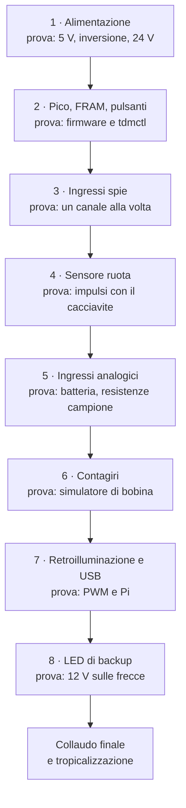

# 06 · Costruzione dell'elettronica

Il modulo sensori si monta su un **millefori doppia faccia da 9 × 7 cm** (30 × 24 fori, passo 2,54 mm), seguendo lo [schema elettrico](04-schemi-elettrici.md). Si costruisce **una sezione alla volta**, e si prova ogni sezione con il tester prima di passare alla successiva: un errore trovato subito costa cinque minuti, uno trovato alla fine un pomeriggio.

> **Attenzione:** fino all'ultima fase la scheda si alimenta solo da un **alimentatore da banco con limite di corrente** (13,8 V, 200 mA), mai dalla batteria della moto. Un cortocircuito sull'alimentatore da banco non brucia nulla.

## Attrezzi e materiali

| Cosa | Note |
|---|---|
| Saldatore a temperatura regolabile | 330–350 °C, punta a scalpello da 2 mm |
| Stagno 0,7 mm con flussante | Sn99Cu1 o Sn60Pb40 |
| Tester | Tensione, resistenza, continuità con cicalino |
| Alimentatore da banco 0–30 V con limite di corrente | Consigliato; in alternativa una batteria con fusibile da 500 mA |
| Pinze, spelafili, trecciola dissaldante | |
| Filo rigido 0,5 mm (collegamenti), filo isolato 0,25 mm² | Colori diversi per +12 V, +5 V, 3,3 V, massa |
| Zoccoli a tulipano | DIP-4 (×6), DIP-6 (×1), header femmina 2×20 per il Pico, 1×5 per il Pololu, 1×8 per la FRAM |
| Adattatori SOT-23 → passo 2,54 (×3) | Per i BAT54S. In alternativa due BAT85 per canale |

## Disposizione


La scheda è divisa in zone, una per foglio dello schema; il disegno viene da [`hardware/perfboard/layout.py`](../../hardware/perfboard/layout.py). Regole:

- **Masse a stella:** una pista di massa larga (filo da 0,5 mm doppio) lungo il bordo inferiore. Le masse delle zone ci arrivano ciascuna con il proprio filo.
- **Alta tensione del contagiri:** D301, R301 e R302 stanno in un angolo, lontano dalle altre piste. Le resistenze da 1 W vanno montate **sollevate di 3–4 mm** dalla scheda, con almeno 3 mm tra i reofori di ingressi diversi.
- **Disaccoppiamento:** i 100 nF di alimentazione (C302, C601) vanno il più vicino possibile al pin di alimentazione del loro integrato.
- **Componenti delicati su zoccolo:** Pico, Pololu, optoaccoppiatori e FRAM. Si tolgono per le prove e si sostituiscono senza dissaldare.

## Ordine di montaggio



### 1 · Alimentazione (zona 2)

Monta Q101, R101, D101, D102, L101, C101, C102, lo zoccolo del Pololu, D103, C103 e i pin +12 V e massa di J101 e J103. **Non** inserire ancora il Pololu.

| Prova (alimentatore 13,8 V, limite 200 mA) | Atteso |
|---|---|
| Corrente assorbita senza Pololu | < 5 mA |
| Tensione su `+12V_P` (catodo di D102) | 13,8 V, cioè uguale all'ingresso: il MOSFET conduce |
| Ingresso **invertito** | Corrente ≈ 0, `+12V_P` a 0 V |

Inserisci il Pololu e riprova:

| Prova | Atteso |
|---|---|
| `+5V` (J103.1) | 5,0 V ± 0,1 V |
| `VSYS_PICO` (catodo di D103) | 4,6–4,8 V |
| Corrente a vuoto | < 15 mA |
| Ingresso a 24 V | Ancora 5,0 V: la TVS non conduce ancora |

### 2 · Pico, FRAM e pulsanti (zone 9, 4, 8)

1. Monta gli header del Pico, le resistenze di pull-up I²C (R601, R602), C601, l'header della FRAM, R603, R604, C602, C603 e J601.
2. Carica il firmware sul Pico (capitolo 09) **prima** di inserirlo.
3. Inserisci Pico e FRAM e collega il Pico al PC con il cavo USB. L'alimentatore resta acceso: il Pico prende l'alimentazione da VSYS e dal PC insieme, attraverso i suoi diodi.

```sh
tdmctl list               # deve comparire il modulo (VID:PID 1209:0001)
tdmctl monitor -n 5       # prima riga "FRAM Blank" (memoria nuova) o "FRAM Ok", poi la telemetria
```

La batteria letta deve essere circa 13,8 V. La colonna `ingressi` di `tdmctl monitor` mostra gli ingressi digitali come maschera esadecimale; ogni ingresso attivo somma il suo valore:

| Ingresso | Valore |
|---|---|
| Folle | `0x0001` |
| Abbaglianti | `0x0002` |
| Freccia sinistra | `0x0004` |
| Freccia destra | `0x0008` |
| Luci di posizione | `0x0010` |
| Tasto MODE | `0x0100` |
| Tasto SET | `0x0200` |

Premendo MODE la maschera deve diventare `0x0100`, con SET `0x0200`.

### 3 · Ingressi delle spie (zona 5)

Monta **un canale alla volta**: R2x1, R2x2, D2x1, C2x1 e lo zoccolo di U2x1. Prova ogni canale prima di passare al successivo.

| Prova | Atteso in `tdmctl monitor` |
|---|---|
| 13,8 V su `BIKE_HIGH_BEAM` (poi `TURN_L`, `TURN_R`, `ILLUM`) | Compare il valore dell'ingresso (`0x0002`, `0x0004`, `0x0008`, `0x0010`) |
| Ingresso scollegato | Il valore sparisce |
| Folle: `BIKE_NEUTRAL` a massa | `0x0001` |
| Corrente in un ingresso a 13,8 V | 2,5–3 mA |

### 4 · Sensore ruota (zona 6)

Monta U401, R401, R402, D401, C401 e J401, poi collega il sensore LJ12A3 col suo connettore DTM (capitolo 05).

- Avvicinando un cacciavite d'acciaio alla faccia del sensore si accende il LED rosso del sensore.
- Con un disco di lamiera con 6 viti, fatto girare con il trapano, la velocità mostrata da `tdmctl monitor` deve essere stabile, senza salti.

### 5 · Ingressi analogici (zona 7)

Monta R501–R505, C501–C503, gli adattatori con i BAT54S e J501.

| Prova | Atteso |
|---|---|
| Alimentatore a 10,0 / 12,0 / 14,5 V | Batteria letta entro ± 0,1 V (correggibile in calibrazione, capitolo 10) |
| 27 Ω tra `BIKE_COOLANT` e massa | ≈ 100 °C |
| 47 Ω | ≈ 80–82 °C |
| `BIKE_COOLANT` scollegato | Avviso "sensore acqua scollegato" |
| Torcia del telefono sul TEMT6000 | Luce ambiente al massimo |

### 6 · Contagiri (zona 3)

Monta D301, R301, R302 sollevate, D302, C301, R303, lo zoccolo dell'H11L1, R304 e C302.

Per provarlo serve un **simulatore di bobina**:
- **Componenti:** un relè da 12 V **senza diodo** sulla bobina e un pulsante, in serie all'alimentatore. Il lato del relè verso il pulsante va a `BIKE_TACH`.
- **Funzionamento:** ogni volta che il pulsante si apre, la bobina del relè dà un picco di qualche centinaio di volt, come quella d'accensione.
- **Cosa vedere:** premendo e rilasciando il pulsante due volte al secondo, `tdmctl monitor` deve mostrare circa 120 giri. Con 13,8 V fissi su `BIKE_TACH` i giri restano a 0.

> **Pericolo:** il picco del simulatore supera i 100 V. Non toccare i contatti mentre premi il pulsante.

### 7 · Retroilluminazione e USB (zona 8)

Monta R701, R702, J701 e collega la breakout TPS61169 (capitolo 05). Senza display, lascia la breakout **scollegata dai LED**: un boost a corrente costante senza carico alza la tensione fino al massimo.

- Il Pico accende la retroilluminazione solo quando il Pi disegna e gli manda la luminosità, quindi il PWM si prova nel collaudo finale. Tra GP15 e massa il tester in tensione continua legge la media del PWM: 0 V a schermo spento, fino a 3,3 V alla luminosità massima.
- Salda il doppino USB ai pad TP2/TP3 del Pico, come nel capitolo 05.

### 8 · LED di backup

Monta R801–R804, D801–D806 sul pannello o sulla scheda.
- **Frecce:** 13,8 V tra `BIKE_TURN_L` e `BIKE_TURN_R` accendono il LED verde sinistro. Invertendo la tensione si accende il destro.
- **Abbaglianti:** 13,8 V su `BIKE_HIGH_BEAM` accendono il blu.
- **Folle:** con `BIKE_NEUTRAL` a massa si accende il verde della folle.

## Collaudo finale al banco

Con tutto montato, display compreso, e alimentatore a 13,8 V limitato a 1,5 A:

| Prova | Atteso |
|---|---|
| Avvio | Quadro acceso in meno di 4 s, test delle spie all'avvio |
| Corrente a regime | 0,5–0,7 A a 13,8 V |
| Stacco brusco dell'alimentazione dopo 1 km simulato | Alla riaccensione i km non sono tornati indietro (capitolo 09) |
| Cavo USB scollegato e ricollegato | Il quadro riprende entro 1 s; dopo 2 s senza dati lo schermo si spegne |
| 1 ora accesa a 13,8 V | Nessun componente oltre i 50 °C al tatto, a parte il Pololu |

## Tropicalizzazione

Quando tutte le prove sono superate:

1. Pulisci la scheda dal flussante con alcol isopropilico.
2. Copri zoccoli, header e connettori con nastro di carta.
3. Stendi due mani sottili di vernice protettiva (conformal coating) sul lato saldature e sul lato componenti.
4. Togli il nastro quando la vernice è asciutta.

La vernice protegge dalla condensa che si forma nel contenitore con gli sbalzi di temperatura.
