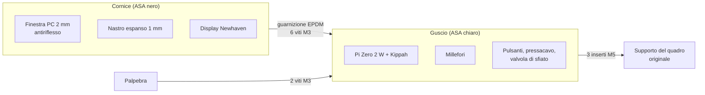
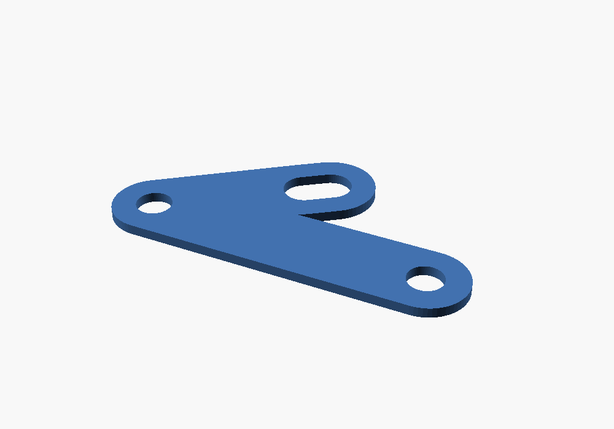

# 07 · Contenitore e staffa

Contenitore e staffa sono disegnati in [OpenSCAD](https://openscad.org) con parametri, quindi si adattano cambiando poche misure in cima ai file:

| Parte | Sorgente | File pronti in [`hardware/exports/cad/`](../../hardware/exports/cad/) |
|---|---|---|
| Cornice anteriore con finestra | [`enclosure.scad`](../../hardware/enclosure/enclosure.scad), `part="front"` | `enclosure-front.stl` |
| Guscio posteriore | idem, `part="rear"` | `enclosure-rear.stl` |
| Palpebra parasole | idem, `part="visor"` | `enclosure-visor.stl` |
| Staffa del sensore | [`sensor-bracket.scad`](../../hardware/bracket/sensor-bracket.scad) | `sensor-bracket.dxf` (alluminio), `sensor-bracket.stl` (prova) |

Per rigenerare tutto dopo aver cambiato un parametro (serve Docker, o OpenSCAD 2021.01 installato):

```sh
docker run --rm -u 0 -v "$PWD":/w -w /w openscad/openscad:2021.01 hardware/cad-export.sh
```


## Il contenitore

Misure esterne: **181,8 × 120,8 mm**, profondità 57 mm più la palpebra.



- **Cornice:** l'apertura è grande quanto l'area attiva del display più 0,5 mm per lato, con uno smusso a 45° verso il pilota che non fa ombra all'immagine. Dietro c'è la sede della finestra, poi il nastro espanso e il display, che finisce a filo del bordo.
- **Guscio:**
  - **Display:** quattro dentini lo premono contro la finestra.
  - **Schede:** distanziali per il Pi Zero 2 W (fori 58 × 23 mm) e per il millefori 90 × 70 mm.
  - **Viti:** sei colonne per le viti M3 che si avvitano negli inserti della cornice.
  - **Faccia inferiore:** pressacavo PG7, valvola di sfiato M12 e i due pulsanti da 16 mm.
- **Palpebra:** una tettoia piatta avvitata sopra il guscio, sporgente di 40 mm, con le guance laterali. Ripara dal sole basso e dalla pioggia.
- **Sensore di luce:** un foro da 4 mm nel bordo inferiore della cornice, chiuso da una bacchetta di acrilico trasparente incollata. Dietro c'è il TEMT6000, incollato al guscio.
- **Colore:** il guscio è chiaro perché scalda meno al sole. Il display e il Pi arrivano al massimo a 70 °C.

### Misure da controllare prima di stampare

Le misure con **[DA VERIFICARE]** nel file vengono dai datasheet o sono stime: vanno controllate sui pezzi veri.

| Parametro | Valore attuale | Come verificarlo |
|---|---|---|
| `panel_t` (spessore del display) | 6,0 mm | Calibro sul display |
| `aa_dx`, `aa_dy` (centro dell'area attiva) | 0, 0 | Misura i bordi neri ai quattro lati del display acceso |
| Posizione del cavo piatto | in basso | Guarda il display: i dentini del guscio non devono premere sul cavo piatto |
| `perf_holes` (fori del millefori) | 84 × 64 mm | Calibro sulla scheda |
| `mount_points` (fissaggio alla moto) | 3 punti | Supporto del quadro originale (capitolo 08 e [rilievi](../ricerca/rilievi-sulla-moto.md)) |
| `button_d` (foro dei pulsanti) | 16,2 mm | Diametro del filetto dei pulsanti acquistati |

## Stampa

| Impostazione | Valore |
|---|---|
| Materiale | **ASA**: resiste a UV e calore. Il PETG ingiallisce e si deforma al sole; il PLA non va bene |
| Ugello e piano | 250–260 °C, 100–110 °C, stampante chiusa (l'ASA si crepa con le correnti d'aria) |
| Strato | 0,2 mm |
| Perimetri | 4 |
| Strati pieni sopra e sotto | 5 |
| Riempimento | 30% gyroid |
| Supporti | Solo per i fori laterali del guscio, se la stampante non fa ponti da 16 mm |

Orientamento:
- **Cornice:** faccia anteriore sul piano (meglio se PEI ruvido, che dà una superficie opaca)
- **Guscio:** fondo sul piano, apertura in alto
- **Palpebra:** faccia superiore sul piano

## Montaggio del contenitore

1. **Inserti a caldo:**
   - **Cornice:** sei inserti M3 (fori da 4 mm, 6 mm di profondità).
   - **Guscio:** due inserti M3 sulla faccia superiore per la palpebra e tre inserti M5 sul retro per il fissaggio.
   - **Come:** con il saldatore a 220–240 °C, spingendo senza forzare.
2. **Finestra:** policarbonato o PMMA antiriflesso da 2 mm, tagliato a 165,4 × 104,4 mm. Si appoggia nella sede della cornice e si sigilla sul bordo con un filo di silicone neutro trasparente.
3. **Display:** nastro espanso da 1 mm sul bordo della finestra, fuori dall'area attiva, poi il display con il cavo piatto verso il basso.
4. **Guscio:**
   - avvita il Pi Zero 2 W con il Kippah e il millefori ai distanziali (viti autofilettanti M2,5 × 6)
   - monta pulsanti, pressacavo e valvola di sfiato
   - incolla il TEMT6000 dietro il foro della luce
5. **Chiusura:**
   - ritaglia una guarnizione piatta in EPDM espanso da 1 mm con la forma del bordo, forata in corrispondenza delle viti
   - chiudi con sei viti M3 × 16 a testa cilindrica, stringendo a croce e senza forzare
6. **Palpebra:** due viti M3 × 8.

## La staffa del sensore



Il sensore LJ12A3 legge le teste dei bulloni del disco anteriore. La staffa è una piastra piana parallela al disco:
- **Fissaggio:** un bullone della moto.
- **Contro la rotazione:** un secondo foro, oppure un dente contro il fodero della forcella.
- **Regolazione:** un'asola permette di regolare il raggio del sensore. Le due dadi M12 del sensore regolano la distanza dai bulloni, **1–2 mm**.

| Parametro | Valore attuale | Significato |
|---|---|---|
| `bolt_d` | 10,5 mm | Foro per il bullone di fissaggio [DA VERIFICARE] |
| `second_bolt`, `bolt_pitch` | sì, 83 mm | Secondo foro contro la rotazione [DA VERIFICARE] |
| `reach`, `angle` | 48 mm, 35° | Posizione del sensore rispetto al primo foro [DA VERIFICARE] |
| `slot` | 8 mm | Regolazione radiale |
| `t` | 3 mm | Spessore |

**Dove fissarla.**
- **Preferibile:** un bullone che **non** fa parte dell'impianto frenante, come quelli del parafango sul fodero.
- **Sui bulloni della pinza:**
  - la staffa deve essere di **alluminio** e i bulloni più lunghi dello spessore della staffa, della stessa classe
  - serraggio alla coppia del manuale d'officina, con frenafiletti medio
  - prova dei freni da fermo prima di partire

> **Pericolo:** una staffa stampata sotto il bullone di una pinza freno cede lentamente sotto il carico e il bullone si allenta. La versione stampata (`sensor-bracket.stl`) serve **solo** per provare le misure.

**Realizzazione in alluminio.**
1. Stampa `sensor-bracket.svg` in scala 1:1 (controlla la scala misurando un foro) e incollalo su una lastra da 3 mm di 5754 o 6082.
2. Fora (prima i fori, poi il contorno), taglia con il seghetto e lima. Il file `.dxf` va bene anche per un servizio di taglio laser.
3. Sbava gli spigoli e vernicia o anodizza.

**Regolazione.**
1. Monta il sensore con un dado per lato.
2. Gira a mano la ruota e porta il sensore sopra il cerchio dei bulloni.
3. Regola la distanza a 1–2 mm con uno spessimetro, poi serra i dadi.
4. Spingi la moto a passo d'uomo con `tdmctl monitor` acceso: la velocità deve essere stabile. Se un bullone non viene letto, la velocità oscilla a ogni giro di ruota. Prova anche con il manubrio tutto a destra e tutto a sinistra.
