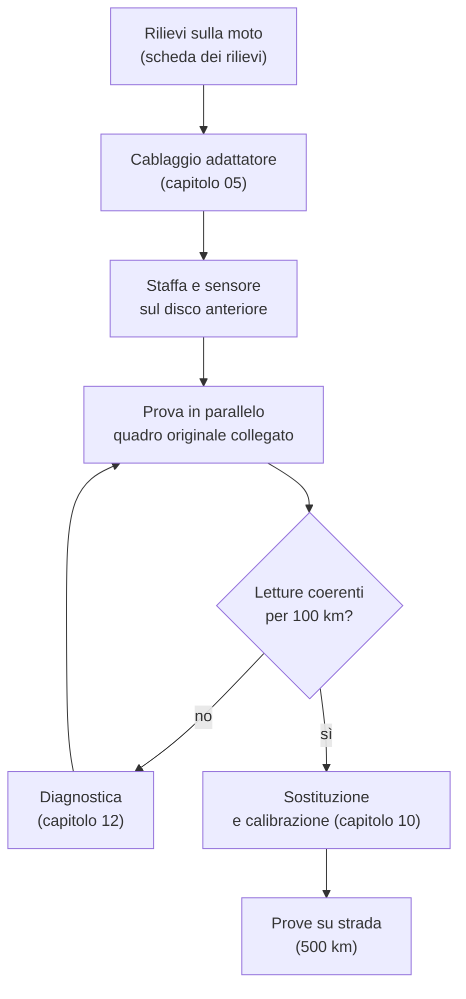

# 08 · Installazione sulla moto

L'installazione si fa in due tempi:
1. **In parallelo:** il nuovo quadro si collega insieme a quello originale, che resta al suo posto. Si confrontano le letture per qualche giorno.
2. **Sostituzione:** solo dopo il confronto il quadro originale si toglie, e si conserva.

L'impianto della moto **non si taglia mai**: tutti i collegamenti passano dal cablaggio adattatore del [capitolo 05](05-schemi-collegamenti.md).

> **Pericolo:** prima di lavorare sull'impianto stacca il **negativo** della batteria. Lavora a motore freddo: collettori e bobina scottano.

> **Attenzione:** colori e piedinature dei fili della moto sono ancora [DA VERIFICARE]. La [scheda dei rilievi](../ricerca/rilievi-sulla-moto.md) va compilata **prima** di costruire l'adattatore.



## 1 · Preparazione

1. **Foto del contachilometri originale:** a quadro acceso, insieme alla targa o al numero di telaio. Serve per impostare i km iniziali e come prova del chilometraggio (capitolo 00).
2. **Smontaggio della strumentazione:**
   - togli il cupolino interno e le viti del supporto della strumentazione, seguendo il manuale d'officina
   - stacca i connettori del quadro originale e fotografali prima di staccarli
3. **Cavo del tachimetro:**
   - sgancialo dal rinvio sul mozzo anteriore. Il rinvio **resta al suo posto**: fa da distanziale tra mozzo e forcella e non va tolto
   - chiudi l'uscita del rinvio con un tappo di gomma contro acqua e sporco

## 2 · Cablaggio adattatore e sensore

1. **Adattatore:** collega il cablaggio adattatore ai connettori originali del quadro. In questa fase usa un **cablaggio a Y**, con i connettori originali che vanno sia al quadro originale sia all'adattatore.
2. **Fusibile:** controlla che il fusibile da 2 A sia sul filo rosso, vicino al connettore della moto.
3. **Staffa e sensore:** monta la staffa e il sensore come nel [capitolo 07](07-contenitore-e-staffa.md).
4. **Cavo del sensore:**
   - fallo salire lungo il tubo del freno, fermandolo con fascette ogni 10–15 cm
   - il connettore DTM resta sotto la piastra della forcella
   - gira il manubrio da un fine corsa all'altro e comprimi la forcella: il cavo non deve tirare né restare schiacciato
5. **Percorso dei cavi:** lontani da collettori, bobina e bloccasterzo, e legati al cablaggio originale.

## 3 · Il contenitore

1. **Fissaggio:**
   - il contenitore si avvita con i tre inserti M5 al supporto del quadro originale, riusando i gommini antivibranti originali
   - se le posizioni non coincidono, servono una piastrina di adattamento oppure nuovi valori di `mount_points` in `enclosure.scad`
2. **Ingombro:**
   - controlla che il contenitore non tocchi il cupolino con il manubrio a fine corsa
   - la finestra deve essere inclinata in modo da non riflettere il cielo negli occhi
3. **Cavi:** entrano dal pressacavo e girano con un'ansa verso il basso, così l'acqua che scende lungo il cavo gocciola fuori invece di entrare.

## 4 · Prima accensione

Ricollega la batteria e, a motore spento:

| Prova | Atteso |
|---|---|
| Chiave su ON | Il quadro si accende in meno di 4 s con il test delle spie; il quadro originale funziona come prima |
| Frecce sinistra e destra | Spia del quadro e LED di backup lampeggiano dal lato giusto |
| Abbaglianti | Spia blu |
| Folle (cambio in folle) | Spia verde; ingranando una marcia si spegne |
| Luci di posizione | Il quadro passa al tema notte se la luce ambiente è bassa |
| Tensione | Uguale a quella del tester sulla batteria, ± 0,2 V |
| Chiave su OFF | Lo schermo si spegne subito; riaccendendo, i km sono quelli di prima |

Imposta i km iniziali, una volta sola, con quelli della foto:

```sh
tdmctl init-odo 41250      # km del contachilometri originale
```

Il Pico accetta il comando solo se la FRAM non ha ancora un valore: i km non si possono "tornare indietro" in seguito.

## 5 · Prova in parallelo

Con il motore acceso:

| Prova | Atteso |
|---|---|
| Minimo | I giri del nuovo quadro e del contagiri originale sono uguali entro il 3%. Se sono il doppio o la metà, va cambiato `pulses_per_rev` nel profilo |
| 3000 giri | Tensione batteria 13,8–14,6 V |
| Motore che si scalda | La temperatura sale insieme alla lancetta originale |

Poi, su strada, per almeno 100 km:

1. Confronta la velocità con un navigatore GPS (o il telefono) a 50, 90 e 130 km/h. Il nuovo quadro deve segnare **uguale o poco di più**, mai meno: la calibrazione fine è nel capitolo 10.
2. Registra un giro, che servirà alla calibrazione e alla diagnostica:

   ```sh
   tdmctl record giro.bin    # dall'immagine di sviluppo, o con un portatile collegato al Pico
   ```

## 6 · Sostituzione

1. **Quadro originale:** toglilo e conservalo in un sacchetto antistatico insieme alla foto del contachilometri.
2. **Cablaggio a Y:** sostituiscilo con il connettore diretto dell'adattatore.
3. **Rilievi:** riporta nella [scheda dei rilievi](../ricerca/rilievi-sulla-moto.md) tutto quello che hai misurato (colori, pin, impulsi per giro). Poi aggiorna i marcatori [DA VERIFICARE] in [`impianto-originale.md`](../ricerca/impianto-originale.md) e i capitoli 04 e 05.

Prima dell'uso normale servono la calibrazione del capitolo 10 e 500 km senza difetti: pioggia, notte, gallerie, occhiali polarizzati, caldo.
