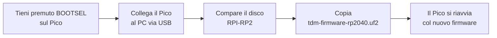
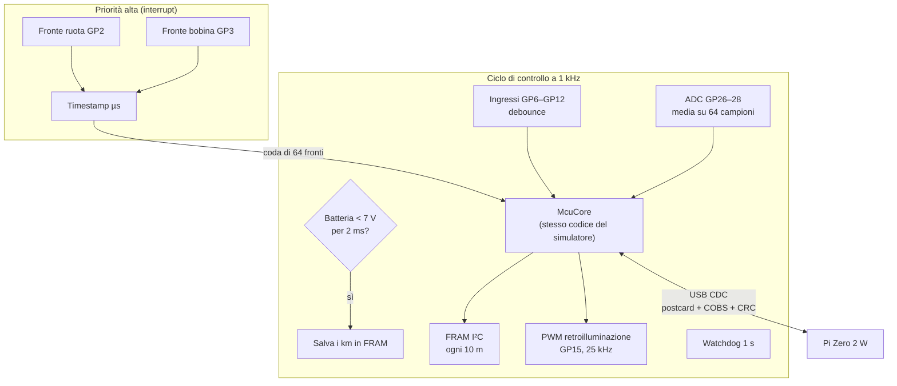
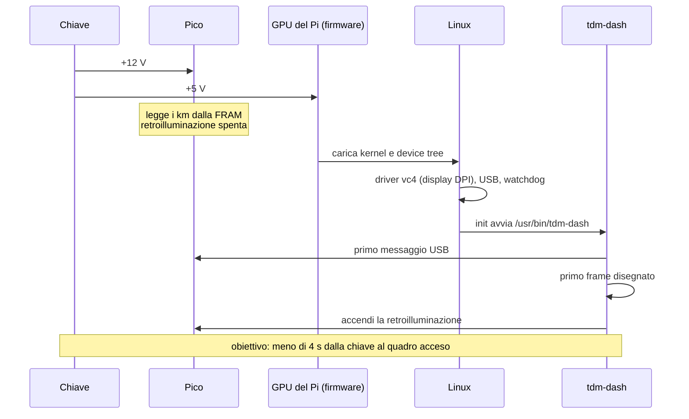

# 09 · Software: firmware, immagine e profilo

Il software di tdm-dash è fatto di tre parti, ognuna aggiornabile da sola:

| Parte | Dove gira | File | Come si aggiorna |
|---|---|---|---|
| Firmware del modulo sensori | Raspberry Pi Pico | `tdm-firmware-rp2040.uf2` (o `-rp2350.uf2` per il Pico 2) | Copiandolo sul disco USB del Pico (sotto) |
| Sistema operativo e quadro | Raspberry Pi Zero 2 W | `tdm-dash-release-sdcard.img.xz` | Riscrivendo la scheda microSD (sezione "Immagine del sistema") |
| Profilo della moto | Scheda SD, partizione `boot` | `tdm-dash.toml` | Modificandolo da qualsiasi PC |

I file pronti sono nelle **release** del repository su GitHub. Le ultime versioni di sviluppo sono negli *artifact* della CI (scheda "Actions").

## Firmware del Pico

### Caricarlo la prima volta



1. Tieni premuto il pulsante **BOOTSEL** sul Pico e collegalo al PC con un cavo micro-USB.
2. Rilascia il pulsante: compare un disco chiamato **RPI-RP2** (o **RP2350** per il Pico 2).
3. Copia sul disco il file `tdm-firmware-rp2040.uf2` (Pico) o `tdm-firmware-rp2350.uf2` (Pico 2).
4. Il disco sparisce e il Pico riparte con il firmware. Il LED del Pico non viene usato.

### Aggiornarlo quando è già montato

Il Pico è saldato dentro il contenitore e il pulsante non è raggiungibile. Dall'immagine di sviluppo del Pi, o da un PC collegato al suo USB:

```sh
tdmctl bootsel        # il Pico si riavvia nel bootloader USB
# copia il file .uf2 sul disco RPI-RP2 che compare
```

I km, i parziali e le impostazioni sono nella FRAM, non nella memoria del Pico: un aggiornamento del firmware non li tocca.

### Verificare che funzioni

Con il Pico collegato a un PC Linux:

```sh
tdmctl list           # deve elencare /dev/ttyACM0 (o simile)
tdmctl monitor -n 10  # 10 secondi di telemetria: velocità, giri, tensioni, ingressi
```

Su Linux, se `ModemManager` è attivo, può "occupare" la porta per alcuni secondi dopo il collegamento. Per evitarlo crea il file `/etc/udev/rules.d/99-tdm-dash.rules`:

```
ATTRS{idVendor}=="1209", ATTRS{idProduct}=="0001", ENV{ID_MM_DEVICE_IGNORE}="1", MODE="0666"
```

### Compilarlo da sorgente

```sh
cd firmware
cargo build --release                                     # Pico (RP2040)
cargo build --release --target thumbv8m.main-none-eabihf \
    --no-default-features --features rp2350               # Pico 2 (RP2350)
python3 ../tools/elf2uf2.py target/thumbv6m-none-eabi/release/tdm-firmware tdm-firmware-rp2040.uf2
```

Con una **Raspberry Pi Debug Probe** collegata ai pin SWD del Pico, `cargo run --release` carica il firmware e mostra i messaggi di log (defmt), senza toccare BOOTSEL.

### Cosa fa il firmware



| Funzione | Pin del Pico | Note |
|---|---|---|
| Sensore ruota | GP2 | Uscita dell'optoaccoppiatore, attiva bassa |
| Contagiri | GP3 | Uscita dell'H11L1, attiva bassa |
| FRAM SDA / SCL | GP4 / GP5 | I²C a 1 MHz, indirizzo 0x50 |
| Folle, abbaglianti, freccia SX, freccia DX, luci | GP6 – GP10 | Optoaccoppiatori, attivi bassi, pull-up interno |
| Tasti MODE, SET | GP11, GP12 | Verso massa, pull-up interno |
| Retroilluminazione | GP15 | PWM 25 kHz verso il TPS61169 |
| Batteria, sensore acqua, luce | GP26, GP27, GP28 | ADC 12 bit, riferimento 3,3 V |

Comportamenti importanti:
- **Tace finché il Pi non parla.** Dopo ogni collegamento USB il Pico non manda nulla finché non riceve un messaggio valido. Così un'eco della porta non può essere scambiata per un comando.
- **Fail-dark.** Se il Pi smette di mandare il segnale di vita per 2 s, il Pico spegne la retroilluminazione.
- **Contachilometri.** Viene salvato ogni 10 m e alla caduta di tensione, in due copie alternate con CRC. Una FRAM corrotta non viene mai sovrascritta.
- **Configurazione salvata nella FRAM.** Circonferenza della ruota e impulsi per giro restano salvati, quindi i km si contano bene anche prima che Linux abbia finito di avviarsi.

## Immagine del sistema

Il Pi Zero 2 W esegue un Linux minimo costruito con [Buildroot](https://buildroot.org) 2026.08. Non c'è una distribuzione: c'è il kernel, BusyBox e il programma del quadro. Ci sono due immagini:

| Immagine | File | Per cosa | Root filesystem |
|---|---|---|---|
| **Rilascio** | `tdm-dash-release-sdcard.img.xz` | Sulla moto | EROFS in sola lettura: togliere la chiave in qualsiasi momento non fa danni |
| **Sviluppo** | `tdm-dash-dev-sdcard.img.xz` | Al banco | ext4 scrivibile, Wi-Fi, accesso SSH. **Non** per la strada |

### Scrivere la scheda SD

1. Scarica l'immagine dalle release del repository (o dagli artifact del workflow "OS image").
2. Scrivila con [Raspberry Pi Imager](https://www.raspberrypi.com/software/) ("Use custom") o con [balenaEtcher](https://etcher.balena.io): entrambi accettano direttamente il file `.img.xz`. Da Linux:

   ```sh
   xz -dc tdm-dash-release-sdcard.img.xz | sudo dd of=/dev/sdX bs=4M conv=fsync status=progress
   ```

   > **Attenzione:** con `dd`, un nome di disco sbagliato (`/dev/sdX`) cancella un altro disco. Controlla con `lsblk` prima.

3. Rimetti la scheda nel PC: compare la partizione **TDMBOOT**. Contiene il profilo `tdm-dash.toml` (sezione "Profilo della moto" più sotto) e `config.txt`.

### Cosa succede all'avvio



- **Niente udev né script di avvio:** `init` di BusyBox monta i filesystem virtuali e la partizione di boot (in sola lettura), poi avvia il quadro. Se il programma termina viene riavviato subito.
- **Watchdog:** il programma "nutre" il watchdog del Pi; se si blocca per più di 10 s il Pi si riavvia. Il Pico, nel frattempo, spegne lo schermo dopo 2 s senza segnale di vita (fail-dark).
- **Display:** il kernel non mostra né logo né testo, quindi lo schermo resta nero finché il quadro non disegna il primo frame.

### Il display in `config.txt`

Il pannello Newhaven è collegato in DPI attraverso il Kippah e configurato in `config.txt` sulla partizione di boot:

```
dtoverlay=vc4-kms-v3d,nohdmi,noaudio
dtoverlay=vc4-kms-dpi-generic,clock-frequency=25000000,hactive=800,hfp=8,hsync=4,hbp=8,vactive=480,vfp=16,vsync=4,vbp=16,width-mm=154,height-mm=86
```

I tempi vengono dal datasheet. Le polarità di sincronismo e clock sono quelle predefinite dell'overlay, pensate per il Kippah, e sono **[DA VERIFICARE]** al banco:
- se l'immagine "sfarfalla" o i colori sono sbagliati, aggiungi `,pixclk-invert` alla seconda riga
- se l'immagine è spostata, prova `hsync-invert,vsync-invert`

### Immagine di sviluppo

1. Rinomina `wpa_supplicant.conf.example` in `wpa_supplicant.conf` sulla partizione TDMBOOT e scrivi nome e password della tua rete.
2. Avvia il Pi e collegati con `ssh root@<indirizzo>`, usando l'indirizzo IP assegnato dal router (è il dispositivo nuovo nella sua pagina dei dispositivi collegati, a volte senza nome). La password è `tdmdash`: cambiala con `passwd`.
3. Per provare una versione nuova del programma, compilala sul PC (`cargo build --release --target aarch64-unknown-linux-gnu -p tdm-dash --no-default-features --features kms`) e copiala con `scp` in `/usr/bin/`, poi `killall tdm-dash`: `init` la riavvia.

### Compilare l'immagine

Serve un PC Linux (o WSL2) con circa 15 GB liberi e un'ora di tempo la prima volta:

```sh
git submodule update --init --depth 1 os/buildroot
make -C os release        # oppure: make -C os dev
# risultato: os/output/release/images/sdcard.img
```

I dettagli (struttura, personalizzazioni, licenze) sono in [`os/README.md`](../../os/README.md).

## Profilo della moto

Il profilo è un file di testo [TOML](https://toml.io) con tutti i dati che dipendono dalla moto. Il quadro cerca, nell'ordine:

1. `/boot/tdm-dash.toml`: sulla partizione `boot` della scheda SD, che si vede da Windows, macOS e Linux
2. `/etc/tdm-dash/default.toml`: il profilo incluso nell'immagine
3. il profilo integrato nel programma

Se il file sulla SD ha un errore, il quadro usa il profilo integrato e mostra l'avviso "Errore nel profilo". La riga dell'errore compare nella schermata Diagnostica.

Il profilo della TDM 850 è [`profiles/yamaha-tdm850-3vd.toml`](../../profiles/yamaha-tdm850-3vd.toml); quello di esempio per altre moto è [`profiles/generic-example.toml`](../../profiles/generic-example.toml). Le voci più importanti:

| Sezione | Voce | Significato |
|---|---|---|
| `[speed]` | `pulses_per_rev` | Bulloni (o magneti) letti dal sensore per giro di ruota |
| | `wheel_circumference_mm` | Circonferenza di rotolamento, si calibra col GPS (capitolo 10) |
| | `display_gain`, `display_offset_kmh` | Margine di legge: il quadro non deve mai segnare meno del reale. Il programma rifiuta valori sotto 1 e 0 |
| `[tach]` | `pulses_per_rev` | Impulsi della bobina per giro motore (1 sulla TDM, 0,5 su un monocilindrico) |
| | `redline_rpm`, `shift_rpm` | Inizio zona rossa e luce di cambiata |
| `[coolant]` | `curve` | Coppie [ohm, °C] del sensore, misurate a bagnomaria |
| | `warn_c`, `critical_c` | Soglie degli avvisi |
| `[battery]` | soglie | Batteria bassa, mancata ricarica, sovratensione |
| `[inputs]` | canali | Quale ingresso del Pico corrisponde a quale spia; `invert = true` inverte la logica |
| `[display]` | `layout`, `theme` | Layout e tema predefiniti |
| `[fuel]` | `tank_l`, `l_per_100km` | Per la stima dell'autonomia |

Per provare un profilo sul PC prima di copiarlo sulla SD:

```sh
cargo run -p tdm-dash -- --profile mio-profilo.toml
```
