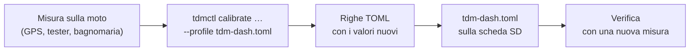

# 10 · Calibrazione

Il quadro esce con i valori del profilo della TDM 850: circonferenza stimata della ruota, 1 impulso per giro, curva dell'acqua dal manuale d'officina. Sono buoni punti di partenza, ma ogni moto è diversa: gomma, usura, tolleranze dei componenti. La calibrazione corregge i valori con misure fatte sulla tua moto.

Tutte le correzioni finiscono nel **profilo** `tdm-dash.toml` sulla partizione di boot della scheda SD (capitolo 09). Il comando `tdmctl calibrate` fa i calcoli e stampa le righe da incollare:



`tdmctl` gira sul PC (Linux, macOS, Windows con WSL) o sull'immagine di sviluppo del Pi. Passa sempre il profilo in uso con `--profile`, così il calcolo parte dai valori attuali:

```sh
tdmctl calibrate wheel 25,41 25,12 --profile /media/TDMBOOT/tdm-dash.toml
```

Per modificare il profilo:
1. Spegni la moto e togli la scheda SD.
2. Aprila sul PC e modifica `tdm-dash.toml` con un editor di testo qualsiasi.
3. Rimetti la scheda nel Pi.

Se il file ha un errore il quadro lo segnala ("Errore nel profilo") e usa i valori integrati: nessun rischio di restare senza strumenti.

## Velocità e contachilometri

La velocità si calcola dal tempo tra i bulloni del disco e dalla **circonferenza di rotolamento** della ruota. La circonferenza stimata (1975 mm per una 110/80-18) può sbagliare del 2–3%: dipende da marca, pressione e usura della gomma.

**Misura.**
1. Pressione delle gomme corretta, gomma non nuova di zecca (dopo i primi 300 km).
2. Azzera il parziale B (nella schermata Viaggio: SET breve per sceglierlo, SET lungo per azzerarlo; capitolo 11) e avvia la registrazione di un percorso su un'app GPS del telefono.
3. Fai **almeno 10 km**, meglio 20–30, su strade senza troppe curve strette: il GPS sottostima nelle curve e nelle soste.
4. Alla fine leggi i km del GPS e quelli del parziale B.

```sh
tdmctl calibrate wheel KM_GPS KM_PARZIALE --profile tdm-dash.toml
```

Esempio: 25,41 km GPS e 25,12 km sul parziale.

```
circonferenza: 1975.0 → 1997.8 mm (+1.15 %)

[speed]
wheel_circumference_mm = 1997.8
```

Sostituisci il valore di `wheel_circumference_mm` nella sezione `[speed]` del profilo. Il comando rifiuta correzioni oltre il ±10%: una differenza così grande indica che `pulses_per_rev` (il numero di bulloni) è sbagliato, o che il sensore perde degli impulsi (capitolo 12).

**Margine di legge.** La velocità **mostrata** è quella calcolata, moltiplicata per `display_gain` (1,03) più `display_offset_kmh` (1 km/h): il quadro segna sempre un po' più del vero, come richiede il regolamento UNECE R39. **Non** abbassare questi valori sotto 1 e 0, e infatti il programma li rifiuta. Il contachilometri e i parziali usano invece la distanza vera, senza margine.

**Verifica.** Rifai lo stesso percorso: la differenza tra GPS e parziale deve stare sotto l'1%. Poi controlla a velocità costante (50, 90, 130 km/h col cruise del GPS): il quadro deve segnare 2–5 km/h in più del GPS, mai meno.

## Contagiri

Il contagiri conta gli impulsi della bobina. La TDM 850 ha una bobina che scocca a ogni giro dell'albero motore, quindi `pulses_per_rev = 1` [DA VERIFICARE]. Se i giri mostrati sono il doppio o la metà di quelli veri, il valore è sbagliato.

**Misura.** Serve un riferimento:
- il contagiri originale, durante la prova in parallelo (capitolo 08)
- oppure un contagiri da officina (a pinza induttiva o ottico)

Porta il motore caldo a un regime stabile, per esempio il minimo o 3000 giri, e leggi entrambi:

```sh
tdmctl calibrate tach GIRI_VERI GIRI_MOSTRATI --profile tdm-dash.toml
```

```
impulsi per giro: 1 → 0.997, arrotondato a 1

[tach]
pulses_per_rev = 1
```

Il valore viene arrotondato al mezzo più vicino, perché un'accensione dà sempre 0,5, 1, 2… impulsi per giro. Se il comando avvisa che il valore esatto è lontano dall'arrotondamento, la misura non era a regime stabile oppure il circuito del contagiri conta male (capitolo 12).

## Temperatura dell'acqua

Il profilo contiene la curva resistenza → temperatura del sensore originale, ma solo due punti vengono dal manuale (≈ 50 Ω a 80 °C, ≈ 27 Ω a 100 °C). Gli altri sono stimati. Per una lettura precisa, la curva si misura **a bagnomaria**.

**Cosa serve:**
- un sensore uguale a quello della moto (di ricambio, per non svuotare l'impianto) oppure quello smontato
- un pentolino d'acqua, un fornello, un termometro da cucina fino a 100 °C
- il tester in ohm

**Misura.**
1. Collega il tester tra il terminale del sensore e il suo corpo metallico, che fa da massa.
2. Immergi il sensore (solo la parte metallica) e il termometro, vicini.
3. Scalda lentamente. A 20, 40, 60, 80, 90 e 100 °C mescola, aspetta che la resistenza sia stabile e annota °C e ohm.
4. Scrivi le misure in un file di testo, una coppia per riga:

   ```
   # sensore acqua, bagnomaria 12/05
   20  1050
   40  452
   60  198,5
   80  50,2
   90  37
   100 27,4
   ```

5. Calcola la curva:

   ```sh
   tdmctl calibrate coolant misure.txt
   ```

   ```
   6 punti

   [coolant]
   curve = [[1050.0, 20], [452.0, 40], [198.5, 60], [50.2, 80], [37.0, 90], [27.4, 100]]
   ```

Sostituisci la riga `curve = …` nella sezione `[coolant]`. Il quadro interpola tra i punti sul logaritmo della resistenza, che segue bene l'andamento di una NTC.

> **Pericolo:** acqua a 100 °C. Usa una pinza per il sensore e non chiudere il pentolino.

**Verifica sulla moto.** A motore caldo, con la ventola che parte, la temperatura mostrata deve essere vicina a quella di intervento della ventola [DA VERIFICARE nel manuale d'officina].

## Tensione della batteria

Il partitore 100k/22k ha resistenze all'1%: la tensione può sbagliare di 0,1–0,2 V.

**Misura.** A motore spento e luci accese, perché la tensione resti stabile:
1. Misura col tester sui morsetti della batteria.
2. Leggi nello stesso momento la tensione nella schermata Diagnostica, o con `tdmctl monitor`.

```sh
tdmctl calibrate battery V_TESTER V_QUADRO --profile tdm-dash.toml
```

```
partitore: 5.5455 → 5.5965 (+0.92 %)

[board]
vbat_divider = 5.5965
```

Aggiungi o sostituisci la sezione `[board]` del profilo. La soglia di salvataggio del contachilometri (7 V nel firmware) non cambia: ha un margine ampio.

## Luce ambiente e luminosità

Il sensore di luce decide il passaggio tra tema Giorno e tema Notte e la luminosità della retroilluminazione. Le soglie sono nella sezione `[display]`:

| Voce | Significato | Valore iniziale |
|---|---|---|
| `light_raw_dark` | Lettura del sensore considerata "buio" (notte, galleria) | 300 |
| `light_raw_bright` | Lettura considerata "pieno sole" | 3500 |
| `night_below`, `day_above` | Soglie del tema, in frazione tra buio e sole: sotto passa a Notte, sopra torna a Giorno | 0,25 e 0,40 |
| `brightness_min_pct` | Luminosità minima di notte | vedi profilo |

**Misura.** Con la schermata Diagnostica (o `tdmctl monitor`, colonna `luce`):
- leggi il valore di notte in una strada illuminata (`light_raw_dark`)
- leggi il valore in pieno sole con il quadro montato (`light_raw_bright`)

Se di notte lo schermo abbaglia, alza `light_raw_dark` o abbassa `brightness_min_pct`. Se in galleria il tema cambia troppo tardi, alza `night_below`.

## Riepilogo

| Cosa | Comando | Sezione del profilo | Quando rifarla |
|---|---|---|---|
| Circonferenza ruota | `tdmctl calibrate wheel` | `[speed] wheel_circumference_mm` | Gomma nuova, marca o misura diversa |
| Impulsi per giro della ruota | (a mano: numero di bulloni) | `[speed] pulses_per_rev` | Disco diverso |
| Contagiri | `tdmctl calibrate tach` | `[tach] pulses_per_rev` | Una volta |
| Curva acqua | `tdmctl calibrate coolant` | `[coolant] curve` | Sensore sostituito |
| Batteria | `tdmctl calibrate battery` | `[board] vbat_divider` | Scheda ricostruita |
| Luce | (a mano) | `[display]` | Se il tema cambia nel momento sbagliato |

Dopo ogni modifica, conserva una copia del profilo sul PC: è tutto ciò che serve per rifare una scheda SD identica.
