# 11 · Uso

Come si legge il quadro, come si usano i tasti MODE e SET e cosa significano gli avvisi. Le immagini sono catturate dal software vero (`tdm-dash --screenshot`), alla risoluzione del display (800×480).

## Accensione

Girando la chiave:

1. Il **Pico** si accende in pochi millisecondi e comincia subito a contare gli impulsi e i km.
2. Il **Pi** avvia Linux con lo schermo spento (obiettivo: meno di 4 s).
3. Compare lo **splash**, poi l'**auto-test**: lancette a fondo scala e ritorno, tutte le spie accese per un istante. Se una spia non si accende durante l'auto-test, c'è un problema da controllare.
4. Il quadro passa alla schermata di guida.

Se si parte prima che l'auto-test sia finito, il quadro lo salta e mostra subito la velocità.

| Splash | Auto-test |
|---|---|
|  | 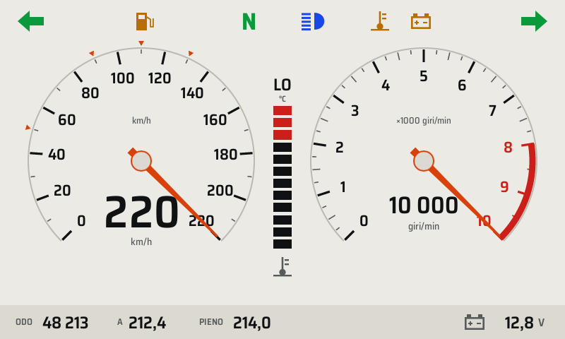 |

## I tre layout di guida

Il layout si sceglie da **Impostazioni → Layout di guida**, oppure nel profilo (`[display] layout`). Il predefinito è **Classic** ([ADR 0010](../adr/0010-layout-predefinito.md)).

### Classic

Due quadranti, come un quadro analogico. Tachimetro da 0 a 220 km/h, con piccoli triangoli arancioni sui limiti italiani (50, 90, 110, 130). Contagiri da 0 a 10 000 con zona rossa da 8000. Al centro la colonna della temperatura dell'acqua.

| Giorno | Notte |
|---|---|
| 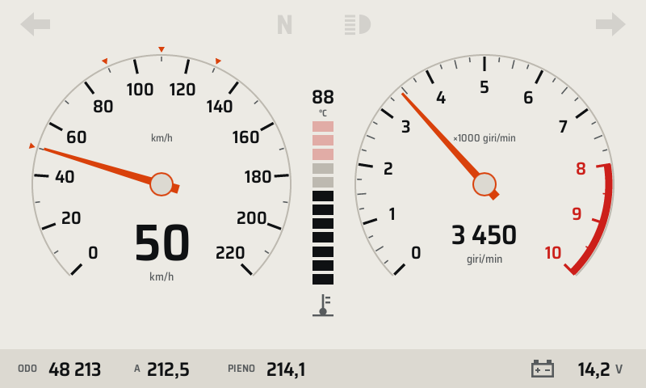 | 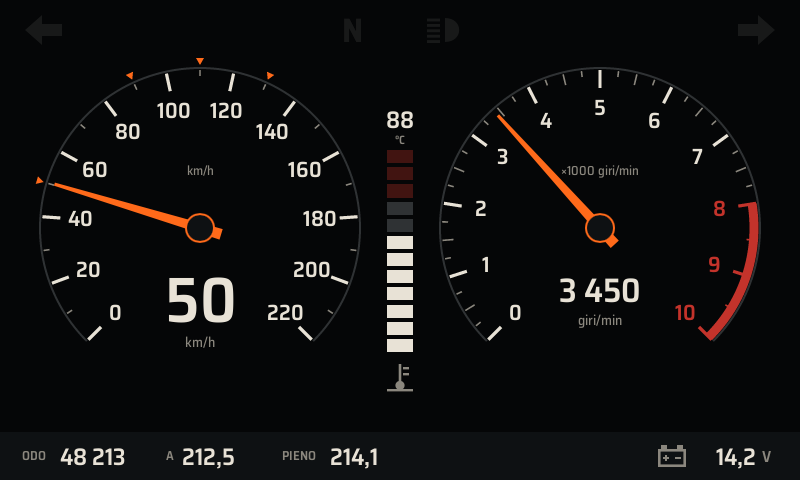 |

### Sport

Velocità molto grande al centro, giri su un arco a 50 segmenti. Oltre i 7500 giri l'arco lampeggia in arancione: è la **luce di cambiata**.

| Giorno | Notte |
|---|---|
| 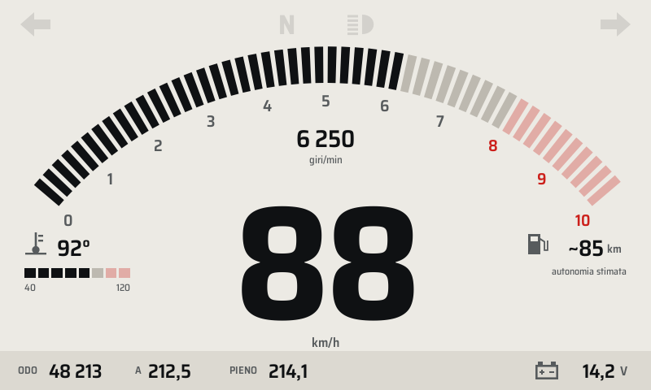 | 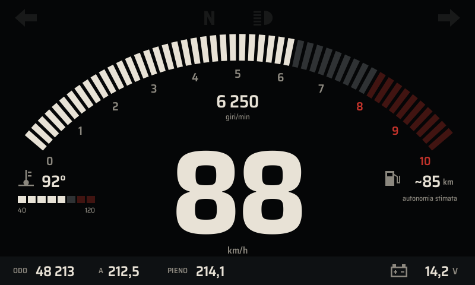 |

### Touring

Velocità grande con barra dei giri, e a destra i dati del viaggio: parziale A, media, tempo in sella, autonomia stimata.

| Giorno | Notte |
|---|---|
| 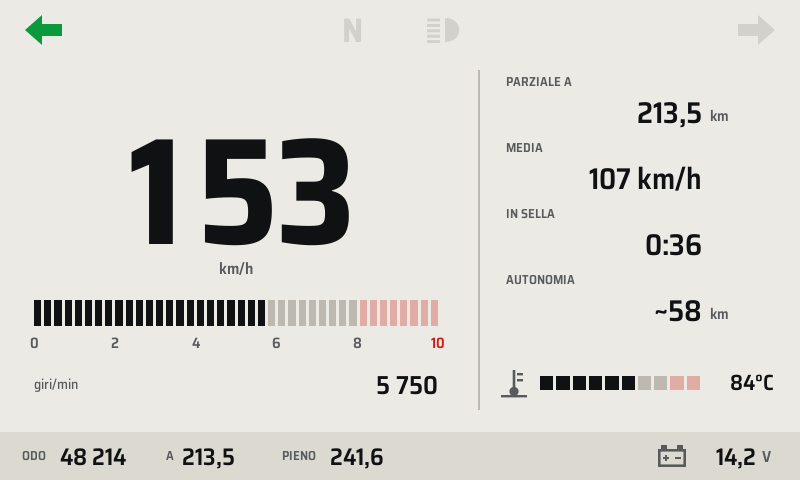 | 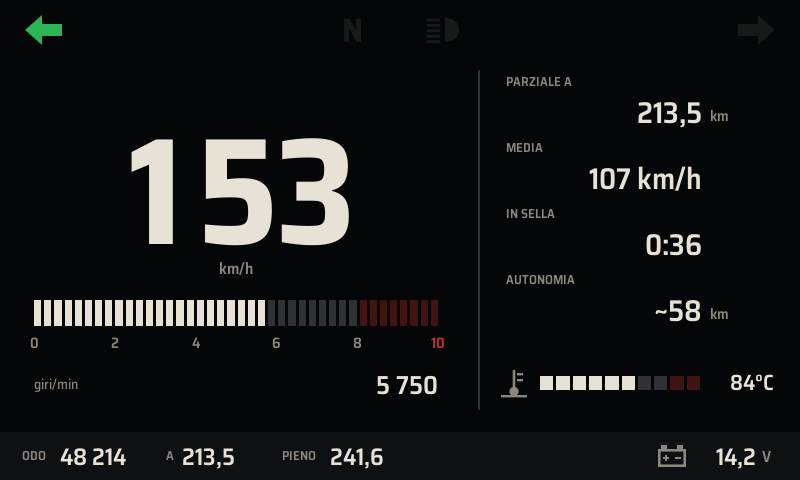 |

## Elementi sempre presenti

**Spie** (in alto):

| Spia | Colore | Quando |
|---|---|---|
| Freccia sinistra / destra | Verde | Frecce accese, lampeggiano col lampeggiatore della moto |
| N | Verde | Folle inserito |
| Abbaglianti | Blu | Abbaglianti accesi |
| Termometro | Ambra o rosso | Avviso sulla temperatura dell'acqua |
| Batteria | Ambra o rosso | Avviso sulla tensione |
| Collegamento barrato | Rosso | Il Pi non riceve dati dal Pico |

Le spie spente restano appena visibili (grigio trasparente): si impara dove sono. Frecce, abbaglianti e folle hanno anche i **LED di backup** sulla cornice, che funzionano anche a quadro spento.

**Striscia in basso:**
- contachilometri totale (ODO)
- parziale A
- parziale "PIENO", da azzerare a ogni rifornimento: serve a stimare l'autonomia
- tensione della batteria, che diventa ambra sotto 11,8 V o sopra 15 V, e rossa sopra 15,5 V

## Tasti

| Tasto | Pressione | Cosa fa |
|---|---|---|
| MODE | breve (< 0,6 s) | Schermata successiva: Guida → Viaggio → Diagnostica → Guida |
| SET | breve | Silenzia per 5 minuti l'avviso ambra visibile; nella schermata Viaggio sceglie il parziale |
| SET | lunga (≥ 1 s) | Da fermi apre le **Impostazioni**; nella schermata Viaggio **azzera** il parziale scelto |

In movimento le impostazioni non si aprono (compare "Impostazioni disponibili solo da fermi") e si chiudono da sole se la moto parte.

## Viaggio, diagnostica, impostazioni

| Viaggio | Diagnostica | Impostazioni |
|---|---|---|
| 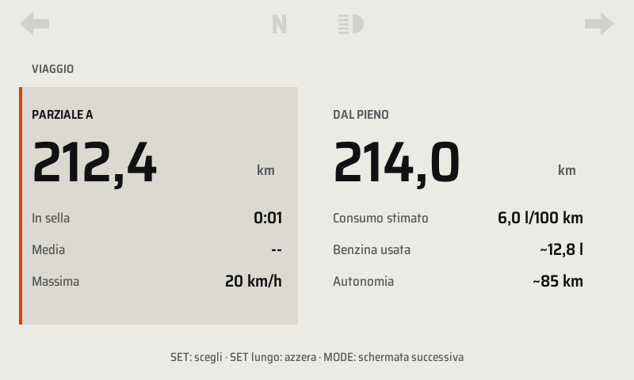 | 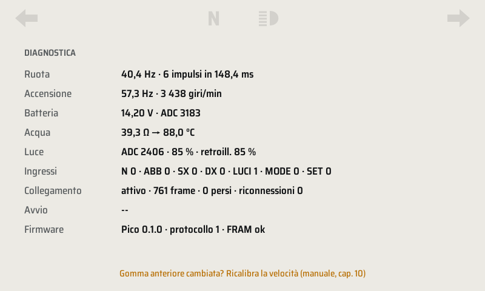 | 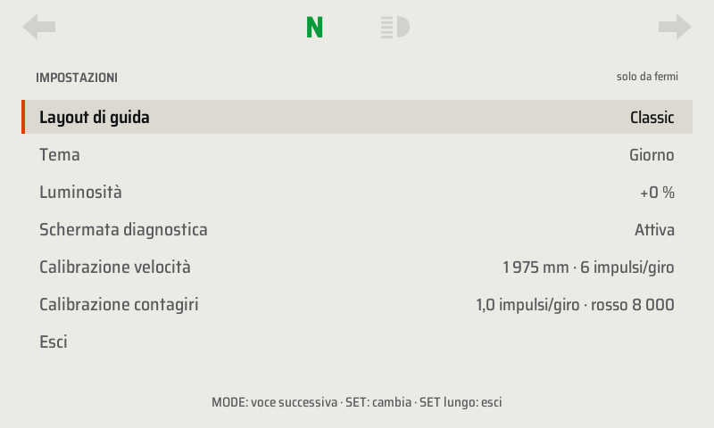 |

**Viaggio.** Due colonne:
- **Parziale A**: km, tempo in sella, media e massima dall'accensione.
- **Dal pieno**: km dal rifornimento, consumo stimato, benzina usata e autonomia.

La TDM 3VD non ha sensore della benzina: l'autonomia è una **stima** basata sul consumo medio del profilo (6 l/100 km) e sul serbatoio da 18 l. Azzera "dal pieno" a ogni pieno.

**Diagnostica.** Valori grezzi letti dal Pico:
- frequenza degli impulsi di ruota e bobina
- tensione e lettura ADC della batteria
- resistenza del sensore dell'acqua
- luce ambiente
- stato degli ingressi
- qualità del collegamento USB
- tempo di avvio, versione del firmware e stato della FRAM

Serve per la calibrazione (capitolo 10) e per la ricerca guasti (capitolo 12). Si può nascondere da Impostazioni.

**Impostazioni.** MODE breve passa alla voce successiva, SET breve cambia il valore, SET lungo esce. Le scelte vengono salvate nella FRAM del Pico e restano anche cambiando la scheda SD.

| Voce | Valori |
|---|---|
| Layout di guida | Classic, Sport, Touring |
| Tema | Automatico, Giorno, Notte |
| Luminosità | −20 … +20 % rispetto alla regolazione automatica |
| Schermata diagnostica | Attiva, Nascosta |
| Calibrazione velocità e contagiri | Mostra i valori del profilo (si modificano nel file `/boot/tdm-dash.toml`) |

## Giorno e notte

Con il tema **Automatico** il sensore di luce decide tema e luminosità:
- passa a **Notte** dopo 10 s di buio (galleria lunga, sera)
- torna a **Giorno** dopo 5 s di luce

I ritardi evitano che il quadro lampeggi passando sotto un ponte. La luminosità della retroilluminazione segue la luce ambiente in modo continuo: sale in fretta uscendo da una galleria, scende lentamente.

## Avvisi

| Tipo | Aspetto | Si può silenziare? |
|---|---|---|
| **Critico** | Fascia rossa sotto le spie | No, resta finché la causa non sparisce |
| **Attenzione** | Banner ambra | Sì, SET breve per 5 minuti; ricompare se la causa si ripresenta |
| **Informazione** | Icona e testo ambra nella striscia in basso | Si spegne da solo |

| Attenzione | Critico | Collegamento perso |
|---|---|---|
| 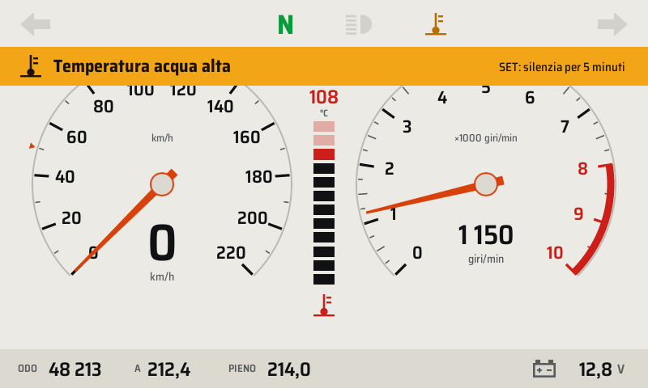 | 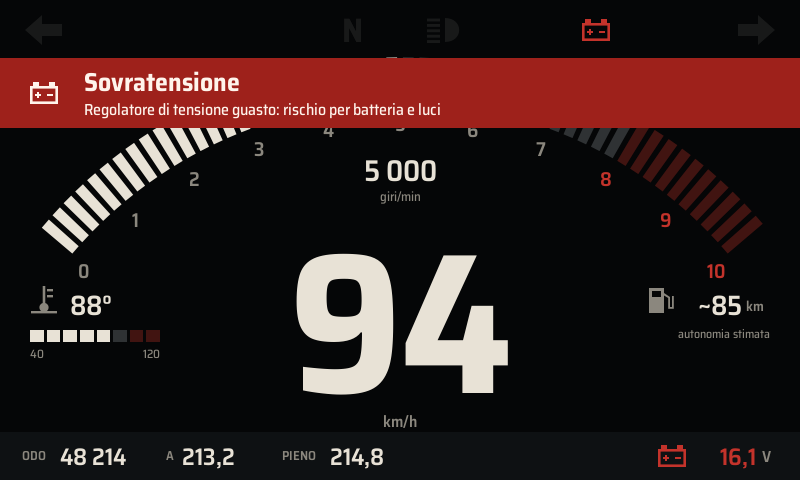 | 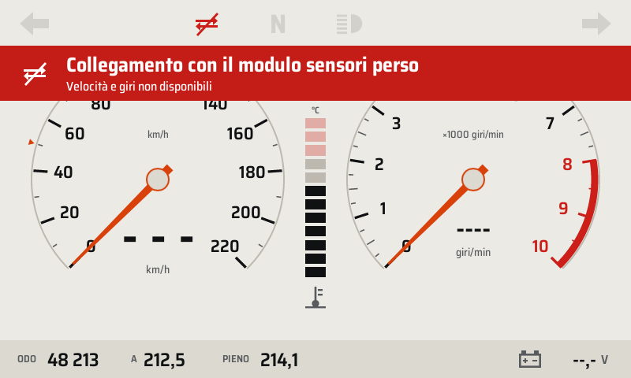 |

| Avviso | Tipo | Quando compare | Cosa fare |
|---|---|---|---|
| Temperatura acqua critica | Critico | ≥ 112 °C per 2 s | Fermarsi e spegnere il motore; controllare liquido e ventola |
| Temperatura acqua alta | Attenzione | ≥ 105 °C per 3 s | Ridurre il carico; controllare la ventola |
| Sensore temperatura scollegato | Attenzione | Sensore aperto o in corto per 5 s | Controllare il filo del sensore |
| Sovratensione | Critico | > 15,5 V per 1 s | Regolatore guasto: spegnere luci accessorie, rientrare, sostituire il regolatore |
| Tensione alta | Attenzione | > 15,0 V per 2 s | Controllare il regolatore |
| Batteria non in carica | Attenzione | < 12,8 V oltre 3000 giri per 30 s | Statore, connettore dello statore o regolatore |
| Batteria bassa | Attenzione | < 11,8 V per 10 s a motore acceso | Ricarica o sostituzione della batteria |
| Collegamento con il modulo sensori perso | Critico | Nessun dato dal Pico per 1 s | Velocità e giri diventano "---"; controllare cavo USB e alimentazione del Pico |
| Firmware del modulo non compatibile | Attenzione | Versione di protocollo diversa | Aggiornare il firmware del Pico (capitolo 09) |
| Errore nel profilo | Attenzione | `/boot/tdm-dash.toml` illeggibile | Il quadro usa il profilo integrato; correggere il file |
| Memoria del contachilometri guasta | Attenzione | FRAM corrotta o assente | Vedi Diagnostica e capitolo 12 |
| Freccia accesa | Informazione | Freccia lampeggiante per più di 30 s sopra i 20 km/h | Spegnere la freccia |
| Riserva stimata | Informazione | Autonomia stimata sotto la riserva (≈ 58 km) | Fare benzina e azzerare "dal pieno" |

**Fail-dark.** Se l'applicazione sul Pi si blocca, il Pico non riceve più il segnale di vita e dopo 2 s spegne la retroilluminazione. Uno schermo nero è più sicuro di una velocità ferma e sbagliata. Il watchdog riavvia poi il Pi; i LED di backup restano accesi.

## Provare il quadro sul PC

Lo stesso software gira su un PC Linux, con un simulatore della moto al posto del Pico:

```sh
cargo run -p tdm-dash                                # scenario città
cargo run -p tdm-dash -- --source sim:mountain --layout sport
cargo run -p tdm-link --bin tdmctl -- scenarios      # elenco degli scenari
```

| Tasto | Funzione |
|---|---|
| M | MODE (tieni premuto ≥ 1 s per il lungo) |
| S | SET (tieni premuto ≥ 1 s per il lungo) |
| ← / → | Freccia sinistra / destra per 5 s |
| H | Abbaglianti |
| L / K | Più luce / meno luce ambiente |
| U | Scollega l'USB per 4 s |
| 1 / 2 / 3 | Layout Classic / Sport / Touring |
