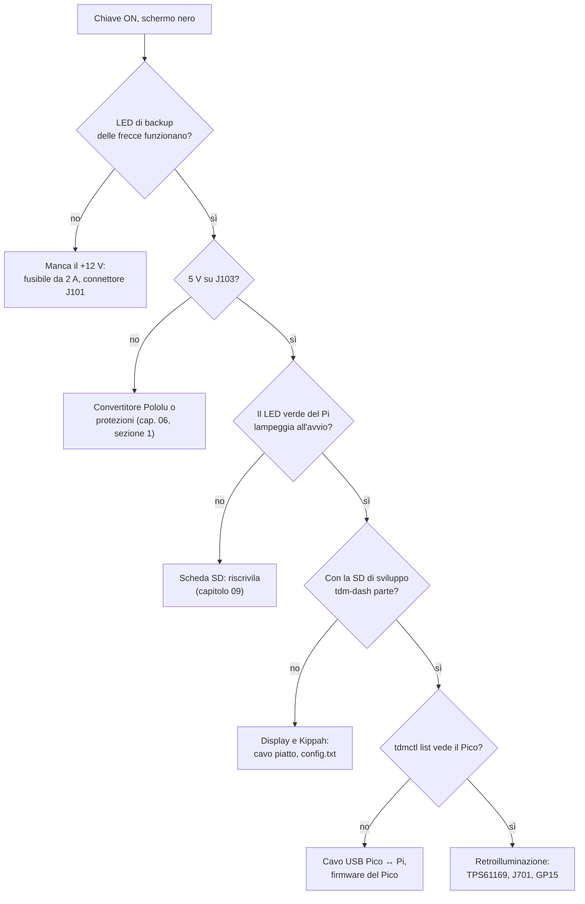
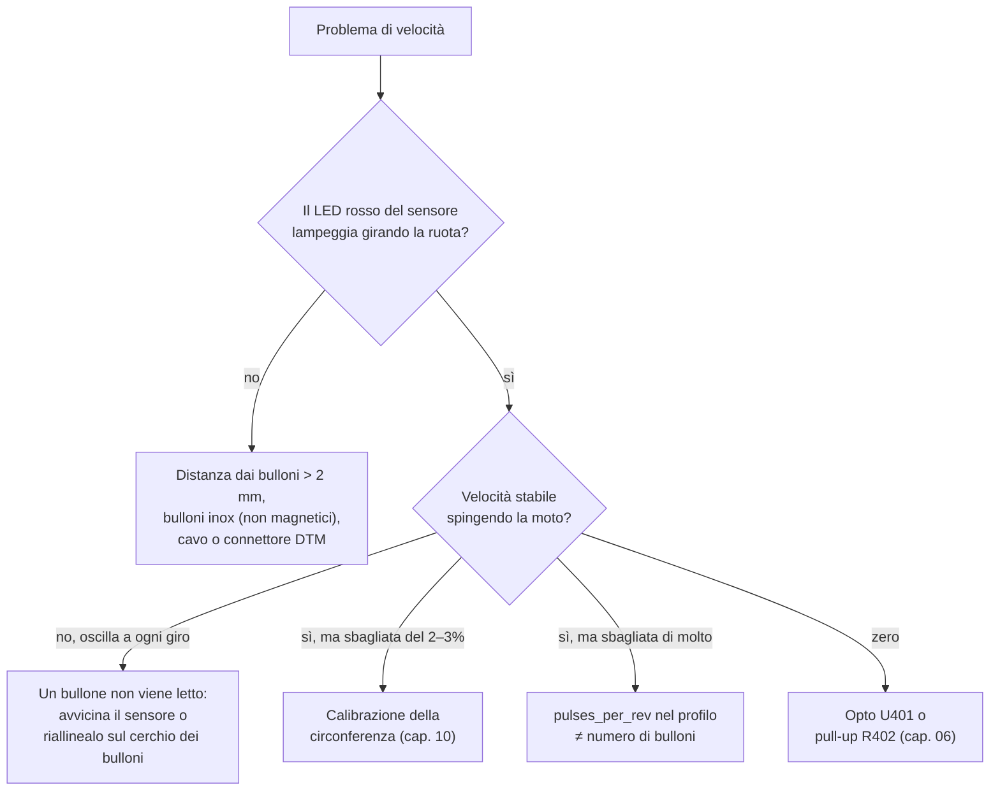
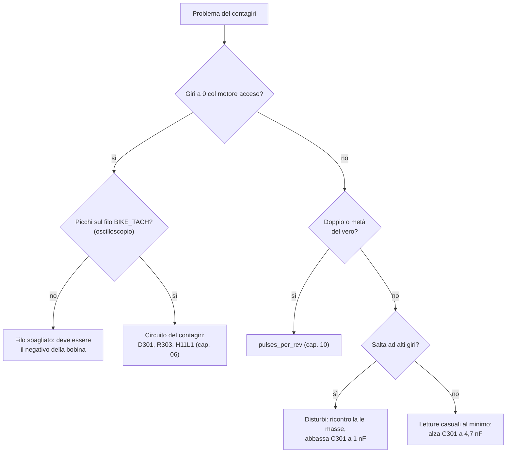

# 12 · Diagnostica e risoluzione dei problemi

Prima di smontare qualcosa, guarda la **schermata Diagnostica** (MODE breve fino a "Diagnostica", capitolo 11). Mostra i valori grezzi che arrivano dal Pico. Lo stesso si vede da un PC collegato al Pico con:

```sh
tdmctl monitor
```

```
modulo: firmware 0.0.1, protocollo 1, FRAM Ok, acceso da 812 s
   12.0 s   50 frame/s   48.3 km/h   3120 giri  14.21 V  acqua Celsius(86.0) (41.2 Ω)  luce 2210  ingressi 0x0004
```

| Colonna | Cosa dice |
|---|---|
| `frame/s` | Messaggi al secondo dal Pico: devono essere 50. Meno indica disturbi sull'USB |
| `km/h`, `giri` | Valori calcolati dal profilo; `NaN` = nessun impulso |
| `V` | Tensione della batteria |
| `acqua` | Temperatura e resistenza del sensore; `Fault` = filo interrotto o in corto, `Low` = più freddo del primo punto della curva |
| `luce` | Lettura del sensore di luce, da 0 a 4095 |
| `ingressi` | Spie e tasti attivi, come maschera (capitolo 06): folle `0x0001`, abbaglianti `0x0002`, freccia SX `0x0004`, DX `0x0008`, luci `0x0010`, MODE `0x0100`, SET `0x0200` |

## Lo schermo non si accende



Il quadro resta nero di proposito se il Pico non riceve il segnale di vita dal Pi per 2 s (fail-dark). Uno schermo che si accende e dopo qualche secondo si spegne indica quindi che il programma sul Pi si è bloccato o che l'USB cade.

## Velocità assente, a scatti o sbagliata



Valori attesi sul connettore del sensore, a quadro acceso:

| Punto | Bullone lontano | Bullone davanti al sensore |
|---|---|---|
| DTM pin 1 (+12 V) | 12–14,5 V | 12–14,5 V |
| DTM pin 2 (segnale), verso massa | ≈ 12 V | < 1,5 V |
| GP2 del Pico | 3,3 V | < 0,4 V |

## Contagiri assente o instabile



> **Pericolo:** sul filo del contagiri ci sono centinaia di volt a motore acceso. Misura solo con l'oscilloscopio e la sonda ×10, mai con il tester sui puntali scoperti.

## Spie che non si accendono o restano accese

| Sintomo | Verifica |
|---|---|
| Una spia non si accende mai | Con la funzione attiva, misura la tensione sul pin di J101: ≈ 12 V per abbaglianti e frecce, ≈ 0 V per la folle. Se c'è, controlla optoaccoppiatore e zoccolo di quel canale |
| Una spia resta sempre accesa | Il filo porta tensione anche a funzione spenta: verifica nei rilievi che sia quello giusto. Il valore `invert` del canale nel profilo deve essere corretto |
| Le frecce si scambiano | Fili dei lati invertiti nell'adattatore: scambiali, oppure scambia i canali `turn_left` e `turn_right` nel profilo |
| La folle si accende in marcia | Il contatto del folle ha perdite verso massa: misura la resistenza del filo verso massa in marcia (deve essere > 10 kΩ) |
| La freccia lampeggia più veloce | Il lampeggiatore sente meno carico: non dipende dal quadro (carico < 3 mA), controlla le lampadine |

## Temperatura dell'acqua

| Sintomo | Causa probabile |
|---|---|
| "Sensore temperatura scollegato" | Filo interrotto o connettore del sensore ossidato: misura la resistenza tra il filo e massa, deve essere tra 20 Ω e 2 kΩ |
| Temperatura sempre al massimo | Filo del sensore a massa (corto) |
| Valori sbagliati di 5–10 °C | Curva del profilo da misurare a bagnomaria (capitolo 10) |

## Tensione e ricarica

| Avviso | Verifica |
|---|---|
| "Batteria non in carica" | A 3000 giri la tensione ai morsetti col tester deve essere 13,8–14,6 V. Se è sotto, controlla il connettore dello statore (punto debole noto della TDM) e il regolatore |
| "Tensione alta" o "Sovratensione" | Regolatore guasto: rischio per batteria e lampadine. Rientra con il minimo di luci accese |
| Tensione mostrata diversa dal tester | Calibrazione del partitore (capitolo 10) |

## Collegamento USB e contachilometri

| Sintomo | Verifica |
|---|---|
| "Collegamento con il modulo sensori perso" a tratti | Doppino USB lungo o non intrecciato, ferrite mancante, massa del Pico. `frame/s` sotto 50 in `tdmctl monitor` conferma i disturbi |
| "Firmware del modulo non compatibile" | Pico e immagine di versioni diverse: aggiorna il firmware (capitolo 09) |
| "Memoria del contachilometri guasta" | FRAM scollegata o danneggiata. La riga `FRAM` di `tdmctl monitor` dice `Missing` (non risponde) o `Corrupt` (dati non validi). Con FRAM nuova serve `tdmctl init-odo` con l'ultimo valore noto |
| Km persi dopo uno stacco brusco | Al massimo 10 m sono normali. Di più: controlla C103 (470 µF) e D103 |

## Registrare un problema

Un problema che compare solo su strada si può registrare e riprodurre sul PC:

```sh
tdmctl record problema.bin          # durante il giro (immagine di sviluppo)
cargo run -p tdm-dash -- --source replay:problema.bin   # sul PC, dal repository
```

Il quadro sul PC si comporta esattamente come sulla moto con quei dati. Allega il file a una segnalazione nel repository.
