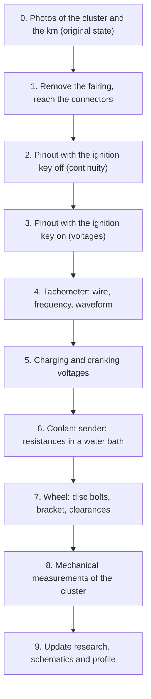

# Measurements to take on the bike

This sheet turns the [TO VERIFY] facts of the [research](original-wiring.md) into [VERIFIED] facts. Fill it in **before** building the electronics. Every answer updates the schematics, the wiring harnesses and the profile `profiles/yamaha-tdm850-3vd.toml`.

**Tools:** digital multimeter, crocodile clip probes, backprobe pins (thin needles to measure from the back of the connector without piercing it), tape measure, calipers, camera, kitchen thermometer, small pan, screwdrivers, spanners for the fairing. A cheap oscilloscope is recommended (a DSO for about 40 €).

> **Safety:** when measuring with the engine running, keep the leads away from the coil and the plug leads. Do not touch the coil negative while the engine is running: the spikes exceed 300 V. Do not run the engine in a closed room.

## Recommended order

## 0. Original state

- [ ] Photo of the cluster switched on (day and evening)
- [ ] Photo of the odometer: **______ km**. It is needed to set the initial value in the new dashboard, once only (`InitOdometer`)
- [ ] Frame number: **______________** (confirms 3VD4)
- [ ] Photos of the connectors behind the cluster, with a ruler next to them

## 1. Cluster connectors

| Connector | Number of pins | Body color | Make/series (if readable) | Photo |
|---|---|---|---|---|
| A | | | | |
| B | | | | |
| Bullet/single | | | | |

## 2. Pinout

Measure from the back of the bike-side connector, with the cluster disconnected when stated. Ground reference: battery negative.

| Pin | Wire color | Key OFF (V) | Key ON (V) | Position lights ON | Neutral engaged | High beam ON | Left turn signal | Right turn signal | Deduced function |
|---|---|---|---|---|---|---|---|---|---|
| 1 | | | | | | | | | |
| 2 | | | | | | | | | |
| 3 | | | | | | | | | |
| 4 | | | | | | | | | |
| 5 | | | | | | | | | |
| 6 | | | | | | | | | |
| … | | | | | | | | | |

Specific checks:
- [ ] Does the neutral wire go to ground (< 1 Ω) only in neutral, with the cluster disconnected?
- [ ] Is the L wire (illumination) **always** powered when the key is ON? In Italy dipped headlights are mandatory: if it is always powered it is no use for telling day from night.
- [ ] Is there a **permanent** +12 V (also with the key OFF) near the cluster? Yes / No, color: ____
- [ ] Rating of the fuse feeding the Br wire: ____ A

## 3. Starting and flasher with the cluster disconnected

- [ ] Does the bike start in neutral with the cluster disconnected? Yes / No
- [ ] Does it start in gear with the clutch pulled in? Yes / No (starter interlock)
- [ ] Turn signals: rate with the cluster connected ____ flashes/min, disconnected ____ flashes/min
- [ ] Do hazard lights (all four turn signals) exist? Yes / No

## 4. Tachometer

- [ ] Color of the wire from the coil negative to the tachometer: ______
- [ ] Is it in the main connector or on a separate spade terminal? ______
- [ ] Number of coils: ____ ; which one feeds the tachometer: ______
- [ ] Frequency measured with the multimeter (Hz function) at idle: ____ Hz, with the original tachometer reading ____ rpm → pulses per revolution = Hz × 60 / rpm = ____
- [ ] With the oscilloscope (×10 probe, ground at the battery negative): maximum peak ____ V, ringing duration ____ µs, rest level ____ V

## 5. Voltages

| Condition | Voltage at the cluster connector (V) | Voltage at the battery (V) |
|---|---|---|
| Key ON, engine off | | |
| While cranking (lowest reached) | | |
| Idle (≈ 1200 rpm) | | |
| 5000 rpm | | |
| 5000 rpm with high beam | | |

## 6. Coolant sender

Better on a spare sender: it avoids draining the system. Dip the tip in water with the thermometer, the sender body connected to the black probe and the terminal to the red one, multimeter on ohms.

| Temperature (°C) | 20 | 40 | 60 | 80 | 90 | 100 |
|---|---|---|---|---|---|---|
| Resistance (Ω) | | | | | | |

- [ ] Color of the sender wire: ______ ; a single wire (ground through the body)? Yes / No
- [ ] Sender thread: ______

## 7. Front wheel and speed sensor

- [ ] Number of discs: ____ ; bolts per disc: ____
- [ ] Are the bolts attracted by a magnet? Yes / No (the LJ12A3 inductive sensor only sees steel; austenitic stainless steel is barely seen)
- [ ] Head diameter ____ mm, height ____ mm, centre-to-centre distance ____ mm, radius of the bolt circle ____ mm
- [ ] Even spacing? Yes / No
- [ ] Possible mounting points for the bracket (photo): caliper, fork foot, mudguard
- [ ] Minimum clearance between bolt head and caliper/fork: ____ mm
- [ ] Alternatively: thread of the speedometer drive output ____ and ratio (cable turns per 10 wheel turns): ____

## 8. Mechanical measurements of the cluster

- [ ] Mounting center distance: ____ mm; rubber mount diameter: ____ mm
- [ ] Maximum size: width ____ × height ____ × free depth behind ____ mm
- [ ] Cluster tilt from horizontal: ____°
- [ ] Possible cable route to the front wheel (photo)

## 9. After the measurements

- [ ] Update the tags in [`original-wiring.md`](original-wiring.md)
- [ ] Update the WireViz harnesses in `hardware/harness/` and the KiCad sheets
- [ ] Update `profiles/yamaha-tdm850-3vd.toml` (pulses per revolution, NTC curve)
- [ ] Save the photos in `docs/research/measurements/` (scaled down to 1600 px)
