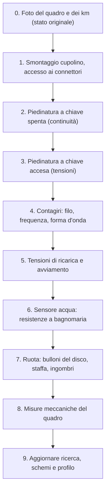

# Rilievi da fare sulla moto

Questa scheda trasforma i dati [DA VERIFICARE] della [ricerca](impianto-originale.md) in dati [VERIFICATO]. Va compilata **prima** di costruire l'elettronica. Ogni risposta aggiorna schemi elettrici, cablaggi e profilo `profiles/yamaha-tdm850-3vd.toml`.

**Attrezzi:** tester digitale, puntali a coccodrillo, pinzetta da backprobe (aghi sottili per misurare dal retro del connettore senza forarlo), metro a nastro, calibro, fotocamera, termometro da cucina, pentolino, cacciaviti, chiavi per il cupolino. Consigliato un oscilloscopio economico (DSO da circa 40 €).

> **Sicurezza:** durante le misure con motore acceso tenere lontani i cavi dalla bobina e dai cavi candela. Non toccare il negativo della bobina mentre il motore gira: i picchi superano i 300 V. Non lasciare il motore acceso in un locale chiuso.

## Ordine consigliato

## 0. Stato originale

- [ ] Foto del quadro acceso (giorno e sera)
- [ ] Foto del contachilometri totale: **______ km**. Serve per impostare una volta sola il valore iniziale nel nuovo quadro (`InitOdometer`)
- [ ] Numero di telaio: **______________** (conferma 3VD4)
- [ ] Foto dei connettori dietro il quadro, con un righello accanto

## 1. Connettori del quadro

| Connettore | Numero di poli | Colore del corpo | Marca/serie (se leggibile) | Foto |
|---|---|---|---|---|
| A | | | | |
| B | | | | |
| Bullet/singoli | | | | |

## 2. Piedinatura

Misurare dal retro del connettore lato moto, con il quadro scollegato quando indicato. Riferimento di massa: negativo batteria.

| Pin | Colore filo | Chiave OFF (V) | Chiave ON (V) | Luci posizione ON | Folle inserito | Abbaglianti ON | Freccia SX | Freccia DX | Funzione dedotta |
|---|---|---|---|---|---|---|---|---|---|
| 1 | | | | | | | | | |
| 2 | | | | | | | | | |
| 3 | | | | | | | | | |
| 4 | | | | | | | | | |
| 5 | | | | | | | | | |
| 6 | | | | | | | | | |
| … | | | | | | | | | |

Controlli specifici:
- [ ] Il filo del folle va a massa (< 1 Ω) solo in folle, a quadro scollegato?
- [ ] Il filo L (illuminazione) è alimentato **sempre** quando la chiave è ON? In Italia le anabbaglianti sono obbligatorie: se è sempre alimentato non serve per capire giorno/notte.
- [ ] Esiste un +12 V **permanente** (anche a chiave OFF) vicino al quadro? Sì / No, colore: ____
- [ ] Portata del fusibile che alimenta il filo Br: ____ A

## 3. Avviamento e lampeggiatore a quadro scollegato

- [ ] La moto si avvia in folle con il quadro scollegato? Sì / No
- [ ] Si avvia con marcia inserita e frizione tirata? Sì / No (consenso all'avviamento)
- [ ] Frecce: frequenza con quadro collegato ____ lampeggi/min, scollegato ____ lampeggi/min
- [ ] Le quattro frecce (emergenza) esistono? Sì / No

## 4. Contagiri

- [ ] Colore del filo che va dal negativo bobina al contagiri: ______
- [ ] È nel connettore principale o su un faston separato? ______
- [ ] Numero di bobine: ____ ; quale alimenta il contagiri: ______
- [ ] Frequenza misurata col tester (funzione Hz) al minimo: ____ Hz, con il contagiri originale che segna ____ giri → impulsi per giro = Hz × 60 / giri = ____
- [ ] Con l'oscilloscopio (sonda ×10, massa al negativo batteria): picco massimo ____ V, durata dell'oscillazione ____ µs, livello a riposo ____ V

## 5. Tensioni

| Condizione | Tensione al connettore del quadro (V) | Tensione alla batteria (V) |
|---|---|---|
| Chiave ON, motore spento | | |
| Durante l'avviamento (minimo raggiunto) | | |
| Minimo (≈ 1200 giri) | | |
| 5000 giri | | |
| 5000 giri con abbaglianti | | |

## 6. Sensore temperatura acqua

Meglio su un sensore di ricambio: si evita di svuotare l'impianto. Immergere la punta in acqua con il termometro, il corpo del sensore collegato al puntale nero e il terminale al rosso, tester in ohm.

| Temperatura (°C) | 20 | 40 | 60 | 80 | 90 | 100 |
|---|---|---|---|---|---|---|
| Resistenza (Ω) | | | | | | |

- [ ] Colore del filo del sensore: ______ ; un solo filo (massa dal corpo)? Sì / No
- [ ] Filetto del sensore: ______

## 7. Ruota anteriore e sensore di velocità

- [ ] Numero di dischi: ____ ; bulloni per disco: ____
- [ ] I bulloni sono attirati da una calamita? Sì / No (il sensore induttivo LJ12A3 vede solo l'acciaio; l'inox austenitico quasi non si vede)
- [ ] Diametro della testa ____ mm, altezza ____ mm, distanza tra centri ____ mm, raggio della circonferenza dei bulloni ____ mm
- [ ] Spaziatura uniforme? Sì / No
- [ ] Punti di fissaggio possibili per la staffa (foto): pinza, piedino della forcella, parafango
- [ ] Gioco minimo tra testa bullone e pinza/forcella: ____ mm
- [ ] In alternativa: filetto dell'uscita del rinvio tachimetro ____ e rapporto (giri cavo per 10 giri ruota): ____

## 8. Misure meccaniche del quadro

- [ ] Interasse dei fissaggi: ____ mm; diametro dei gommini: ____ mm
- [ ] Ingombro massimo: larghezza ____ × altezza ____ × profondità libera dietro ____ mm
- [ ] Inclinazione del quadro rispetto all'orizzontale: ____°
- [ ] Passaggio cavi possibile verso la ruota anteriore (foto)

## 9. Dopo i rilievi

- [ ] Aggiornare le marcature in [`impianto-originale.md`](impianto-originale.md)
- [ ] Aggiornare i cablaggi WireViz in `hardware/harness/` e i fogli KiCad
- [ ] Aggiornare `profiles/yamaha-tdm850-3vd.toml` (impulsi per giro, curva NTC)
- [ ] Salvare le foto in `docs/ricerca/misure/` (ridotte a 1600 px)
