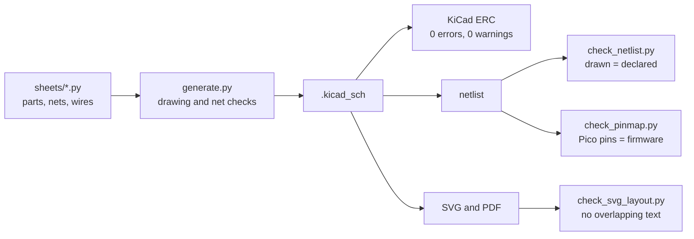

# Hardware

| Folder | Contents | How to regenerate |
|---|---|---|
| [`kicad/`](kicad/) | KiCad 9 schematic of the sensor module: a block diagram and 8 sheets. **Generated** by [`generate.py`](kicad/generate.py) from [`sheets/`](kicad/sheets/): do not edit the `.kicad_sch` files by hand | `python3 hardware/kicad/generate.py` |
| [`exports/kicad/`](exports/kicad/) | Schematic as PDF and one SVG per sheet | `hardware/kicad/export.sh` (checks included, see below) |
| [`harness/`](harness/) | Wiring harnesses in WireViz (YAML) | `wireviz -f st -o hardware/exports/harness hardware/harness/<file>.yml` |
| [`exports/harness/`](exports/harness/) | Harness drawings (SVG) and bills of materials (TSV) | see `harness/` |
| [`enclosure/`](enclosure/) | Parametric enclosure in OpenSCAD: thin display unit (bezel and cover), a small pod for the boards and the aluminum plate that mounts it on the original cluster grommets | `hardware/cad-export.sh` |
| [`bracket/`](bracket/) | Wheel sensor bracket in OpenSCAD | `hardware/cad-export.sh` |
| [`exports/cad/`](exports/cad/) | STL files to print, DXF/SVG outlines of the sensor bracket and the mount plate, PNG previews | `hardware/cad-export.sh` (also with Docker, see below) |
| [`drawings/`](drawings/) | Dimensioned A4 drawings: sensor bracket 1:1, enclosure 1:2, mount plate and fit template 1:1, perfboard zone plan 2:1 | `python3 hardware/drawings/generate.py` |
| [`exports/drawings/`](exports/drawings/) | The drawings as SVG (for the manual) and PDF (to print at 100 %) | see `drawings/` |

Where they are explained in the manual:
- every schematic sheet and the component calculations: [chapter 04](../docs/manual/04-schematics.md)
- wiring harnesses and pinouts: [chapter 05](../docs/manual/05-wiring-harnesses.md)
- building the perfboard: [chapter 06](../docs/manual/06-building-the-electronics.md)
- enclosure and bracket: [chapter 07](../docs/manual/07-enclosure-and-bracket.md)

The mechanical parts are exported with OpenSCAD 2021.01, also through Docker, and the drawings after them, because the drawings of the sensor bracket and the mount plate read their outlines:

```sh
docker run --rm -u 0 -v "$PWD":/w -w /w openscad/openscad:2021.01 hardware/cad-export.sh
python3 hardware/drawings/generate.py
```

## Editing the schematic

The schematic is written by a script, so it can be checked as code. Each sheet is a Python module in [`kicad/sheets/`](kicad/sheets/), for example `s3_tach.py`. A module places every part with the net of each pin, then draws the wires, labels and power symbols that connect them. The drawing helpers are in [`kicad/schgen/`](kicad/schgen/), and the KiCad library symbols in use are copied in [`kicad/symbols/`](kicad/symbols/), so the generator runs without KiCad.

1. Edit the sheet module. `python3 hardware/kicad/generate.py --only 3 --out /tmp/x` writes one sheet alone, to look at it while drawing.
2. Regenerate and check with KiCad 9, also through Docker:

   ```sh
   docker run --rm -u 0 -v "$PWD":/w -w /w kicad/kicad:9.0.9 \
       sh -c 'python3 hardware/kicad/generate.py && hardware/kicad/export.sh'
   ```

3. Commit the sheet module and the generated files: CI (the `Hardware` workflow) checks that they match.

A sheet that starts using a new symbol of the KiCad library needs it copied first: add it to `USED` in [`vendor_symbols.py`](kicad/vendor_symbols.py) and run that script in the KiCad image.



What is checked:
- **`generate.py`** refuses what KiCad would read differently from what is meant: wires that end in the middle of another wire, overlapping wires, four-way junctions, wires through a symbol, a label on two wires, two names on one net. Then it proves that the drawn connections are exactly the declared nets of the pins.
- **ERC** with every warning counted as a failure.
- **[`tools/check_netlist.py`](../tools/check_netlist.py)** compares the netlist that KiCad itself reads from the drawing with the declared one.
- **[`tools/check_pinmap.py`](../tools/check_pinmap.py)** compares the Pico GPIOs with `firmware/src/main.rs`, and the battery divider and coolant pull-up with the software.
- **[`tools/check_svg_layout.py`](../tools/check_svg_layout.py)** measures every text of the exported sheets: no text may overlap another text, a wire, a symbol outline, the frame or the title block.

Opening the project in KiCad to look at it is fine. Changes made in the editor must be carried over to the sheet modules, otherwise the next generation erases them.

### Drawing rules

- **Direction:** signals read from left (the bike) to right (the Pico). Supplies point up, grounds point down.
- **Repeated channels** are drawn the same way, one under the other, with a heading.
- **Labels:**
  - hierarchical labels sit on the sheet edge where the signal leaves the sheet, and match a pin of the sheet's block on the block diagram;
  - local labels only name nodes worth measuring, never two equal labels close together;
  - supplies are power symbols, never labels.
- **References and values** never cross a wire or another text; values carry what matters for buying the part (22k 1W, 100uF 50V).
- **Notes:** each sheet starts with a heading that explains it. Short notes go next to the circuit, longer explanations in chapter 04. Parts that are not on the board (switches, the TPS61169 breakout) sit in a dashed box.
- **[TO VERIFY]** notes are orange and point to `docs/research/original-wiring.md`.
- **Format:** A4 landscape, printable at home. The title block is drawn by `schgen/writer.py`.

## Editing the drawings

The dimensioned drawings are Python in [`drawings/`](drawings/), one module per sheet. They read every value from the `.scad` files, so a changed parameter changes the drawing. Values marked `[TO VERIFY]` in the `.scad` comments, and the values computed from them, are printed in orange. The drawings of the sensor bracket and of the mount plate take their outlines from the OpenSCAD exports (`exports/cad/sensor-bracket.svg`, `exports/cad/dash-mount.svg`), so the print is the shape that gets cut; they stop if the export does not match the `.scad` parameters.

The frame and title block repeat the schematic ones. The generator refuses overlapping texts, and texts that leave the frame or enter the title block. Each drawing is written as SVG, for the manual, and as PDF, to print at 100 %: every sheet has a 50 mm bar to check the print scale.

## Wiring harness names

The harness drawings use the designators of the schematic, so a connector can be found on both:
- `J…` are the connectors of the schematic: terminals on the perfboard (J103, J401, J501, J601, J701), the Pico USB pads (J702), the plug in the Pi USB port (J703) and the panel backlight pins (J704);
- `P101` and `P102` are the harness plugs that mate J101 and J102;
- `X…` are the other connectors along a harness: the bike side, the DTM pair of the wheel sensor, the plug in the Pi PWR IN port, numbered per harness;
- parts off the board keep their schematic designator (U701, SW601, SW602), and the ones not in the schematic get one in the harness (S1, U1).

## License

Hardware under CERN-OHL-P-2.0 (see [LICENSING.md](../LICENSING.md)).
