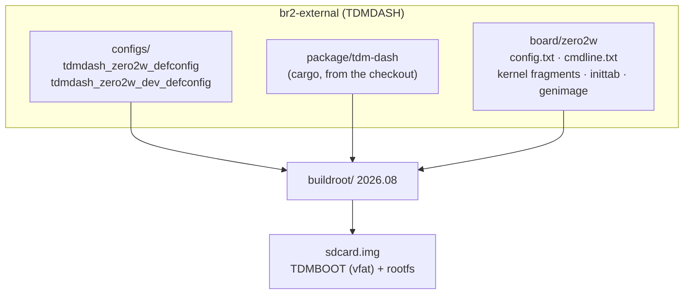

# Operating system (Buildroot)

Images for the SD card of the Raspberry Pi Zero 2 W, built with [Buildroot](https://buildroot.org) 2026.08 ([`buildroot/`](buildroot/) submodule) and the external tree [`br2-external/`](br2-external/) (name `TDMDASH`). Using the images is explained in [chapter 09 of the manual](../docs/manual/09-software.md#system-image).

```sh
git submodule update --init --depth 1 os/buildroot
make -C os release                    # os/output/release/images/sdcard.img
make -C os dev                        # os/output/dev/images/sdcard.img
make -C os release-linux-menuconfig   # any Buildroot command, prefixed by the image
make -C os release-legal-info         # licences and sources to publish with the image
```

Downloads and the compiler cache live in `os/dl` and `os/ccache`, shared by the two images. The first build takes about an hour and 15 GB of disk. CI runs it with the [`os-image.yml`](../.github/workflows/os-image.yml) workflow:
- on `v*` tags, attaching the images to the release
- once a week
- on pull requests that touch `os/`

## Structure



| File | Role |
|---|---|
| `configs/tdmdash_zero2w_defconfig` | Release image: read-only EROFS (lz4hc) rootfs, no network, trimmed kernel |
| `configs/tdmdash_zero2w_dev_defconfig` | Development image: writable ext4, Wi-Fi, dropbear (SSH), strace |
| `package/tdm-dash/` | Builds `tdm-dash` (KMS platform) and `tdmctl` from the repository checkout, installs the profile |
| `board/zero2w/config.txt` | Cut-down firmware (`start_cd.elf`), fast boot, USB host, DPI display with the Newhaven timings |
| `board/zero2w/cmdline.txt` | Read-only EROFS root, quiet kernel, watchdog at 10 s |
| `board/zero2w/linux.fragment` | Drivers built into the kernel: vc4, DPI panel, dwc2, cdc-acm, watchdog, EROFS, FAT |
| `board/zero2w/linux-release.fragment` | Release only: no network, media, logo or console on the display |
| `board/zero2w/rootfs-overlay/` | Release `inittab` and `fstab`: no init scripts, only the dashboard |
| `board/zero2w/rootfs-overlay-dev/` | `inittab`, `fstab` and Wi-Fi of the development image |
| `board/zero2w/post-build.sh` | Creates `/boot`; in the release it removes unused modules and init scripts |
| `board/zero2w/post-image.sh`, `genimage.cfg.in` | Assembles the card: TDMBOOT partition (firmware, kernel, `config.txt`, profile) and rootfs |

## Choices

- **The program is built from the checkout** ([ADR 0011](../docs/adr/0011-image-from-checkout.md)): `tdm-dash.mk` uses the `local` method on the repository root, so an image always matches the commit it was built from. The Rust dependencies are put in the `VENDOR` folder with `cargo vendor --locked`, as Buildroot does for downloaded cargo packages.
- **Read-only rootfs** ([ADR 0005](../docs/adr/0005-read-only-rootfs.md)): the boot partition is mounted read-only, `/tmp` and `/run` are in RAM. Pulling the key cannot corrupt anything, and the odometer lives in the Pico FRAM.
- **No modules, no udev:** the needed drivers are inside the kernel, and the kernel creates the files in `/dev` (devtmpfs). The program finds the Pico by looking for its VID:PID in `/sys`.
- **Bike profile:** `BR2_PACKAGE_TDM_DASH_PROFILE` selects the file from `profiles/` to install as `/etc/tdm-dash/default.toml` and to copy to the boot partition as `tdm-dash.toml`.

## Customizing

- **Another bike:** add the profile in `profiles/` and set `BR2_PACKAGE_TDM_DASH_PROFILE` (`make -C os release-menuconfig`, *External options* menu). Editing `tdm-dash.toml` on an already written card also works.
- **Another DPI display:** change the timings of the `vc4-kms-dpi-generic` line in `board/zero2w/config.txt`, or directly on the card.
- **Updating Buildroot:** move the submodule to a new tag and compare the defconfigs with `raspberrypizero2w_64_defconfig` of that version. 2027.02 will be the next long-term release.

## Licences

The image contains the Linux kernel (GPL-2.0), BusyBox (GPL-2.0), glibc (LGPL-2.1), the Broadcom firmware (its own licence, redistributable) and `tdm-dash`. The latter is MIT/Apache-2.0, but the binary includes Slint, so it is distributed under **GPL-3.0** (see [LICENSING.md](../LICENSING.md)). Every release includes the `legal-info` archive produced by Buildroot, with licences and sources; the source of `tdm-dash` is this repository, at the release tag.
