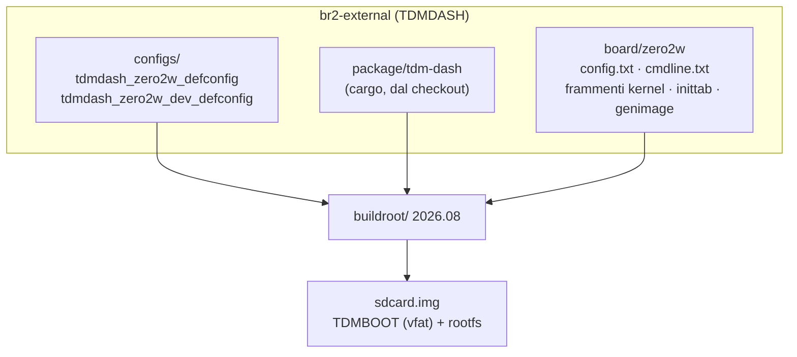

# Sistema operativo (Buildroot)

Immagini per la scheda SD del Raspberry Pi Zero 2 W, costruite con [Buildroot](https://buildroot.org) 2026.08 (sottomodulo [`buildroot/`](buildroot/)) e l'albero esterno [`br2-external/`](br2-external/) (nome `TDMDASH`). L'uso delle immagini è spiegato nel [capitolo 09 del manuale](../docs/manuale/09-software.md#immagine-del-sistema).

```sh
git submodule update --init --depth 1 os/buildroot
make -C os release                    # os/output/release/images/sdcard.img
make -C os dev                        # os/output/dev/images/sdcard.img
make -C os release-linux-menuconfig   # qualsiasi comando Buildroot, prefissato dall'immagine
make -C os release-legal-info         # licenze e sorgenti da pubblicare con l'immagine
```

Download e cache del compilatore stanno in `os/dl` e `os/ccache`, condivisi dalle due immagini. La prima compilazione richiede circa un'ora e 15 GB di disco. La CI la esegue con il workflow [`os-image.yml`](../.github/workflows/os-image.yml):
- sui tag `v*`, allegando le immagini alla release
- una volta alla settimana
- sulle pull request che toccano `os/`

## Struttura



| File | Ruolo |
|---|---|
| `configs/tdmdash_zero2w_defconfig` | Immagine di rilascio: rootfs EROFS (lz4hc) in sola lettura, niente rete, kernel ridotto |
| `configs/tdmdash_zero2w_dev_defconfig` | Immagine di sviluppo: ext4 scrivibile, Wi-Fi, dropbear (SSH), strace |
| `package/tdm-dash/` | Compila `tdm-dash` (piattaforma KMS) e `tdmctl` dal checkout del repository, installa il profilo |
| `board/zero2w/config.txt` | Firmware ridotto (`start_cd.elf`), avvio veloce, USB host, display DPI con i tempi del Newhaven |
| `board/zero2w/cmdline.txt` | Root EROFS in sola lettura, kernel silenzioso, watchdog a 10 s |
| `board/zero2w/linux.fragment` | Driver integrati nel kernel: vc4, pannello DPI, dwc2, cdc-acm, watchdog, EROFS, FAT |
| `board/zero2w/linux-release.fragment` | Solo per il rilascio: niente rete, media, logo e console sul display |
| `board/zero2w/rootfs-overlay/` | `inittab` e `fstab` del rilascio: nessuno script di avvio, solo il quadro |
| `board/zero2w/rootfs-overlay-dev/` | `inittab`, `fstab` e Wi-Fi dell'immagine di sviluppo |
| `board/zero2w/post-build.sh` | Crea `/boot`; nel rilascio toglie moduli e script di avvio inutilizzati |
| `board/zero2w/post-image.sh`, `genimage.cfg.in` | Compone la scheda: partizione TDMBOOT (firmware, kernel, `config.txt`, profilo) e rootfs |

## Scelte

- **Il programma si compila dal checkout** ([ADR 0011](../docs/adr/0011-immagine-dal-checkout.md)): `tdm-dash.mk` usa il metodo `local` sulla radice del repository, così un'immagine corrisponde sempre al commit da cui è stata costruita. Le dipendenze Rust vengono messe nella cartella `VENDOR` con `cargo vendor --locked`, come fa Buildroot per i pacchetti cargo scaricati.
- **Rootfs in sola lettura** ([ADR 0005](../docs/adr/0005-rootfs-sola-lettura.md)): la partizione di boot si monta in sola lettura, `/tmp` e `/run` sono in RAM. Togliere la chiave non può corrompere nulla, e il contachilometri sta nella FRAM del Pico.
- **Nessun modulo, nessun udev:** i driver necessari sono dentro il kernel, i file in `/dev` li crea il kernel (devtmpfs). Il programma trova il Pico cercando VID:PID in `/sys`.
- **Profilo della moto:** `BR2_PACKAGE_TDM_DASH_PROFILE` sceglie il file di `profiles/` da installare in `/etc/tdm-dash/default.toml` e da copiare sulla partizione di boot come `tdm-dash.toml`.

## Personalizzare

- **Altra moto:** aggiungi il profilo in `profiles/` e imposta `BR2_PACKAGE_TDM_DASH_PROFILE` (`make -C os release-menuconfig`, menu *External options*). Basta anche modificare `tdm-dash.toml` sulla scheda già scritta.
- **Altro display DPI:** cambia i tempi della riga `vc4-kms-dpi-generic` in `board/zero2w/config.txt`, o direttamente sulla scheda.
- **Aggiornare Buildroot:** sposta il sottomodulo su un nuovo tag e confronta i defconfig con `raspberrypizero2w_64_defconfig` di quella versione. La 2027.02 sarà la prossima versione a lungo termine.

## Licenze

L'immagine contiene il kernel Linux (GPL-2.0), BusyBox (GPL-2.0), glibc (LGPL-2.1), il firmware Broadcom (licenza propria, ridistribuibile) e `tdm-dash`. Quest'ultimo è MIT/Apache-2.0, ma il binario include Slint, quindi è distribuito sotto **GPL-3.0** (vedi [LICENSING.md](../LICENSING.md)). Ogni release include l'archivio `legal-info` prodotto da Buildroot, con licenze e sorgenti; il sorgente di `tdm-dash` è questo repository, al tag della release.
